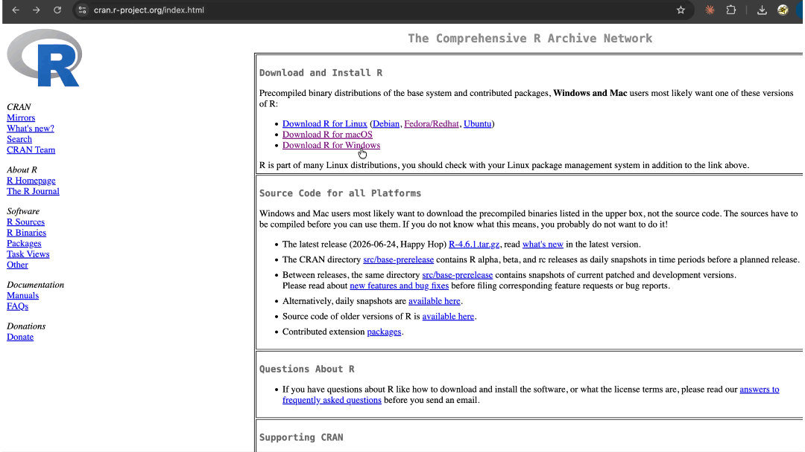
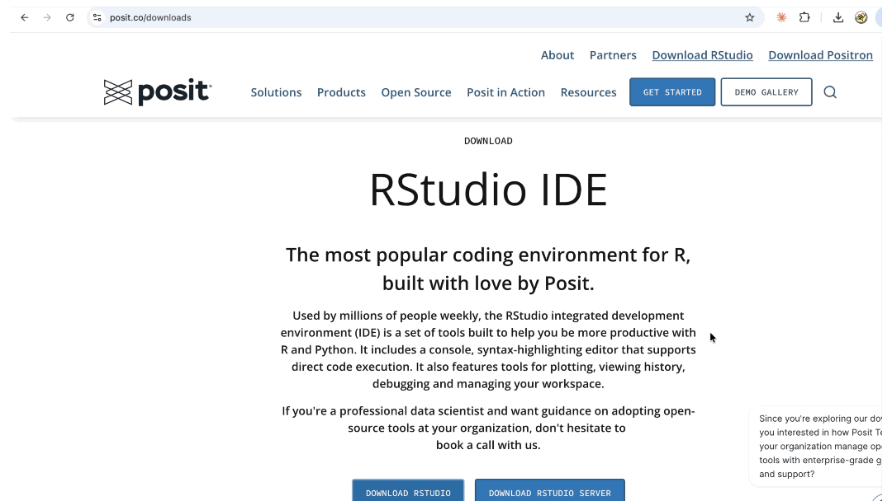
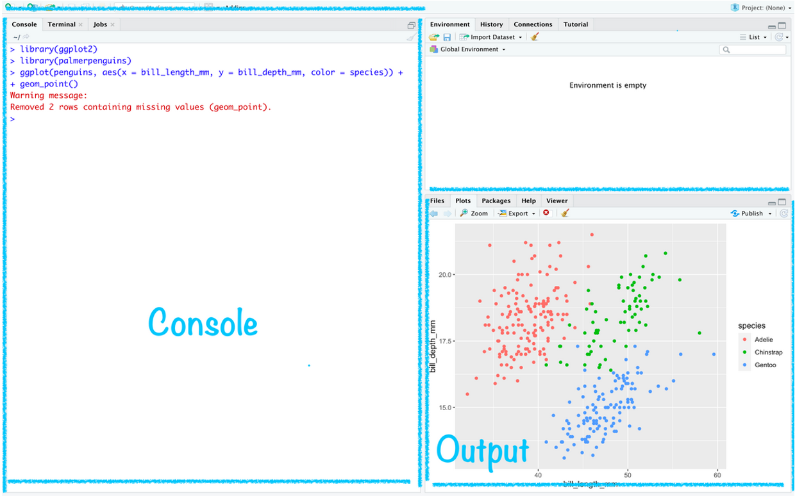

# Getting Started with R and RStudio {#sec-r-basics}

::: chapter-info
**Author:** Luis Fernando Delgado Muñoz\
**Session:** Pre-course Session 1 (online, 2 h)
:::

::: callout-note
## Slides for this session

[Open the slides of Pre-course Session 1](../slides/01-r-basics.html){target="_blank"}
:::

## Learning objectives

- Install R, RStudio and the course packages, or use Posit Cloud
- Work inside an RStudio project
- Create and inspect vectors, factors and data frames
- Import a CSV/Excel field file and make a first plot

## Installing the software

R has become one of the most widely used programming languages for data science applied to plant breeding. For beginners, learning how to set up and use R is an important first step, regardless of the operating system they use. This tutorial provides a practical guide to installing R on three major platforms: Windows 10, macOS, and Ubuntu Linux.

### Installing R on Windows 10

Installing R on Windows 10 is a simple and process. The recommended approach is to download and install R directly from CRAN (The Comprehensive R Archive Network). To begin, visit the [CRAN downloads page](https://cran.r-project.org/index.html) and follow the installation steps demonstrated in the video below.



Once the download is complete, run the `.exe` file and follow the default installation steps by clicking **Next** until finished.

### Installing RStudio

After installing R, install **RStudio** for a better environment to write and run R scripts. It includes a console, plotting tools, and workspace management. Simply visit the [RStudio downloads page](https://posit.co/downloads) and follow the installation steps (watch video below).



### Installing the course packages

R is extended through **packages**: collections of functions written by the community. We will use about 30 packages during the course. Instead of installing them one by one, run the installation script included in the course repository. Open RStudio and type in the Console:

```{r}
#| eval: false
source("R/install_packages.R")
```

The script installs only the packages that are missing and prints `OK` or `FAILED` for each one. Installation can take 10–20 minutes the first time. If a package shows `FAILED`, copy the error message and bring it to the session.

::: callout-tip
## Installing a single package

You can always install and load one package manually:

```{r}
#| eval: false
install.packages("dplyr")   # once per computer
library(dplyr)              # every time you start R
```
:::

### Posit Cloud: the alternative for older computers

If your computer has less than 4 GB of RAM or you cannot install software (for example, without administrator rights), use **Posit Cloud**, which runs RStudio in the web browser:

1.  Create a free account at <https://posit.cloud/plans/free>.
2.  Click **New Project → New RStudio Project**.
3.  Upload the course files with the **Upload** button in the Files pane.
4.  Run `source("R/install_packages.R")` as above.

The free plan has limited memory and hours per month, which is enough for the course exercises. You need a stable internet connection.

### Before the session

Please check that you have:

- [ ] R and RStudio installed (or a Posit Cloud account).
- [ ] The course packages installed without `FAILED` messages.
- [ ] Downloaded the course repository (datasets and scripts).
- [ ] Created free accounts in at least two AI assistants (e.g., ChatGPT, Claude, Gemini, DeepSeek or Qwen). We will use them in week 2.

## The RStudio interface

When you open RStudio you will see four panes:

| Pane | What it is for |
|------------------------------------|------------------------------------|
| **Source** (top left) | Scripts and Quarto documents: where you write and save your code |
| **Console** (bottom left) | Where R runs the code and prints the results |
| **Environment / History** (top right) | Objects you have created (datasets, results) |
| **Files / Plots / Packages / Help** (bottom right) | Your folders, graphs, installed packages and help pages |

{fig-align="center"}

Always write your code in a **script** (*File → New File → R Script*) rather than directly in the Console. A script is a record of your analysis that you can save, correct and run again. To run a line, place the cursor on it and press **Ctrl + Enter** (Windows) or **Cmd + Enter** (macOS).

## RStudio projects and the working directory

R reads and saves files in a folder called the **working directory**. The most common error for beginners is `cannot open file 'data.csv': No such file or directory`, which means R is looking in the wrong folder.

The best way to avoid this problem is to work inside an **RStudio project**. A project is a folder that contains all the files of one analysis, and RStudio automatically sets it as the working directory.

To create a project: *File → New Project → New Directory → New Project*, choose a name (e.g., `rtc-course`) and a location, and click **Create Project**. Inside the project, use this folder structure:

```         
rtc-course/
├── rtc-course.Rproj   # double-click to open the project
├── data/              # raw data files (never edit them by hand after saving)
├── R/                 # your scripts
└── output/            # tables and figures produced by the scripts
```

You can check the working directory at any time:

```{r}
#| eval: false
getwd()
```

::: callout-warning
## Avoid `setwd()`

Scripts that start with `setwd("C:/Users/maria/Desktop/analysis")` only work on one computer. Inside a project, use **relative paths** such as `"data/precourse_trial.csv"`, which work on any computer.
:::

## Objects and data structures

### Objects and functions

Everything in R is an **object**. You create objects with the assignment operator `<-` (shortcut: **Alt + -**). You use **functions** to do something with objects. A function has a name followed by parentheses with its arguments.

```{r}
plot_area <- 6          # plot area in m2
grain_kg  <- 2.7        # grain weight harvested in the plot
yield_t_ha <- grain_kg / plot_area * 10   # convert kg/m2 to t/ha
yield_t_ha
round(yield_t_ha, 1)
```

Object names are case-sensitive (`Yield` and `yield` are different objects). Use short names without spaces, such as `plant_height`.

### Vectors

A **vector** is a set of values of the same type. It is the basic building block of R: each column of a dataset is a vector.

```{r}
height <- c(92.5, 88.0, 101.3, 95.1)         # numeric
geno   <- c("M4-01", "M4-02", "Parent", "Check")  # character
is_check <- c(FALSE, FALSE, TRUE, TRUE)      # logical

mean(height)
length(geno)
height[3]            # third element
height[height > 90]  # elements that meet a condition
```

### Factors

A **factor** is a vector of categories. In breeding trials, **genotype, replicate, block, row and column must be factors** when they are used as effects in a model; otherwise R treats them as numbers (for example, it would treat replicate 3 as "three times" replicate 1).

```{r}
rep <- c(1, 1, 2, 2, 3, 3)
rep_f <- factor(rep)
rep_f
levels(rep_f)
```

### Matrices

A **matrix** is a table in which all values are of the same type. Matrices appear in genetic analyses (e.g., a genotype × environment table of means).

```{r}
gxe <- matrix(c(4.1, 3.8, 4.5,
                3.6, 3.9, 4.0),
              nrow = 2, byrow = TRUE,
              dimnames = list(c("M4-01", "Parent"), c("Env1", "Env2", "Env3")))
gxe
rowMeans(gxe)
```

### Data frames

A **data frame** is a table in which each column is a vector and each row is an observation (in our case, a plot). It is the structure we will use for almost all field data.

```{r}
df <- data.frame(
  geno  = c("M4-01", "M4-02", "Parent"),
  rep   = factor(c(1, 1, 1)),
  yield = c(4.6, 3.8, 4.3)
)
df
str(df)        # structure: type of each column
df$yield       # one column
df[2, ]        # second row
df[df$yield > 4, ]   # rows that meet a condition
```

## Importing field data

### The practice dataset

The course repository includes a small **practice dataset**, `data/precourse_trial.csv`: a trial with 10 M4 mutant lines, the parent and a check, evaluated in a randomized complete block design with 3 replicates in Skopje. Each row is a plot. It has four traits: grain yield (t/ha), plant height (cm), days to flowering and disease score (1–9). The same data are provided in three formats so you can practice the most common situations.

| File | Format |
|------------------------------------|------------------------------------|
| `precourse_trial.csv` | Comma separator, decimal point |
| `precourse_trial_eu.csv` | Semicolon separator, decimal comma (European Excel) |
| `precourse_trial.xlsx` | Excel workbook, sheet `trial` |

### Reading CSV files

We use the `readr` package (part of the tidyverse). Empty cells are read as missing values (`NA`). If your files use other codes for missing data (for example `.` or `-`), add them to the `na` argument.

```{r}
library(readr)
trial <- read_csv("data/precourse_trial.csv", na = c("", "NA", "."))
trial
```

### Decimal comma and semicolon

Excel in many European countries saves CSV files with **semicolons** as separators and **commas** as decimal marks. If you read such a file with `read_csv()`, all values end up in one column, or numbers are read as text. Use `read_csv2()` instead:

```{r}
trial_eu <- read_csv2("data/precourse_trial_eu.csv")
head(trial_eu$yield_t_ha)
```

For other combinations, `read_delim()` lets you choose the separator and the decimal mark:

```{r}
#| eval: false
read_delim("my_file.txt", delim = "\t",
           locale = locale(decimal_mark = ",", encoding = "UTF-8"))
```

::: callout-tip
## Special characters in names

If genotype or location names with characters such as č, š, ž or ğ appear incorrectly, the file was saved with a different **encoding**. Save it from Excel as *CSV UTF-8*, or add `locale = locale(encoding = "latin1")` (or `"windows-1250"` for Central European files).
:::

### Reading Excel files

```{r}
library(readxl)
trial_xl <- read_excel("data/precourse_trial.xlsx", sheet = "trial")
dim(trial_xl)
```

### Checking the data after import

Always check the data immediately after importing them:

```{r}
library(dplyr)
glimpse(trial)    # column names and types
summary(trial)    # ranges and number of missing values
```

Then convert the design variables to factors:

```{r}
trial <- trial |>
  mutate(across(c(rep, row, col, geno), as.factor))
levels(trial$geno)
```

## Basic data manipulation

The `dplyr` package provides a small set of verbs that cover most data preparation tasks. They are combined with the **pipe** `|>` (shortcut: **Ctrl/Cmd + Shift + M**), which reads as "and then".

| Verb                         | What it does                    |
|------------------------------|---------------------------------|
| `select()`                   | keep or drop columns            |
| `filter()`                   | keep rows that meet a condition |
| `mutate()`                   | create or modify columns        |
| `arrange()`                  | sort rows                       |
| `group_by()` + `summarise()` | calculate summaries by group    |

```{r}
# Keep design columns and yield
trial |>
  select(rep, geno, yield_t_ha) |>
  head()

# Plots of the parent only
trial |>
  filter(geno == "Parent")

# New variable: yield in kg/ha
trial <- trial |>
  mutate(yield_kg_ha = yield_t_ha * 1000)
```

Summaries by genotype are the first step to compare mutant lines with the parent:

```{r}
geno_means <- trial |>
  group_by(geno) |>
  summarise(
    n          = sum(!is.na(yield_t_ha)),
    yield_mean = mean(yield_t_ha, na.rm = TRUE),
    height_mean = mean(plant_height_cm, na.rm = TRUE)
  ) |>
  arrange(desc(yield_mean))
geno_means
```

### R for Data Science Book

A great book for anyone starting from scratch. It provides a strong foundation and helps you progress beyond the basics. Highly recommended for learning through reading and hands-on practice.

[](https://r4ds.hadley.nz/)

::: callout-note
## Missing values

`mean()` returns `NA` if any value is missing. The argument `na.rm = TRUE` removes missing values before calculating. The column `n` shows that two genotypes have only two yield values, which we will need to account for in the analysis (Day 3).
:::

## A first plot

`ggplot2` builds graphs in layers following a "grammar of graphics". Every plot needs three elements:

1.  **data**: the data frame;
2.  **aesthetics** (`aes()`): which variables go on the x and y axes, colour, etc.;
3.  **geometry** (`geom_...()`): how the data are drawn (points, boxes, bars...).

```{r}
#| fig-width: 7
#| fig-height: 4
library(ggplot2)
ggplot(trial, aes(x = geno, y = yield_t_ha, fill = geno)) +
  geom_boxplot() +
  geom_point(colour = "grey40") +
  labs(x = "Genotype", y = "Grain yield (t/ha)") +
  theme_minimal()
```

Adding a layer is as simple as adding `+`. Here, the relationship between plant height and yield, with the parent and check highlighted:

```{r}
#| fig-width: 6
#| fig-height: 4
ggplot(trial, aes(x = plant_height_cm, y = yield_t_ha, colour = check)) +
  geom_point(size = 2) +
  labs(x = "Plant height (cm)", y = "Grain yield (t/ha)", colour = "Parent/check") +
  theme_minimal()
```

To save a figure in the `output/` folder:

```{r}
#| eval: false
ggsave("part0-precourse/output/yield_boxplot.png", width = 7, height = 4, dpi = 300)
```

Day 1 of the course covers visualization for exploratory analysis in detail.

## Importing real field data: a bean trial

The practice dataset is small and clean. Real trial files are larger and usually bring problems that must be solved before any analysis. In this section we import a real common bean (*Phaseolus vulgaris*) trial from the Alliance of Bioversity International and CIAT and apply the same steps.

### The dataset

## Dataset context

The file `data/Example_Beans.csv` contains data from the `Dar16C_hiP` common bean field trial conducted in Darién, Colombia, in 2016 under high-phosphorus conditions. The trial was associated with the Bean Breeding Program of the International Center for Tropical Agriculture (CIAT), currently part of the Alliance of Bioversity International and CIAT.

The experiment used an alpha-lattice design to evaluate 380 bean lines in two replicates. Each replicate contained 18 incomplete blocks of 22 plots. Each row of the dataset represents one experimental plot, whose field position is identified by row and column coordinates within a 66 × 12 layout.

## Response variables

- **`DF` – Days to flowering:** Number of days from planting until the flowering criterion was reached.

  $$
  DF = \text{Flowering date} - \text{Planting date}
  $$

- **`DPM` – Days to physiological maturity:** Number of days from planting until the plants reached physiological maturity.

  $$
  DPM = \text{Maturity date} - \text{Planting date}
  $$

- **`PLHA` – Plants harvested:** Number of plants harvested from the experimental plot.

- **`POM_c2` – Grain moisture:** Moisture content of the harvested seed, expressed as a percentage. Seed weight was adjusted to a reference moisture content of 14% using:

  $$
  MCF = \frac{100-POM\_c2}{100-14}
  $$

- **`SW100` – 100-seed weight:** Weight of 100 seeds, expressed in grams. This variable is an indicator of seed size.

  $$
  SW100 =
  \frac{\text{Sample weight}}{\text{Number of seeds}}
  \times 100
  $$

- **`TSW` – Total seed weight:** Total seed weight harvested from the plot, expressed in grams.

- **`YDHA` – Yield based on plot area:** Grain yield in kilograms per hectare, calculated from the total seed weight corrected to 14% moisture and a harvested plot area of $1.20\;m^2$.

  $$
  YDHA =
  \frac{
  TSW\left(\frac{100-POM\_c2}{86}\right)\times 10
  }{1.20}
  $$

- **`YDHPL` – Yield based on harvested plants:** Grain yield in kilograms per hectare, estimated from seed production per harvested plant and extrapolated to a reference population of 180,000 plants per hectare.

  $$
  YDHPL =
  \frac{TSW}{PLHA}
  \left(\frac{100-POM\_c2}{86}\right)
  \times 180
  $$

- **`YdHa_clean` – Cleaned yield:** Corrected grain yield in kilograms per hectare. Based on the numerical relationship observed in the dataset, the calculation uses an effective harvested area of approximately $2.22\;m^2$.

  $$
  YdHa_{clean} =
  \frac{
  TSW\left(\frac{100-POM\_c2}{86}\right)\times 10
  }{2.22}
  $$


| Column | Content |
|------------------------------------|------------------------------------|
| `dataset` | trial name |
| `unique_identifier`, `plot` | plot identifiers |
| `line` | bean line (genotype) |
| `rep` | replicate (R1, R2) |
| `treatment` | entry code in the field book |
| `block` | incomplete block within the replicate |
| `row`, `col` | plot position in the field |
| `DF`, `DPM`, `PLHA`, `POM_c2`, `SW100`, `TSW`, `YDHA`, `YDHPL`, `YdHa_clean` | measured traits |


### Import and first check

```{r}
library(readr)
library(dplyr)
beans <- read_csv("data/Example_Beans.csv")
dim(beans)
glimpse(beans)
```

The design columns (`rep`, `block`, `row`, `col`, `line`) must be factors. `row` and `col` were read as numbers, so we convert them as well:

```{r}
beans <- beans |>
  mutate(across(c(rep, block, row, col, line), as.factor))
nlevels(beans$line) # number of genos (lines)
```

### Finding the problems

**Missing values.** Count them per column before doing anything else:

```{r}
colSums(is.na(beans))
```

Seven traits have between 3 and 6 missing plots. They are few, but they mean that some lines do not have data in both replicates, which matters when we compare them.

**Repeated lines.** The trial has 396 plots per replicate but only 380 lines. Some lines appear more than once:

```{r}
beans |>
  count(line, rep) |>
  filter(n > 1)
```

Sixteen lines appear twice in each replicate, under different entry codes (`treatment`). This is common in breeding trials: checks or lines entered twice in the field book. Sixteen lines were intentionally included twice in the treatment list as repeated checks

**Balance across replicates.** Each replicate should contain the same entries:

```{r}
table(beans$rep)
```

### Looking at the trial as an RCBD

The original design is an **alpha-lattice** (replicates divided into incomplete blocks), which we study on Day 2. Because each replicate contains all the entries, we can also look at the trial as a **randomized complete block design (RCBD)**, using the replicate as the complete block and ignoring the incomplete blocks.

Mean yield of the best lines across the two replicates:

```{r}
beans |>
  group_by(line) |>
  summarise(
    n_plots = sum(!is.na(YdHa_clean)),
    yield   = mean(YdHa_clean, na.rm = TRUE)
  ) |>
  arrange(desc(yield)) |>
  head(10)
```

Yield distribution in each replicate (block):

```{r}
#| fig-width: 5
#| fig-height: 3.5
library(ggplot2)
ggplot(beans, aes(x = rep, y = YdHa_clean)) +
  geom_boxplot() +
  labs(x = "Replicate (block)", y = "YdHa_clean") +
  theme_minimal()
```

Because the field position of every plot is recorded, we can also draw the trial as a map. Patterns in this map are the reason to use blocks and, on Day 4, spatial models:

```{r}
#| fig-width: 7
#| fig-height: 4
beans |>
  mutate(row = as.numeric(row), col = as.numeric(col)) |>
  ggplot(aes(x = row, y = col, fill = YdHa_clean)) +
  geom_tile() +
  scale_fill_viridis_c() +
  labs(x = "Row", y = "Column", fill = "YdHa_clean") +
  coord_equal() +
  theme_minimal()
```

### When the text looks wrong: file encoding

The file `data/Example_rice.csv` (a rice trial with irrigation and drought treatments) was saved with a Spanish Windows encoding (Latin-1). If we read it with the default settings, the accented letters are not shown correctly:

```{r}
rice <- read_csv("data/Example_rice.csv")
unique(rice$TRAT) # Spanish accent marks detected
```

Telling R the encoding of the file solves the problem:

```{r}
rice <- read_csv("data/Example_rice.csv",
                 locale = locale(encoding = "latin1"))
unique(rice$TRAT)
```

The same happens with names that contain letters such as č, š, ž or ğ. For Central European files saved in Windows, use `encoding = "windows-1250"`. The best long-term solution is to save files from Excel as **CSV UTF-8**.

::: callout-note
## Checklist for any new data file

1.  Read the file and check the dimensions with `dim()`.
2.  Check column names and types with `glimpse()`.
3.  Count missing values per column.
4.  Convert design variables to factors.
5.  Check repeated genotypes and the balance across replicates.
6.  Check that names and accents are displayed correctly.
:::

## Exercise (homework before the course)

Use `data/precourse_trial.csv` in an RStudio project.

1.  Import the European version of the file (`precourse_trial_eu.csv`) and check that `yield_t_ha` is numeric.
2.  How many plots have a missing value for `disease_score`?
3.  Calculate the mean days to flowering for each genotype and sort the result from early to late.
4.  Keep only the mutant lines (not the parent or the check) with a mean yield higher than the parent.
5.  Draw a boxplot of disease score by replicate.

::: {.callout-tip collapse="true"}
## Solution

```{r}
#| fig-width: 5
#| fig-height: 3.5
library(readr); library(dplyr); library(ggplot2)

# 1
ex <- read_csv2("data/precourse_trial_eu.csv")
is.numeric(ex$yield_t_ha)

# 2
sum(is.na(ex$disease_score))

# 3
ex |>
  group_by(geno) |>
  summarise(flowering = mean(days_to_flowering)) |>
  arrange(flowering)

# 4
means <- ex |>
  group_by(geno, check) |>
  summarise(yield = mean(yield_t_ha, na.rm = TRUE), .groups = "drop")

parent_yield <- means |> filter(geno == "Parent") |> pull(yield)

means |>
  filter(check == "no", yield > parent_yield)

# 5
ggplot(ex, aes(x = factor(rep), y = disease_score, fill = factor(rep))) +
  geom_boxplot() +
  labs(x = "Replicate", y = "Disease score (1-9)")
```
:::

## Key takeaways

- Work inside an **RStudio project** and use relative paths; avoid `setwd()`.
- Check every dataset right after importing it with `glimpse()` and `summary()`; European CSV files need `read_csv2()`.
- Genotype, replicate, block, row and column must be **factors** before modelling.
- Five `dplyr` verbs (`select`, `filter`, `mutate`, `arrange`, `group_by` + `summarise`) cover most data preparation.
- A `ggplot2` graph is data + aesthetics + geometry, built in layers with `+`.

## References

- R Core Team. *R: A Language and Environment for Statistical Computing*. R Foundation for Statistical Computing, Vienna. <https://www.r-project.org>
- Wickham, H., Çetinkaya-Rundel, M. & Grolemund, G. (2023). *R for Data Science*, 2nd edition. O'Reilly. <https://r4ds.hadley.nz>
- Posit. *RStudio IDE User Guide*. <https://docs.posit.co/ide/user>
