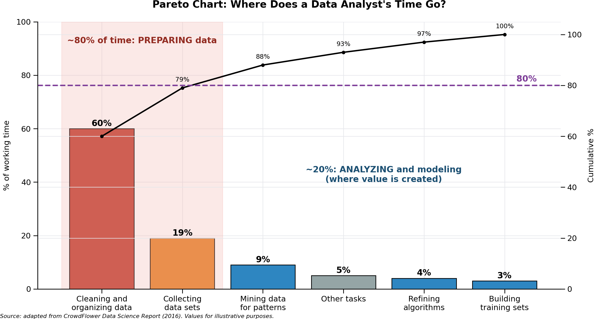
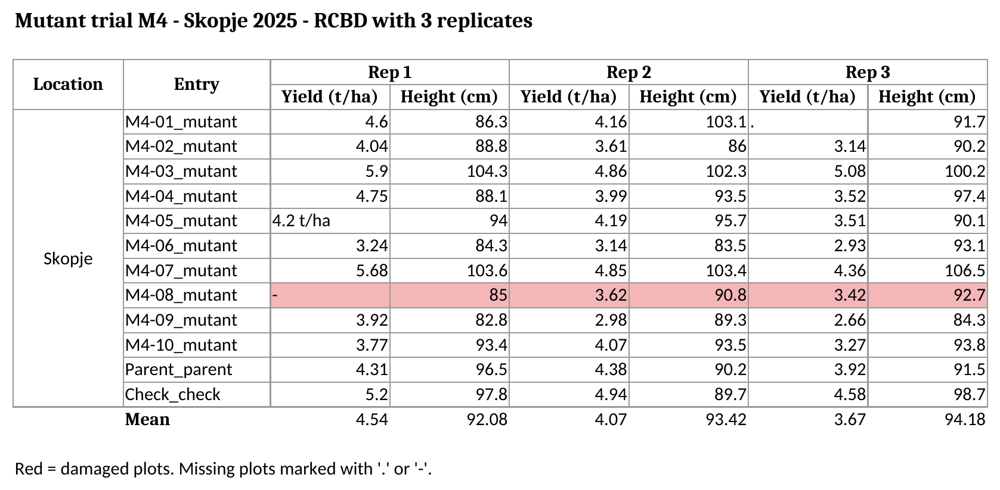
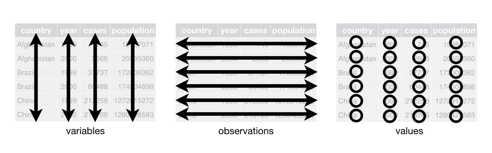
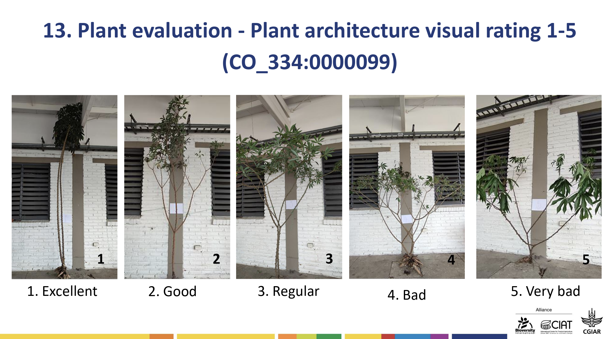

# Preparing Your Data in Tidy Format {#sec-tidy-data}

::: chapter-info
**Author:** Luis Fernando Delgado Muñoz\
**Session:** Pre-course Session 2 (online, 2 h)
:::

::: callout-note
## Slides for this session

[Open the slides of Pre-course Session 2](../slides/02-tidy-data.html){target="_blank"}
:::

## Learning objectives

- Recognize the most common problems of field data stored in spreadsheets
- Apply the three rules of tidy data to a breeding trial
- Turn a messy field book into a tidy dataset in R
- Organize your own data with the course template, metadata and a data dictionary
- Check your file in R before sending it

## Why data organization matters

Most of the time spent on a data analysis is not spent on the statistics, but on preparing the data. A field book that is easy to read for a person (titles, merged cells, colours, totals) is usually very hard to read for a computer. The consequences are:

- **Lost time:** hours of copying, deleting and reshaping before any analysis.
- **Silent errors:** a missing plot typed as `0` is analysed as a real zero yield; a replicate written as text is not recognized; a value with its unit (`4.2 t/ha`) turns the whole column into text.
- **Results that cannot be repeated:** manual changes in Excel leave no record, so nobody (including you, six months later) can know exactly what was done.



If the data are organized well **from the moment they are recorded**, the analysis in R becomes a few lines of code. That is the goal of this chapter, and the reason why every participant prepares their dataset before the course.

## What messy data looks like

The file `data/messy_trial.xlsx` contains the same M4 mutant trial that we used in @sec-r-basics, but written the way many field books are written in practice:

{#fig-messy fig-align="center" width="100%"}

The sheet is clear for a person, but it contains seven problems that prevent R from reading it correctly:

| Problem | Where in @fig-messy | Why it is a problem |
|------------------------|------------------------|------------------------|
| **Title above the header** | Row 1 | R takes the title as the column name |
| **Double header** | Rows 3 and 4: replicate on top, trait below | R needs one row of column names |
| **Merged cells** | `Location`, and `Rep 1`, `Rep 2`, `Rep 3` | Only the first cell has a value; the others are read as empty |
| **One variable spread over several columns** | Yield and height repeated for each replicate | The replicate is a variable, but it is hidden in the column names |
| **Two variables in one column** | `Entry`: `M4-01_mutant` (genotype and type) | You cannot filter or group by each one separately |
| **Units and codes inside cells** | `4.2 t/ha`; missing plots as `.` and `-` | The column becomes text instead of numbers |
| **Information only in colours, comments and summary rows** | Red row, the comment on M4-08, the `Mean` row | Colours and comments are lost when reading; the mean row is read as a plot |

Other frequent problems are a missing plot written as `0` (it looks like real data), dates written in different formats in the same column, several tables in one sheet, and the same genotype written in different ways (`M4-01`, `M4 01`, `m4-01`).

::: callout-warning
## Never save a course CSV file from Excel

Opening a CSV file in Excel and saving it again can change the separators and destroy the numbers (for example, `938.067907` becomes `938.067.907` with some regional settings). To look at a CSV file, open it in RStudio (*View File*) or close Excel **without saving**.
:::

## The three rules of tidy data

In *R for Data Science*, Wickham, Çetinkaya-Rundel and Grolemund describe a consistent way to organize data, called **tidy data**. A dataset is tidy when it follows three rules:

1.  **Each variable is a column**, and each column is one variable.
2.  **Each observation is a row**, and each row is one observation.
3.  **Each value is a cell**, and each cell contains one value.



In a field trial, the observation is usually **the plot**. So a tidy field book has **one row per plot** and one column for each variable: the design variables (location, replicate, block, row, column, genotype) and the traits.

This is the tidy version of the trial in @fig-messy:

```{r}
library(readr)
library(dplyr)
trial <- read_csv("data/precourse_trial.csv")
trial |>
  select(location, rep, row, col, geno, check, yield_t_ha, plant_height_cm) |>
  head(8)
```

The replicate, which was hidden in the column names of the messy file, is now a column. The 12 genotypes × 3 replicates are 36 rows, one per plot.

::: callout-note
## Why tidy data works so well in R

`dplyr`, `ggplot2` and the model functions (`lm()`, `lmer()`, `SpATS()`...) all expect one row per observation and one column per variable. With a tidy dataset, the formula of the model is written directly from the column names: `yield_t_ha ~ rep + geno`.
:::

Read more in the chapter *Data tidying* of *R for Data Science* (2nd edition): <https://r4ds.hadley.nz/data-tidy.html>

## From messy to tidy in R

Sometimes you receive a messy file that you cannot correct by hand (for example, historical data). Here we fix `messy_trial.xlsx` step by step, with the `readxl`, `tidyr` and `dplyr` packages.

### Step 1. Look at the sheet as R sees it

```{r}
library(readxl)
raw <- read_excel("data/messy_trial.xlsx", col_names = FALSE,
                  .name_repair = "minimal")
raw
```

The title, the empty row, the two header rows, the merged cells (shown as `NA`), the mean row and the note at the bottom are all visible.

### Step 2. Read only the data, with clear column names

`range` reads only the block with plot data (cells A5 to H16), which leaves out the title, the headers, the mean row and the note. `na` declares the codes used for missing values. The column names are written once, combining the replicate and the trait.

```{r}
trial_wide <- read_excel(
  "data/messy_trial.xlsx",
  range     = "A5:H16",
  col_names = c("location", "entry",     # rename colnames
                "R1_yield", "R1_height",
                "R2_yield", "R2_height",
                "R3_yield", "R3_height"),
  na        = c("", ".", "-")
)
trial_wide
```

::: {.callout-tip collapse="true"}
## Building the names from the double header automatically

With many columns, writing the names by hand is slow. You can read the two header rows and combine them. Merged cells appear as `NA`, so the replicate is first filled to the right:

```{r}
header <- read_excel("data/messy_trial.xlsx", range = "C3:H4",
                     col_names = FALSE, .name_repair = "minimal")

# Row 1: rep labels. Fill empty cells (from merged cells) with the value before them
rep_row   <- vctrs::vec_fill_missing(unlist(header[1, ]), direction = "down")

# Row 2: trait names
trait_row <- unlist(header[2, ])

# Join them into column names, e.g. "Rep1_height"
paste(rep_row, trait_row, sep = "_")
```
:::

### Step 3. Fill the merged cells

Only the first row has the location; the merged cells were read as `NA`. `fill()` copies the last value down:

```{r}
library(tidyr)
# Show the location column before the fix (it has empty cells / NA)
trial_wide$location


# Fill each NA with the last location above it
trial_wide <- trial_wide |>
  fill(location)

# Show the location column again (now every row has a location)
trial_wide$location
```

### Step 4. Remove the units typed inside the cells

Because of `4.2 t/ha`, the column `R1_yield` was read as text. `parse_number()` keeps only the number:

```{r}
library(tidyverse)
# Check the type of R1_yield before the fix
class(trial_wide$R1_yield)

# Extract only the number from each value and turn the column into numeric
trial_wide <- trial_wide |>
  mutate(R1_yield = parse_number(R1_yield))

# Check the type again (now "numeric")
class(trial_wide$R1_yield)
```

### Step 5. Separate two variables stored in one column

```{r}
# Split the "entry" column into two new columns at the "_" separator
# (the original "entry" column is removed)
trial_wide <- trial_wide |>
  separate_wider_delim(entry, delim = "_", names = c("geno", "type"))

# Show only the location, geno and type columns, first 3 rows,
# to check that fill() and separate_wider_delim() worked
trial_wide |> select(location, geno, type) |> head(3)
```

### Step 6. One row per plot: from wide to long

The replicate is hidden in the column names (`R1_yield`, `R2_height`...). `pivot_longer()` moves it into its own column. With `names_sep = "_"`, the first part of the name (`R1`) goes to the column `rep` and the second part (`yield`, `height`) becomes a column of values (`.value`).

```{r}
# Make the table long: one row per genotype and rep
trial_tidy <- trial_wide |>
  pivot_longer(cols      = starts_with("R"),      # columns R1_yield, R1_height, ...
               names_to  = c("rep", ".value"),    # "R1" goes to rep; yield/height stay as columns
               names_sep = "_") |>                # split names at "_"
  mutate(rep = parse_number(rep)) |>              # "R1" becomes 1
  rename(yield_t_ha = yield, plant_height_cm = height)  # add units to the names
trial_tidy
```

36 rows: one per plot. This is the same information as the clean file.

### Step 7. Check the result

Compare the tidy data with the clean file used in Session 1. No rows should differ:

```{r}
# clean file used in Session 1.
clean <- trial |> select(geno, rep, yield_t_ha, plant_height_cm)

# Find rows in "clean" that are NOT in "trial_tidy" (matching on all 4 columns)
# 0 rows = our cleaned version matches the original
anti_join(clean, trial_tidy, by = c("geno", "rep", "yield_t_ha", "plant_height_cm"))
```

An empty result means that the two datasets are identical.

::: callout-note
## What about the colours and the comment?

The red row and the comment on M4-08 (*damaged by hail*) cannot be read by R. That information must be stored as data, for example in a column `damaged` with the values `yes` / `no`. Information that exists only as a colour is usually lost.
:::

### The opposite: from long to wide

Sometimes a wide table is useful, for example to present yield per replicate in a report. `pivot_wider()` does the opposite of `pivot_longer()`:

```{r}
# This is the opposite of pivot_longer(). It gives a table that's easier for people to read, 
# with each genotype's reps side by side.
trial |>
  select(geno, rep, yield_t_ha) |>
  pivot_wider(names_from = rep, values_from = yield_t_ha, names_prefix = "rep_") |>
  head(4)
```

The rule is: **store and analyse the data in long format; make wide tables only to present results.**

## The course field book template

To avoid all these problems, organize your data with the template `data/template_field_book.xlsx`. It has three sheets: `instructions`, `field_book` and `dictionary`.

The `field_book` sheet has one row of column names and **one row per plot**:

| Column | Content | Example | Required |
|------------------|------------------|------------------|------------------|
| `location` | Site of the trial | Skopje | yes |
| `year` | Year of planting | 2025 | yes |
| `trial` | Trial name or code | M4_yield_2025 | yes |
| `generation` | Generation of the mutant material | M4 | yes |
| `design` | Experimental design | RCBD | yes |
| `plot` | Plot number | 17 | yes |
| `rep` | Replicate | 2 | yes |
| `block` | Incomplete block (if the design has them) | 5 | if any |
| `row`, `col` | Position of the plot in the field | 3, 8 | recommended |
| `geno` | Genotype, mutant line or variety | M4-07 | yes |
| `check` | Is the entry a parent or check? | yes / no | yes |
| traits | One column per trait, with the unit in the name | `yield_t_ha` | yes |

::: callout-tip
## Rules for the template

- One table per sheet. The header in **row 1 only**, with no titles or empty rows above it.
- **No merged cells.** Repeat the value in every row (for example, the location).
- **Only numbers** in trait columns. Put the unit in the column name (`yield_t_ha`), not in the cell.
- **Leave missing values empty.** Do not use `.`, `-`, `NA` or `0`.
- **No colours or comments** as information: add a column (`damaged`, `notes`).
- **No totals or means** inside the data: calculate them in R.
- **Simple column names:** lower case, no spaces or accents (`plant_height_cm`).
- Write genotype names **always the same way** (`M4-01`, never `M4 01` or `m4-01`).
- Save the sheet as **CSV UTF-8** when you send it.
:::

### Why the metadata matter?

The design columns are not decoration: each one becomes a term of the statistical model.

| Column | Used for |
|------------------------------------|------------------------------------|
| `rep`, `block` | Separating environmental variation from genetic variation (Day 2 and Day 3) |
| `row`, `col` | Spatial analysis of field trends (Day 4) |
| `location`, `year` | Multi-environment trials and G×E (Day 5) |
| `generation`, `check` | Comparing mutant lines with the parent (Dunnett test, Day 2) and decisions on advancement (week 2) |

A trial without `row` and `col` cannot be corrected for spatial trends; a trial without `rep` cannot be analysed as a designed experiment. **Record them in the field from the beginning.**

## The data dictionary

A column name such as `DF` or `SW100` is clear for the person who recorded it, but not for a colleague or for you two years later. A **data dictionary** describes every column of the field book: what it is, its type, its unit and its possible values. It is the `dictionary` sheet of the template.

This is the dictionary of the practice trial, stored in `data/precourse_trial_dictionary.csv`:

```{r}
dictionary <- read_csv("data/precourse_trial_dictionary.csv", na = character())
knitr::kable(dictionary)
```

::: callout-note
## Scales and scores

For traits scored on a scale (disease, vigour, lodging), write in the dictionary what each value means, for example *1 = no symptoms, 9 = very severe*. Two people using different scales on the same trial is one of the most frequent and least visible errors in field data.
:::

[](https://cgspace.cgiar.org/server/api/core/bitstreams/24d9d3ab-c917-49ae-83a8-7ea44916eaa8/content)

## Checking your file in R

The function `check_dataset()` reads a CSV or Excel file and reports the problems described in this chapter. It does not change your file.

```{r}
source("R/check_dataset.R")
```

The clean practice trial passes the check:

```{r}
check_dataset("data/precourse_trial.csv")
```

The messy field book does not:

```{r}
check_dataset("data/messy_trial.xlsx")
```

Run it on your own file and correct each `[!]` line before sending your data.

## Digital data collection: Field Book and GridScore NEXT

Recording data directly on a phone or tablet avoids transcription errors and produces files that are already close to tidy: one row per plot, with the plot identifier and its position.

|   | Field Book | GridScore NEXT |
|------------------------|------------------------|------------------------|
| Developed by | PhenoApps (open source) | James Hutton Institute (open source) |
| Devices | Android phones and tablets | Any device with a web browser (Android, iPhone, computer); works offline |
| Field layout | Imported from a CSV file | Defined as a grid of rows and columns |
| Data export | CSV | Excel and other formats |
| Installation | [Install Field Book app (only for Android device)](https://github.com/PhenoApps/Field-Book/releases) | [Install Gridscore NEXT](https://www.installpwa.com/from/gridscore.hutton.ac.uk) |
| Documentation | [Field Book Documentation](https://fieldbook.phenoapps.org/#/) | [Gridscore Documentation](https://cropgeeks.github.io/gridscore-next-client/) |

The general workflow is the same in both apps:

1.  **Generate the field layout** (randomization) with FielDHub (Day 2) or your own tool, with one row per plot and the columns `plot`, `rep`, `row`, `col` and `geno`.
2.  **Import the layout** into the app.
3.  **Define the traits** with their type, unit and valid range, using the data dictionary. A valid range prevents typing errors in the field (for example, a plant height of 950 cm instead of 95.0).
4.  **Collect the data** plot by plot in the field.
5.  **Export** the data and read them in R. Check them with `check_dataset()`.

## Exercise (homework before arriving in Skopje)

**Part 1.** Using `trial_tidy` from this chapter:

1.  Calculate the mean yield of each genotype across the three replicates.
2.  Make a wide table of plant height with one column per replicate.
3.  Add a column `damaged` with the value `yes` for M4-08 and `no` for all other genotypes.

**Part 2.** Prepare one dataset of your own:

1.  Organize it with `template_field_book.xlsx` (one row per plot) and complete the `dictionary` sheet.
2.  Save the field book as CSV UTF-8 and run `check_dataset()` on it.
3.  Correct every `[!]` line and send the file and the dictionary to the instructors before the course.

::: {.callout-tip collapse="true"}
## Solution (Part 1)

```{r}
# 1. Mean yield per genotype
trial_tidy |>
  group_by(geno) |>
  summarise(yield = mean(yield_t_ha, na.rm = TRUE)) |>
  arrange(desc(yield))

# 2. Plant height, one column per replicate
trial_tidy |>
  select(geno, rep, plant_height_cm) |>
  pivot_wider(names_from = rep, values_from = plant_height_cm, names_prefix = "rep_")

# 3. A column instead of a colour
trial_tidy <- trial_tidy |>
  mutate(damaged = if_else(geno == "M4-08", "yes", "no"))
count(trial_tidy, damaged)
```
:::

## Key takeaways

- A tidy dataset has **one column per variable, one row per observation (plot) and one value per cell**.
- Merged cells, double headers, units inside cells, missing-value codes, colours and summary rows are the most common problems of field books.
- `read_excel(range, na)`, `fill()`, `parse_number()`, `separate_wider_delim()` and `pivot_longer()` fix most of them in R; but it is better to **record the data tidy from the beginning**.
- Design columns (`rep`, `block`, `row`, `col`, `location`, `year`) become terms of the statistical model: record them in the field.
- A **data dictionary** makes your data understandable for others and for yourself in the future.
- Check every file with `check_dataset()` before the analysis.

## References

- Wickham, H., Çetinkaya-Rundel, M. & Grolemund, G. (2023). *R for Data Science*, 2nd edition, chapter "Data tidying". O'Reilly. <https://r4ds.hadley.nz/data-tidy.html>
- Wickham, H. (2014). Tidy data. *Journal of Statistical Software*, 59(10), 1-23. <https://doi.org/10.18637/jss.v059.i10>
- Broman, K. W. & Woo, K. H. (2018). Data organization in spreadsheets. *The American Statistician*, 72(1), 2-10. <https://doi.org/10.1080/00031305.2017.1375989>
- Field Book: <https://github.com/PhenoApps/Field-Book>
- GridScore NEXT: <https://github.com/cropgeeks/gridscore-next-client>
