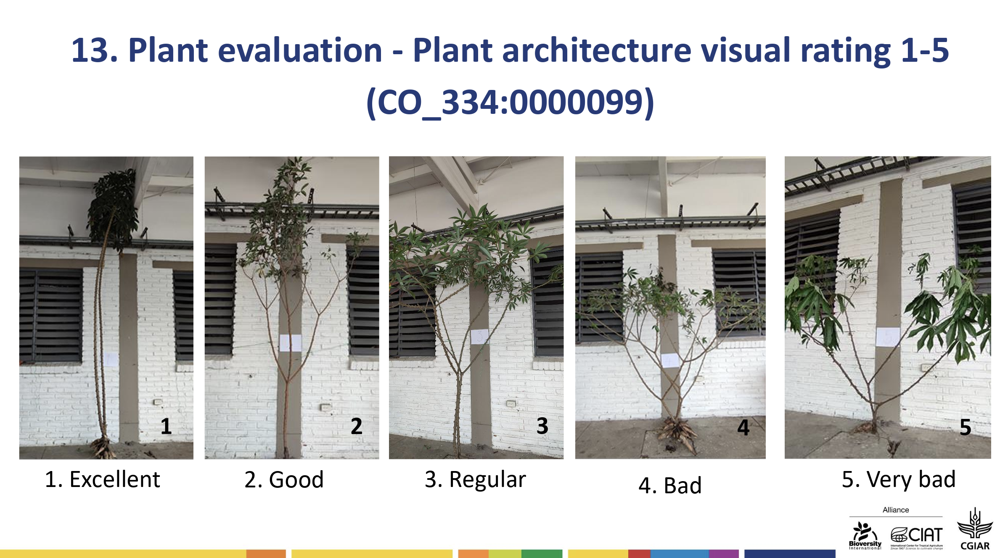

# Collecting and Validating Field Data {#sec-field-data}

::: chapter-info
**Author:** Luis Fernando Delgado Muñoz\
**Session:** Day 1, Monday 9 November
:::

## Learning objectives

- Define a trait completely: name, method, scale, unit and timing
- Recognize the phenotyping challenges of mutant populations
- Identify the most common errors in field data and how to prevent them
- Validate a field book against the field plan in R

This chapter builds on @sec-tidy-data. There we organized the data in tidy format; here we look at **how the data are produced in the field** and how to check that they match the experiment that was planned.

```{r}
#| message: false
library(dplyr)
library(tidyr)
library(ggplot2)
library(agridat)   # real datasets from published agricultural experiments
```

::: callout-tip
## The `agridat` package

`agridat`, by Kevin Wright, contains more than 400 datasets from published agricultural experiments, with their original references. It is used in this chapter and in @sec-qc-eda. If it is not installed yet:

```{r}
#| eval: false
install.packages("agridat")
```
:::

## Defining a trait

A column name such as `height` or `disease` is not enough. Two people can measure "plant height" in different ways (to the tip of the leaves or to the top of the stem; one plant or the mean of five) and obtain values that cannot be compared. A trait is completely defined when we know:

| Element | Question | Example: plant height |
|----|----|----|
| **Name** | What is it called in the field book? | `plant_height_cm` |
| **Method** | How is it measured? | From the ground to the top of the main stem |
| **Scale or unit** | In what units, or with what scale? | Centimetres |
| **Sampling** | On what part of the plot? | Mean of 5 plants in the central rows |
| **Timing** | When? | At physiological maturity |

The **Crop Ontology** (<https://cropontology.org>) provides standard trait definitions for many crops, each with a unique identifier. Using them makes data comparable between programs, locations and years. For example, the cassava trait *plant architecture, visual rating 1 to 5* has the identifier `CO_334:0000099`, and its scale is defined with photographs:

[{#fig-cassava-scale fig-align="center" width="90%"}](https://cgspace.cgiar.org/server/api/core/bitstreams/24d9d3ab-c917-49ae-83a8-7ea44916eaa8/content)

### Types of scales

| Type | Example | How to analyse it |
|----|----|----|
| **Continuous** | Yield (t/ha), plant height (cm) | Means, ANOVA, mixed models |
| **Count** | Number of pods, tillers | Means or count models (Poisson) |
| **Ordinal score** | Disease 1 to 9, vigour 1 to 5 | The distance between scores is not equal; medians, ordinal models |
| **Categorical** | Flower colour, mutant type | Frequencies, chi-square tests |
| **Binary** | Lodged yes/no, mutant/normal | Proportions, logistic models |

### The timing matters: a real example

The dataset `lee.potatoblight` contains resistance scores to late blight (*Phytophthora infestans*) in potato, on a 1 to 9 scale, from screening trials in New Zealand (Lee, 2009). In 1999, 80 genotypes were scored on five dates:

```{r}
blight <- lee.potatoblight |>
  filter(year == 1999) |>
  droplevels()
table(blight$date)
```

```{r}
#| fig-width: 7
#| fig-height: 3.5
#| label: fig-blight-dates
#| fig-cap: "Blight scores of 80 potato genotypes on five dates in 1999 (data: lee.potatoblight)."
ggplot(blight, aes(x = date, y = y)) +
  geom_boxplot(fill = "#EAD9BC") +
  labs(x = "Date of scoring", y = "Blight score (1 to 9)") +
  theme_minimal()
```

In this trial the scores fall as the disease advances during the season, so the same plots receive very different scores depending on the date. A score without its date cannot be interpreted, and two locations scored at different times cannot be compared. **Record the date of every measurement**, write down which end of the scale is healthy, and define in the protocol when each trait is scored (for example, *when the susceptible check reaches a defined level of damage*).

## Phenotyping mutant populations

Mutant populations add their own challenges to field data collection:

- **M1 plants** often show physiological damage from the mutagen (reduced germination, sterility, abnormal leaves). Most of these effects are **not inherited**, so M1 plants are usually not selected on their phenotype.
- **Chimeras**: an M1 plant can be a mosaic of mutated and non-mutated tissue. The mutation appears only in the seeds of some branches, spikes or panicles. Record **which part of the M1 plant** each M2 family comes from.
- **Segregation in M2**: most induced mutations are recessive and appear for the first time in the M2, segregating within families. Data are collected **plant by plant** or by family row, not by plot.
- **Off-types**: a plant that looks like a mutant may come from seed admixture or outcrossing. Including the **parent** (non-mutagenized) regularly in the field helps to tell mutants from off-types.
- **Confirmation**: a putative mutant must be confirmed in the next generation (M3 or later). Keep the **pedigree** (M1 plant, M2 family, M2 plant) so the line can be traced back.

::: callout-note
## What to record in early generations

Besides the traits, record as columns: `m1_plant`, `m2_family`, `plant` (in M2), `mutant` (yes / no), `mutant_type` (for example chlorophyll, dwarf, early flowering) and `notes`. Each observation still occupies one row: in M2 the observation is usually **the plant**, not the plot.
:::

## Common errors in field data

| Error | Example | How to prevent it |
|----|----|----|
| **Plot recorded twice** | Plot 105 entered two times | Data collection app; check duplicates in R |
| **Plot missing** | One plot skipped while walking the field | Check the number of plots against the plan |
| **Wrong plot order** | Recording in serpentine order when the field book is in straight order | Record the plot number, not only the position; use barcodes |
| **Typing errors** | 103 instead of 10.3 | Valid ranges in the app; range checks in R |
| **Different names for the same genotype** | `Ross`, `ross`, `ROSS` | Use the names from the field plan; choose from a list in the app |
| **Changed protocol** | Different people, different scale or timing | Written protocol, trained evaluators, reference photos |

### Serpentine layouts

In many trials the plots are numbered in a **serpentine** (zig-zag) order, following the path of the planter or of the person walking the field. The dataset `kling.augmented` (Kling, accessed 2022) is an augmented design of meadowfoam with 50 new genotypes in one plot each and 3 checks repeated in 6 blocks:

```{r}
#| fig-width: 9
#| fig-height: 4
#| label: fig-serpentine
#| fig-cap: "Field layout of the augmented trial. Numbers are plot numbers; coloured plots are the checks (data: kling.augmented)."
plan <- kling.augmented |>
  mutate(type = if_else(name %in% c("Ross", "MF183", "Starlight"), name, "New genotype"))

ggplot(plan, aes(x = col, y = row, fill = type)) +
  geom_tile(colour = "white") +
  geom_text(aes(label = plot), size = 3) +
  scale_y_reverse(breaks = 1:6) +
  scale_x_continuous(breaks = 1:12) +
  scale_fill_manual(values = c("Ross" = "#E07B39", "MF183" = "#4F7A3A",
                               "Starlight" = "#3E6FA8", "New genotype" = "grey85")) +
  labs(x = "Column", y = "Row", fill = NULL) +
  theme_minimal()
```

Plot 112 is at the end of row 1 and plot 113 is directly below it: the numbering goes left to right in row 1, right to left in row 2, and so on. A person who records the data in a straight order (left to right in every row) assigns half of the values to the wrong plots, and no error message appears. This is why the field book must contain the **plot number and its position**.

This design is similar to an early-generation mutant trial: many entries without replication, and a few checks repeated in every block to estimate the environmental variation.

## Validating the field data against the field plan

The **field plan** is the list of plots, with their position and genotype, produced when the experiment was designed (for example with FielDHub, Day 2). The **field data** are what was recorded. Before any analysis, check that the two match.

To practise, we take the field plan of the augmented trial and create a copy of the field data with five errors that are typical of real field books:

```{r}
field_plan <- kling.augmented |>
  select(plot, block, row, col, name)

# Field data as recorded, with five typical errors
field_data <- kling.augmented |>
  select(plot, name, tsw) |>
  filter(plot != 152) |>                                     # 1. a plot was skipped
  bind_rows(kling.augmented |>
              filter(plot == 105) |>
              select(plot, name, tsw)) |>                    # 2. plot 105 recorded twice
  mutate(name = if_else(plot == 107, "ross", name),          # 3. a name typed differently
         tsw  = if_else(plot == 130, tsw * 10, tsw),         # 4. a decimal error
         plot = if_else(plot == 116, 216L, plot))            # 5. a wrong plot number

nrow(field_plan); nrow(field_data)
```

The number of rows already gives a warning: 68 plots planned, 68 rows recorded, but not the same plots. We now find each problem.

### Duplicated plots

```{r}
field_data |>
  count(plot) |>
  filter(n > 1)
```

### Planned plots without data, and data without a planned plot

`anti_join()` keeps the rows of the first table that have no match in the second:

```{r}
anti_join(field_plan, field_data, by = "plot")   # planned but not recorded
anti_join(field_data, field_plan, by = "plot")   # recorded but not in the plan
```

Plot 152 was never recorded, plot 116 is missing because it was typed as 216, which does not exist in the plan.

### Genotype names that do not match the plan

```{r}
field_data |>
  inner_join(field_plan, by = "plot", suffix = c("_data", "_plan")) |>
  filter(name_data != name_plan) |>
  select(plot, name_data, name_plan)
```

### Values outside the valid range

The valid range comes from the data dictionary (@sec-tidy-data). For thousand seed weight of meadowfoam, values between 5 and 20 g are plausible:

```{r}
field_data |>
  filter(tsw < 5 | tsw > 20)
```

A value of about 100 g is ten times the others: a decimal error. Look at the original field sheet before correcting it.

### Checks in every block

In an augmented design, every block must contain every check exactly once:

```{r}
field_plan |>
  filter(name %in% c("Ross", "MF183", "Starlight")) |>
  count(block, name) |>
  pivot_wider(names_from = name, values_from = n)
```

::: callout-tip
## A validation routine for every trial

1.  Same number of plots as the plan?
2.  Any duplicated plot numbers?
3.  Any planned plots without data, or data without a planned plot?
4.  Do genotype names agree with the plan?
5.  Are all values inside their valid range?
6.  Does every block or replicate contain what the design requires?

Then run `check_dataset()` (@sec-tidy-data). Never correct a value without checking the original field sheet or the app, and record every correction in a script, not by hand in Excel.
:::

## Exercise

The dataset `stroup.nin` is a wheat trial of the Nebraska Intrastate Nursery (Stroup et al., 1994), with 56 genotypes in an RCBD with 4 replicates.

1.  How many plots have no yield (`NA`)?
2.  Which genotype name do these plots have? And which replicate?
3.  Why is this coding dangerous for the analysis?
4.  Create a corrected version where these plots have `gen` as `NA`.

::: {.callout-tip collapse="true"}
## Solution

```{r}
# 1. Plots without yield
sum(is.na(stroup.nin$yield))

# 2. Their genotype and replicate
stroup.nin |>
  filter(is.na(yield)) |>
  count(gen, rep)
```

3.  The 18 plots without yield were coded with the name of a real cultivar (`Lancer`) and without replicate. They are positions of the field grid without data, kept so that the grid is complete for spatial analysis (the package documentation explains why). If they are not detected, `Lancer` appears with 22 plots instead of 4, and any count or mean per genotype is wrong.

```{r}
# 4. Corrected version
nin <- stroup.nin |>
  mutate(gen = if_else(is.na(rep), NA, as.character(gen)))
nin |> count(gen == "Lancer")
```
:::

## Key takeaways

- A trait is completely defined by its **name, method, scale or unit, sampling and timing**. Use the Crop Ontology when possible.
- **Record the date** of every measurement: scores change during the season.
- In mutant populations, keep the **pedigree** (M1 plant, M2 family, plant), include the **parent** regularly, and confirm mutants in the next generation.
- Record the **plot number and its position**; serpentine numbering is a frequent source of silent errors.
- **Validate** every field book against the field plan: duplicates, missing plots, unknown plots, names, valid ranges and the design.

## References

- Kling, J. *Introduction to augmented experimental design*. Plant Breeding and Genomics. <https://plant-breeding-genomics.extension.org/introduction-to-augmented-experimental-design/> (accessed May 2022). Data: `agridat::kling.augmented`.
- Lee, A. C.-L. (2009). *Random effects models for ordinal data*. PhD thesis, The University of Auckland. <https://researchspace.auckland.ac.nz/handle/2292/4544>. Data: `agridat::lee.potatoblight`.
- Stroup, W. W., Baenziger, P. S. & Mulitze, D. K. (1994). Removing spatial variation from wheat yield trials: a comparison of methods. *Crop Science*, 34(1), 62-66. <https://doi.org/10.2135/cropsci1994.0011183X003400010011x>. Data: `agridat::stroup.nin`.
- Wright, K. *agridat: Agricultural Datasets*. R package version 1.27. <https://kwstat.github.io/agridat/>
- Crop Ontology: <https://cropontology.org>
