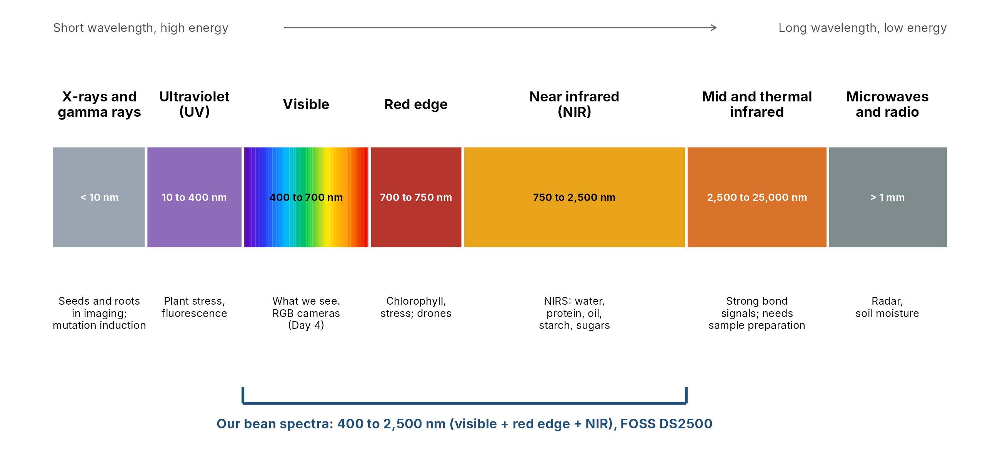
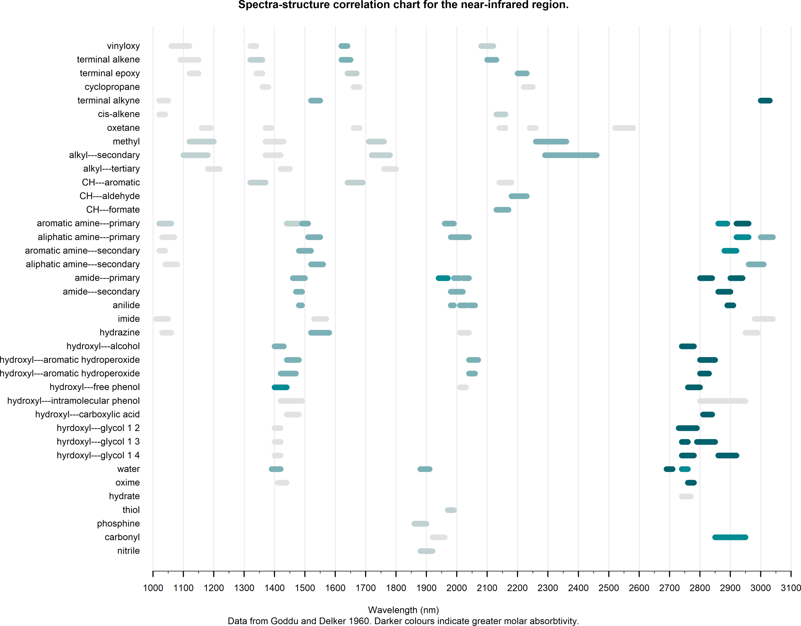
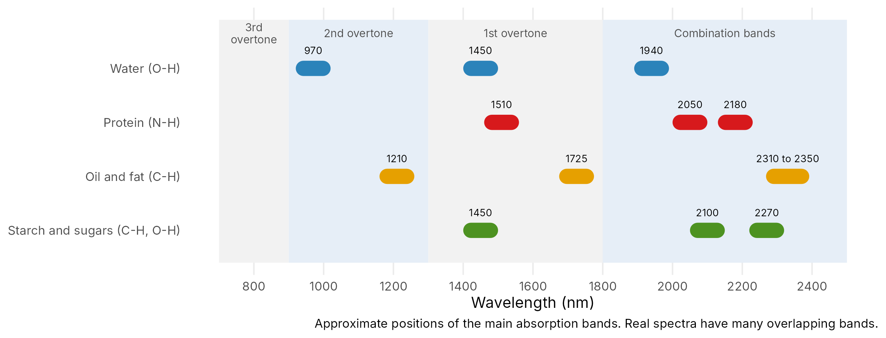

# Machine Learning for Prediction in Plant Breeding {#sec-ai-breeding}

::: chapter-info
**Author:** Luis Fernando Delgado Muñoz\
**Session:** Day 5, Friday 13 November, 15:00 to 16:15
:::

::: {.callout-tip}
## Materials for this session

- [Lecture slides](../slides/11-ai-plant-breeding.html){target="_blank"}
- [Practical: NIR spectra of beans and PCR (ZIP)](../downloads/ML_NIRS_beans_practical.zip). Unzip it, open the `.Rproj`, and start with `NIRS_beans_PCR_practical.Rmd`.
- [Data: bean NIR spectra and laboratory values (CSV)](../data/bean_nirs.csv)
:::

## Learning objectives

- Explain the difference between explaining a trial and predicting a new sample
- Describe what near-infrared (NIR) light is and what a NIR spectrum measures
- Say which kinds of traits NIR predicts well (chemical) and which not (minerals, cooking and physical traits)
- Build a simple prediction model, principal component regression (PCR), and describe other common models in one sentence each
- Measure prediction quality with RMSE, bias, R² and RPD, and compare with a baseline
- Validate honestly and avoid **data leakage**, for example by keeping all samples of a bean line in the same fold

Most of this course uses models to **explain** a trial: is there a difference between lines, how large is it, how sure are we? Machine learning (ML) is used for another goal: to **predict** a value for a new sample. We may not need to understand every step of the model if it predicts well. But we do need to know **how well it predicts in the situation where we will use it**. This chapter is about that question, with NIR spectra of common beans.

```{r}
#| message: false
source("exercises/ML_NIRS_beans_practical/helpers.R")   # the functions used in the practical
source("slides/ml_deck_functions.R")                     # extra models for the comparison
```

```{r}
#| include: false
fmt <- function(x, d = 0) format(round(x, d), big.mark = ",", scientific = FALSE, nsmall = d)
theme_set(theme_minimal(base_size = 11))
```

::: callout-note
## Functions in a separate file
To keep the code short, the work is done by functions in `helpers.R`: `load_bean_nir()`, `prepare_spectra()`, `fit_pcr()`, `predict_pcr()`, `quality()`, `make_folds()`, `cv_predict()` and `cv_curve()`. You can open the file to see how each one works. The practical uses the same file.
:::

## Prediction against explanation

| | Explain (inference) | Predict |
|---|---|---|
| Question | Why? Is there an effect? | What will the value be for a new sample? |
| Typical tools | ANOVA, mixed models | PCR, PLS, random forest, boosting |
| Result | An effect size and a p-value | A number for each new sample, and its error |
| A model is good when | The assumptions hold and the design is sound | It predicts samples it has never seen |

A model can explain well and predict badly, and the other way around.

## Where prediction pays in a breeding programme

Some measurements are slow or costly: laboratory analysis of phytate, sugars or protein, scoring disease in the field, phenotyping every line in every trial. A prediction model learns the link between a **cheap measurement** (a NIR spectrum, an image, a marker) and the **expensive one**. We measure the expensive trait on a few samples, build the model, and then use the cheap measurement on all samples.

In a mutation breeding programme there can be thousands of M2 or M3 plants and lines. NIR on the seed allows a fast **screening** for composition. The interesting lines are then confirmed in the laboratory. Prediction does not replace the laboratory: it tells you where to look.

## Light we can see and light we cannot see

Light is a wave, and its **wavelength** (in nanometres, nm) tells us what kind of light it is. Our eyes see only 400 to 700 nm. The NIR region starts just after the red edge, at about 750 nm, and goes to about 2,500 nm. Before the visible there are ultraviolet light and X-rays; after the NIR there are the mid and thermal infrared, microwaves and radio waves.

{#fig-light width="95%"}

A NIR instrument sends light onto the sample (for example whole seed or flour). The sample **absorbs** some wavelengths and the instrument records the light that comes back. The result at each wavelength is the **spectrum**. It is fast, it needs no chemicals, and the sample is not destroyed. But the spectrum is **indirect**: we need a model to turn it into a number.

## What NIR can "see"

Molecules absorb NIR light when their bonds vibrate. In the NIR region the strongest bands come from bonds with hydrogen: **O-H** (water, sugars, starch), **N-H** (protein) and **C-H** (oil, sugars, starch). @fig-groups shows where many chemical groups absorb. It is drawn from the data of Goddu and Delker (1960), compiled by S. D. J. Brown.

{#fig-groups width="85%"}

@fig-bands is a simple summary for food and grain. The bands are broad and overlap, so we cannot read a compound from one wavelength. That is why we need a calibration model.

{#fig-bands width="85%"}

::: callout-important
## NIR sees bonds, not elements
NIR works well for **chemical** traits made of organic molecules: water, protein, oil, starch, sugars, fibre and phenolics. It works poorly for traits that are not built from organic bonds or that have many physical causes:

- **Minerals** such as iron and zinc: a metal has no NIR band. A model can only use the link between the mineral and the organic matrix, so it is indirect and weaker.
- **Physical and cooking traits** such as cooking time, water absorption, hardness or texture. They depend on the seed coat, structure and storage, not on one chemical group.

So NIR is very good for chemical variables and less good for physico-chemical ones. Always test each new trait before you trust a model.
:::

## The NIR spectra of beans

The data come from common bean seed samples of CIAT: **117 samples of 44 lines** (most lines have 3 repeats), with NIR spectra from 400 to 2,500 nm (here every 2 nm, 1,050 variables) and 13 laboratory traits.

```{r}
bean <- load_bean_nir("data/bean_nirs.csv")   # lab, X (spectra), wl, line
lab  <- bean$lab
X    <- bean$X
line <- bean$line
dim(X)
table(table(line))        # lines with 1, 2 or 3 samples
```

```{r}
traits <- c("water_absorption", "cooking_time", "iron", "zinc", "phytate", "phenolics",
            "verbascose", "stachyose", "raffinose", "sucrose", "fructose",
            "total_sugars", "total_oligosaccharides")
tab <- data.frame(trait = traits,
                  mean = sapply(traits, function(t) mean(lab[[t]])),
                  sd   = sapply(traits, function(t) sd(lab[[t]])),
                  min  = sapply(traits, function(t) min(lab[[t]])),
                  max  = sapply(traits, function(t) max(lab[[t]])))
knitr::kable(tab, digits = 2, row.names = FALSE)
```

Units: iron and zinc in mg/kg; phytate and sugars in mg/g; water absorption in %; cooking time in minutes.

```{r}
#| label: fig-spectra
#| fig-cap: "Raw NIR spectra of 60 samples, coloured by phytate. The spectra look alike and the differences are small."
#| fig-width: 8
#| fig-height: 3.8
plot_spectra(X, colour_by = lab$phytate, n = 60, legend_title = "Phytate")
```

## Preparing the spectra

Two light steps make the differences easier to see:

1. **SNV** (standard normal variate): each spectrum is centred and scaled by itself. It removes differences in level caused by grain size and light scatter.
2. **First derivative**: removes a sloping baseline and sharpens the peaks.

```{r}
Z <- prepare_spectra(X)
dim(Z)
```

```{r}
#| label: fig-prep
#| fig-cap: "The same spectra after SNV and first derivative."
#| fig-width: 8
#| fig-height: 3.6
plot_spectra(Z, colour_by = lab$phytate, n = 60, ylab = "SNV + first derivative", legend_title = "Phytate")
```

Each spectrum is treated on its own, so this step cannot leak information between samples.

**Principal components.** PCA summarises the 1,045 variables in a few new variables, the principal components. Here the first four hold `{r} fmt(sum(100 * prcomp(Z)$sdev[1:4]^2 / sum(prcomp(Z)$sdev^2)), 0)` % of the variation.

```{r}
#| label: fig-pca
#| fig-cap: "The first two principal components of the prepared spectra, coloured by grain colour."
#| fig-width: 7
#| fig-height: 4
pca <- prcomp(Z)
ve  <- 100 * pca$sdev^2 / sum(pca$sdev^2)
ggplot(data.frame(PC1 = pca$x[, 1], PC2 = pca$x[, 2], colour = lab$colour), aes(PC1, PC2, colour = colour)) +
  geom_point(size = 2.2) + labs(x = paste0("PC1 (", round(ve[1]), "%)"), y = paste0("PC2 (", round(ve[2]), "%)"), colour = "Grain colour")
```

## Measuring prediction quality

Let $y_i$ be the observed value and $\hat y_i$ the predicted value of sample $i$, for $n$ samples that **were not used to build the model**.

| Measure | Formula | Meaning |
|---|---|---|
| RMSE | $\sqrt{\frac{1}{n}\sum (y_i-\hat y_i)^2}$ | Typical size of the error, in the unit of the trait. Small is good |
| Bias | $\frac{1}{n}\sum (\hat y_i-y_i)$ | Is the model on average too high or too low? Close to 0 is good |
| R² | squared correlation of $y$ and $\hat y$ | Share of variation explained. Close to 1 is good |
| RPD | $\mathrm{sd}(y)/\mathrm{RMSE}$ | How much better than predicting the mean for everyone |

A common guide for RPD (Williams): below 1.5 the model is not useful; 1.5 to 2 rough screening; 2 to 2.5 approximate quantitative prediction; above 2.5 good. The **baseline** "always predict the mean" has RMSE equal to the standard deviation, so RPD = 1. A model must beat the baseline. Wadoux et al. (2021, chapter 9) describe these measures and others, such as the RPIQ (using the interquartile range) and Lin's concordance correlation coefficient (CCC), which are better for skewed data.

## The models

### Principal component regression (PCR)

PCR is the simplest model that works well for spectra. It has three steps:

1. **PCA** of the spectra of the training samples (1,045 variables to a few components).
2. A normal **linear regression** of the trait on the first *k* components.
3. To **predict** a new sample, project its spectrum on the same components and use the regression.

You choose one number: *k*. In the code, the three steps are two functions: `fit_pcr()` and `predict_pcr()`.

```{r}
y <- lab$phytate
f_random  <- make_folds(line, by_line = FALSE)
f_by_line <- make_folds(line, by_line = TRUE)

model <- fit_pcr(Z, y, ncomp = 12)       # fit on all samples
round(quality(y, predict_pcr(model, Z)), 2)   # same samples: too good, not a real test
```

The last line predicts the samples that built the model. It looks good, but this is not a test.

### Other model families

| Model | In one sentence |
|---|---|
| **PCR** | PCA first, then a linear regression on the components |
| **PLS** (partial least squares) | Like PCR, but the components are built to be related to the trait. The classic NIR method |
| **Ridge** | A linear model that shrinks all coefficients, so no wavelength dominates |
| **Lasso** | Shrinks and sets many coefficients exactly to zero: it selects wavelengths |
| **Elastic net** | A mix of ridge and lasso |
| **Random forest** | Many decision trees, each on a random part of the data; the average is the prediction. It needs tuning and can overfit |
| **Support vector machine (SVM)** | Finds a smooth curve that stays close to the data; a kernel lets it follow curved relations |
| **Boosting (GBM)** | Many small trees built one after the other, each one fixing the errors of the previous ones |

Ridge, lasso and elastic net start from a linear model with one coefficient for each wavelength and add a **penalty** for large coefficients. Ridge makes all coefficients smaller. The lasso pushes many of them to exactly zero, so only some wavelengths stay in the model. Elastic net mixes the two. The strength of the penalty is chosen by cross-validation.

PCR and PLS are the traditional tools of NIR. Trees and boosting come from machine learning. The soil spectroscopy book of Wadoux et al. (2021) also describes Cubist and memory-based learning.

### Comparison on one trait

We predict phytate with every model, with validation by line (@sec-leakage explains why). Inside each training set, the number of components or the penalty is chosen by an inner cross-validation.

```{r}
#| cache: true
Z5 <- thin(Z, 5)                       # average 5 neighbouring variables, for speed
models <- c("PCR", "PLS", "Ridge", "Lasso", "ENet", "RF", "GBM", "SVM")
P <- sapply(models, function(m) cv_model(m, Z5, y, f_by_line, line))
perf <- t(apply(P, 2, function(p) quality(y, p)))
perf <- rbind(perf, "Always the mean" = c(RMSE = sd(y) * sqrt(116 / 117), R2 = 0, bias = 0, RPD = 1))
knitr::kable(perf, digits = 2)
```

All models beat the baseline, but none is excellent: phytate is a difficult trait. PCR is the weakest here. Lasso, elastic net, boosting and SVM do better (RPD about 1.7), but none reaches 2, so they are useful for rough screening only.

```{r}
#| label: fig-pred-obs
#| fig-cap: "Predicted against observed phytate for four models (validation by line). The dashed line is the 1:1 line."
#| fig-width: 9
#| fig-height: 3.4
pl <- do.call(rbind, lapply(c("PCR", "PLS", "Lasso", "RF"), function(m) data.frame(model = m, obs = y, pred = P[, m])))
ggplot(pl, aes(obs, pred)) + geom_abline(linetype = 2) + geom_point(colour = "#2c7fb8", alpha = 0.7) +
  facet_wrap(~model, nrow = 1) + labs(x = "Observed phytate (mg/g)", y = "Predicted phytate (mg/g)")
```

### How many components?

With few components the model is too simple; with many it learns the noise (**overfitting**). We try 1 to 25 components and look at the validation error.

```{r}
#| label: fig-curve
#| fig-cap: "Validation error of PCR for phytate against the number of components, with random folds and with folds by line."
#| fig-width: 7
#| fig-height: 3.6
#| cache: true
cv_a <- cv_curve(Z, y, f_random, 25)
cv_b <- cv_curve(Z, y, f_by_line, 25)
curve <- rbind(transform(cv_a, folds = "random folds"), transform(cv_b, folds = "by-line folds"))
ggplot(curve, aes(components, RMSE, colour = folds)) + geom_line(linewidth = 1) + geom_point() +
  labs(x = "Number of components", y = "RMSE of cross-validation (mg/g)", colour = NULL)
```

## Knowing if the number is honest {#sec-leakage}

The rule is simple: **judge a model on samples it has not seen**. In cross-validation we cut the data in *k* folds; each part is called a **fold**. Each time one fold is the test and the other folds build the model. With k = 5 there are 5 rounds and every sample is tested once.

### Data leakage

Many bean lines have up to **three samples** that are almost the same bean. If the folds are random, one sample of a line can be in the training set and another sample of the same line in the test set. The model has already "seen" that line, so the test is too easy and the error looks too good. This is **data leakage**.

```{r}
d9 <- data.frame(sample = lab$sample, line = line, fold_random = f_random, fold_by_line = f_by_line)
knitr::kable(d9[order(d9$line), ][1:9, ], row.names = FALSE)
```

With random folds the three samples of line L03 go to different folds (1, 10, 9). With folds by line they all go to fold 1. In breeding the question is: *will the model work on a **new line**?* So the validation must hold out **whole lines**.

```{r}
trait_pick <- c("phytate", "iron", "cooking_time")
leak <- do.call(rbind, lapply(trait_pick, function(t) {
  yy <- lab[[t]]
  c1 <- quality(yy, cv_predict(Z, yy, f_random,  12))
  c2 <- quality(yy, cv_predict(Z, yy, f_by_line, 12))
  data.frame(trait = t, validation = c("random", "by line"), rbind(c1, c2)[, c("RMSE", "R2", "RPD")])
}))
knitr::kable(leak, digits = 2, row.names = FALSE)
```

Random folds look better, but that is the leak, not a better model. Report the by-line numbers.

**What about averaging the replicates?** Using the mean spectrum and the mean value of each line is a valid choice for line-level decisions. It reduces noise and removes leakage, because each line is one point. The cost is that only 44 points remain and the error is on a different scale. Our advice is to keep all samples and validate by line, and to use line means as a second check.

```{r}
Zm <- rowsum(Z, line) / as.vector(table(line)[rownames(rowsum(Z, line))])
Lm <- rownames(Zm); fm <- make_folds(Lm, k = 10)
avg <- do.call(rbind, lapply(c("phytate", "iron", "cooking_time"), function(t) {
  yy <- lab[[t]]; ym <- tapply(yy, line, mean)[Lm]
  a <- quality(yy, cv_predict(Z, yy, f_by_line, 12))
  b <- quality(ym, cv_predict(Zm, ym, fm, 12))
  data.frame(trait = t, data = c("all samples, by line", "line means"), rbind(a, b)[, c("RMSE", "R2", "RPD")])
}))
knitr::kable(avg, digits = 2, row.names = FALSE)
```
 The same idea holds for years, sites, plots or families: any group that is "the same thing" measured more than once must stay together in one fold.

```{r}
#| eval: false
# WRONG: samples of the same line can be in training and in test
folds <- make_folds(line, by_line = FALSE)
# RIGHT: all samples of a line stay together
folds <- make_folds(line, by_line = TRUE)
quality(y, cv_predict(Z, y, folds, ncomp = 12))
```

## What NIR predicts well, and what not

We use the same recipe (PCR, validation by line, number of components chosen between 1 and 25) for all 13 traits.

```{r}
#| label: fig-traits
#| fig-cap: "R² of PCR with validation by line for 13 bean traits, coloured by type of trait."
#| fig-width: 8
#| fig-height: 4.2
#| cache: true
type <- c(water_absorption = "Cooking / physical", cooking_time = "Cooking / physical",
          iron = "Minerals", zinc = "Minerals", phytate = "Organic compounds", phenolics = "Organic compounds",
          verbascose = "Organic compounds", stachyose = "Organic compounds", raffinose = "Organic compounds",
          sucrose = "Organic compounds", fructose = "Organic compounds", total_sugars = "Organic compounds",
          total_oligosaccharides = "Organic compounds")
res <- do.call(rbind, lapply(traits, function(t) {
  yy  <- lab[[t]]
  k   <- which.min(cv_curve(Z, yy, f_by_line, 25)$RMSE)
  data.frame(trait = t, type = type[[t]], R2 = r2(yy, cv_predict(Z, yy, f_by_line, k)))
}))
res$trait <- factor(res$trait, levels = res$trait[order(res$R2)])
ggplot(res, aes(R2, trait, fill = type)) + geom_col() + labs(x = "R² (PCR, validation by line)", y = NULL, fill = NULL)
```

The picture agrees with the chemistry:

- **Sugars and phenolics** (organic molecules with many C-H and O-H bonds): good.
- **Phytate and the other oligosaccharides**: medium. Useful for screening, not for exact values.
- **Iron and zinc**: weak to moderate. NIR cannot see a metal; it sees what goes with it.
- **Cooking time and water absorption**: weak. They depend on the seed coat, storage and structure.

The number of components was chosen on the same validation folds, so these R² values are slightly optimistic. The model comparison above used a stricter, nested validation.

Published work gives the same message. In a CIAT study of common bean (Garcia et al. 2025), NIR predicted nitrogen well (CCC 0.84) and iron and zinc only moderately (about 0.4). A study of Croatian landraces (Vranić et al. 2019) found good prediction of nitrogen (R² 0.89), usable models for phytic acid and phosphorus, and poor models for iron and zinc. A 2026 review of legume breeding (Ghaitaranpour et al. 2026) also reports that visible and NIR models work best for composition and less well for appearance and texture, and that the human sensory panel remains the reference.

## Other uses and other validation units

The same workflow is used with image features (disease severity, plant traits), multi-environment trials (yield and G×E in new environments, using weather and soil covariates) and markers (genomic selection). Flexible models can beat simple ones when the data are large; with small data, simple models are often as good. In genomic prediction, machine learning has not consistently beaten classical models such as GBLUP (Yoosefzadeh-Najafabadi et al. 2025), and reviews list large data needs, hard interpretation and biased data as limits (Yoosefzadeh Najafabadi et al. 2023).

Data leakage by line is one case of a general rule: **leave out the whole unit you want to predict**. For a new line, keep all samples of the line together. For a new environment, keep all plots of that environment together. For a new season, keep a whole year together. The function `make_folds()` takes any grouping variable.

## Limits of prediction models

- **Interpretability**: trees, boosting and SVM are harder to explain than PCR or the lasso. Check that a model uses sensible wavelengths.
- **Transfer across crops**: a bean model does not work for chickpea or wheat. Build and test a new one for each crop.

- **Small data**: 117 samples from 44 lines give noisy estimates of R².
- **Another instrument, season or sample form** (whole seed against flour): the model may not transfer. Check it and re-calibrate.
- A model is valid only inside the **range** of the data used to build it.
- The laboratory value is the reference: a noisy laboratory method limits the model.
- A calibration is **living**: add new samples each season and check the error again.

## Practical

Use the ZIP file at the top of this chapter. You will follow the same workflow with short code and functions: look at the spectra, prepare them, fit PCR, validate with random folds and with folds by line, choose the number of components, compare a chemical trait (total sugars, phytate) with a physical one (cooking time, iron), and write a conclusion for a breeder.

## Key takeaways

- ML is for **prediction**: it turns a cheap measurement into an estimate of an expensive one. It does not replace the experimental design or the mixed model.
- NIR measures **bonds** (O-H, N-H, C-H). It is very good for **chemical** traits and weak for minerals and physical or cooking traits.
- Prepare the spectra (SNV, first derivative) and start with a **simple model**: PCR or PLS.
- Report **RMSE, R², bias and RPD**, and always compare with "always the mean".
- Avoid **leakage**: keep all samples of one line in the same fold. Random folds look too good.
- Use prediction to **screen**, and confirm the promising lines in the laboratory.

## References {#sec-ai-breeding-refs}

- Garcia, T., Carvajal-Yepes, M., Drewry, D. T., Santos, L. G., Duitama, J., Wenzl, P. and Chacón-Sánchez, M. I. (2025). Non-destructive prediction of nitrogen, iron and zinc content in diverse common bean seeds from a genebank using near-infrared spectroscopy. *Food Chemistry: Molecular Sciences* 11: 100316. DOI: 10.1016/j.fochms.2025.100316.
- Ghaitaranpour, A., Kebede, B., Duizer, L. M. and Yoosefzadeh-Najafabadi, M. (2026). AI-assisted nondestructive phenotyping of sensory-related traits in modern legume breeding. *Smart Agricultural Technology* 15: 102668. DOI: 10.1016/j.atech.2026.102668.
- Goddu, R. F. and Delker, D. A. (1960). Spectra-structure correlations for the near-infrared. *Analytical Chemistry* 32: 140-141. Data compiled by S. D. J. Brown, GitHub `sdjbrown/NIR-spectra-structure`.
- Vranić, M., Petek, M., Bošnjak, K., Lazarević, B. and Carović-Stanko, K. (2019). Prediction of macro and microelements content in Croatian common bean landraces (*Phaseolus vulgaris* L.) by NIR spectroscopy. *Poljoprivreda* 25(1): 48-55. DOI: 10.18047/poljo.25.1.7.
- Yoosefzadeh Najafabadi, M., Hesami, M. and Eskandari, M. (2023). Machine learning-assisted approaches in modernized plant breeding programs. *Genes* 14(4): 777. DOI: 10.3390/genes14040777.
- Yoosefzadeh-Najafabadi, M., Xavier, A., Eskandari, M. and Hesami, M. (2025). Machine learning after a decade: is it still a missing keystone in genomic-based plant breeding? *Artificial Intelligence Review* 58: 260. DOI: 10.1007/s10462-025-11274-y.
- Wadoux, A. M. J.-C., Minasny, B. and McBratney, A. B. (2021). *Soil Spectral Inference with R*. Springer. Chapter 9.
- Bean NIR data: CIAT (PhD work of L. F. Londoño), shared for training.
