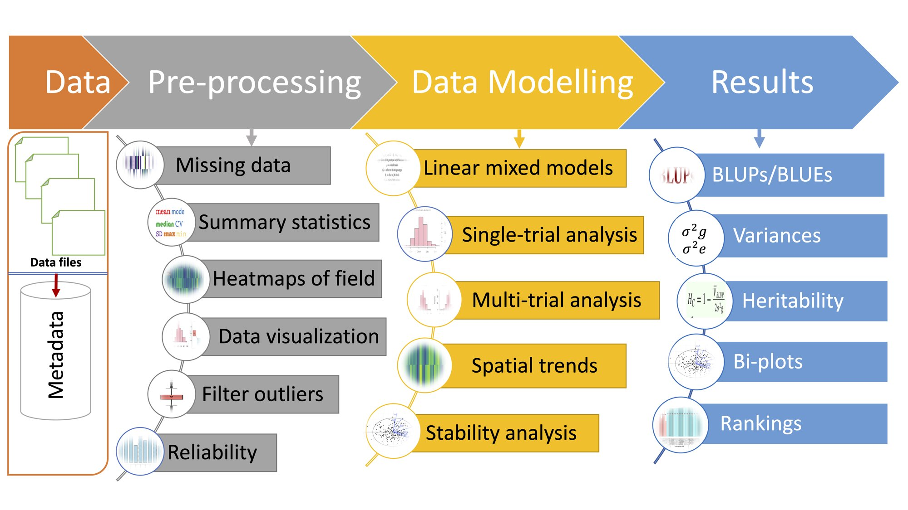

# Data Analysis Pipeline in Plant Breeding {#sec-pipeline}

::: chapter-info
**Author:** Luis Fernando Delgado Muñoz\
**Session:** Day 6, Monday 16 November (after the machine learning session)
:::

::: {.callout-tip}
## Materials for this session

- [Lecture slides](../slides/12-analysis-pipeline.html){target="_blank"}
- [Support folder (ZIP)](../downloads/Pipeline_cassava_support.zip). It has the full R Markdown of this chapter, the cassava data, the original code of the nine trials, and the code and demo data of Hussain et al. (2022). Unzip it, open the `.Rproj`, and run `00_install_packages.R` first.
- [Data: nine cassava trials (CSV)](../data/cassava_DVGXE_tidy.csv)
:::

## Learning objectives

- Describe the steps of a data analysis pipeline, from raw data to a selection decision
- Check the quality of trial data: design, missing values and shared clones
- Fit a spatial model in each trial and estimate heritability
- Fit a multi-environment model and read clone by trial interaction (G×E)
- Combine traits in a selection index and make an advancement table
- Know where to find an open pipeline (Hussain et al. 2022) and its code

The course focus is mutation breeding. In this chapter we show the regular pipeline of a breeding programme, with real cassava data. The same steps apply to a mutant population. Every figure is made with free R packages, so you can repeat it.

## Pipeline overview

A breeding programme runs many trials, in many places, with many traits. At the end the breeder must decide which clones go to the next stage. A pipeline is a fixed sequence of steps, written as code, that gives the same answer every time.

{width="90%" fig-align="center"}

Our steps in this chapter are:

1. Import the data
2. Quality control (design, missing data, shared clones, variation)
3. Single trial analysis with a spatial model, and heritability
4. Multi-environment analysis, G×E and genotypic correlation
5. Results: correlation between traits, selection index and advancement table

## The cassava example

The data come from nine cassava trials in the Caribbean coast of Colombia, in 2021 and 2022, with 51 clones. Each trial is a row-column design with checks (released varieties) spread at random. The traits are yield (t/ha), dry matter, plant type (score 1 to 5), germination, height of the first branch and branch number. The data are public in Cassava Base, and the original code is in the repository `Cassava2050/2022DVGXE9env`.

```{r}
#| label: pipe-setup
#| cache: false
source("exercises/Pipeline_cassava_support/helpers.R")
library(patchwork)
d <- load_cassava("data/cassava_DVGXE_tidy.csv")
dim(d)
table(d$trial, d$check_test)
```

## Quality control

First look at the field design. Orange tiles are checks, blue tiles are test clones.

```{r}
#| fig-width: 11
#| fig-height: 4.2
(plot_trial_layout(d, "ciat21") | plot_trial_layout(d, "ciat22")) + plot_layout(guides = "collect")
```

Then missing data. A common rule is to drop a trait or trial with more than 20% missing values. Here almost everything is complete.

```{r}
#| fig-width: 9
#| fig-height: 4.4
plot_missing(d)
```

Trials can only be compared if they share clones (or checks).

```{r}
#| fig-width: 8
#| fig-height: 4.4
plot_connect(d)
```

Last, look at the variation between trials. The trials differ a lot in the mean. This is the environment effect. We want the clone effect, not the place effect.

```{r}
#| fig-width: 9
#| fig-height: 4.2
plot_trait_trial(d, "yield_ha")
```

## Single trial analysis

Neighbour plots are often more alike than distant plots (soil, water, light). If we ignore this, the trend goes into the error and the clone ranking gets noisy. The package **SpATS** fits clone as random plus a smooth two-dimensional surface over rows and columns. It gives a BLUP per clone and a heritability per trial.

```{r}
#| fig-width: 10
#| fig-height: 4.4
m1 <- fit_spats(d, "ciat22", "yield_ha")
plot(m1, cex = 0.7)
getHeritability(m1)
```

We repeat this for every trial and every trait in a loop.

```{r}
#| fig-width: 9
#| fig-height: 4.2
H2 <- single_h2(d)
H2$trial <- factor(H2$trial, levels = levels(d$trial))
H2$trait <- factor(H2$trait, levels = TRAITS)
ggplot(H2, aes(trait, trial, fill = h2)) + geom_tile(colour = "white") +
  geom_text(aes(label = sprintf("%.2f", h2)), size = 3.2) +
  scale_fill_gradient(low = "#F3E5D8", high = "#0072B2", limits = c(0, 1), name = "H2") +
  labs(x = NULL, y = NULL) + theme_minimal(base_size = 13) +
  theme(axis.text.x = element_text(angle = 30, hjust = 1))
```

Most values are moderate to high. A trait with a very low value in a trial (germination in stom22) is not reliable there, and it should not go to the multi-environment analysis.

## Multi-environment analysis

The model is: yield of a plot = trial mean + clone effect + clone by trial effect + error. In lme4 we write `yield ~ trial + (1 | clone) + (1 | clone:trial)`.

```{r}
met <- lapply(c("yield_ha", "DM_gravity", "plant_type"), function(tr) {
  m <- met_model(d, tr); v <- met_h2(m, d, tr)
  data.frame(trait = TRAIT_LABELS[[tr]], clone = v[["Vg"]], clone_x_trial = v[["VgxE"]],
             residual = v[["Ve"]], H2 = v[["h2"]])
})
knitr::kable(do.call(rbind, met), digits = 2, row.names = FALSE,
             col.names = c("Trait", "Clone variance", "Clone by trial variance", "Residual variance", "Heritability, all trials"))
```

When the clone by trial variance is large, the best clone changes from place to place. The genotypic correlation between trials shows where this happens. Values near 1 mean the ranking is similar.

```{r}
#| fig-width: 8.5
#| fig-height: 4.6
mY <- met_model(d, "yield_ha")
plot_corr(trial_gcor(mY))
```

## Results

The correlation between traits (clone BLUPs across all trials) shows which traits move together.

```{r}
#| fig-width: 7.5
#| fig-height: 4.6
B <- all_blups(d)
Rt <- cor(B[, TRAITS])
colnames(Rt) <- rownames(Rt) <- c("yield", "dry matter", "plant type", "germination", "height 1st br.", "branch no.")
plot_corr(Rt)
```

### Selection index

We use yield, dry matter and plant type. Each BLUP is standardised and multiplied by a score chosen by the breeder: yield +10, dry matter +10, plant type -5 (a low plant type score is better). We keep the top 20%.

```{r}
S <- selection_table(B)
top <- head(S, 11)
knitr::kable(data.frame(Rank = top$rank, Clone = top$g, Yield = round(top$yield_ha, 1),
                        `Dry matter` = round(top$DM_gravity, 1), `Plant type` = round(top$plant_type, 2),
                        Index = round(top$index, 1), Advance = ifelse(top$selected, "yes", "no"),
                        check.names = FALSE), row.names = FALSE)
```

The scores are a decision of the breeder, not a statistical result. The statistics gives fair numbers to combine. Clones with "is" in the name are released varieties used as checks.

## What a breeder decides from this

- Keep the clones with a high index and a stable ranking across trials.
- Look again at clones that are good in one place only (G×E).
- Check the traits that were not in the index (disease, root quality) before the final list.
- Do not trust a trait with low heritability.
- Write down the weights and the cut-off, so the next cycle can repeat them.

## Qualitative traits

Disease scores and similar traits are binary or ordinal. A model for categories can be better than a normal model.

```{r}
#| eval: false
library(glmmTMB)
# glmmTMB(disease ~ rep + (1 | geno), family = binomial, data = trial)
library(ordinal)
# clmm(score ~ rep + (1 | geno), data = trial)
```

## How the pipeline changes for mutant populations

- The checks are the parent, and the plots are M2 or M3 plants or families. The same steps apply.
- Check the design, fix the soil trend, and estimate the effect of each line against the parent.
- Few replicates and many lines mean low heritability. Do not skip the quality control step.

## Open pipelines and reproducibility

Hussain et al. (2022) published an open pipeline with R Markdown files (quality check and lme4) and demo data. Their repository is [github.com/whussain2/Analysis-pipeline](https://github.com/whussain2/Analysis-pipeline). A copy is in the support folder, in `reference/Hussain_Analysis-pipeline/`. Use it to compare with the code of this chapter.

To make your own analysis repeatable, use an RStudio project, write the steps in a Quarto or R Markdown file, keep the data and the code together, and use Git and GitHub for versions.

## Exercise

Open `Pipeline_cassava_support.Rmd` from the support folder.

1. Repeat the box plot for dry matter. Which trial has the lowest mean?
2. Fit the spatial model for `DM_gravity` in trial `momi21`. What is its heritability?
3. Change the selection weights, for example dry matter +20. How many of the top 11 clones change?

::: {.callout-tip collapse="true"}
## Solution

```{r}
#| eval: false
plot_trait_trial(d, "DM_gravity")
m2 <- fit_spats(d, "momi21", "DM_gravity")
getHeritability(m2)
S2 <- selection_table(B, weights = c(yield_ha = 10, DM_gravity = 20, plant_type = -5))
sum(head(S2$g, 11) %in% head(S$g, 11))   # clones in both lists
```
:::

## Key takeaways

- A pipeline turns many trials into one repeatable decision.
- Always look at the data first: design, missing values, shared clones.
- Fix the field trend in each trial before comparing clones.
- Use a multi-environment model to separate clone, place and interaction.
- The selection index uses the breeder's weights, and the code makes them visible.

## References

- Hussain, W., Anumalla, M., Catolos, M., Khanna, A., Sta. Cruz, M. T., Ramos, J., and Bhosale, S. (2022). Open-source analytical pipeline for robust data analysis, visualizations and sharing in crop breeding. *Plant Methods* 18, 1. doi: 10.1186/s13007-022-00845-7
- Rodríguez-Álvarez, M. X., Boer, M. P., van Eeuwijk, F. A., and Eilers, P. H. C. (2018). Correcting for spatial heterogeneity in plant breeding experiments with P-splines. *Spatial Statistics* 23, 52 to 71.
