# Experimental Design and Statistical Pipelines for Mutation Breeding Applications {#sec-mutant-populations}

::: {.chapter-info}
**Author:** Luis Fernando Delgado Muñoz\
**Session:** Day 8, Wednesday 18 November (Topic 10)\
**Slides:** [Pipelines for mutant populations](../slides/16-mutant-pipeline.html) and [Radiosensitivity analysis](../slides/17-radiosensitivity.html)\
**Practice files:** [Mutant_pipeline_practical.zip](../downloads/Mutant_pipeline_practical.zip) and [Radiosensitivity_practical.zip](../downloads/Radiosensitivity_practical.zip)
:::

## Learning objectives

- Explain what is different in the analysis of a mutant population (M2 to M5).
- Choose an approach for unreplicated and replicated early generations.
- Run a complete pipeline with free packages: explore, clean, single trial, multi-environment, stability and selection.
- Estimate GR50 and LD50 from a dose test and choose a working dose.

## Mutant populations

In a mutation breeding programme the variation does not come from crosses between known parents. It comes from **random changes in the DNA** caused by the radiation. Three facts shape the analysis.

1. Most mutations are neutral or harmful. The useful ones are **rare**.
2. The population is large, and the **material per line is small**.
3. Early generations are often **unreplicated**.

The statistics are the same as in conventional breeding: mixed models, BLUEs and BLUPs, heritability, G × E and selection indices. What changes is the **amount of material** and the **stage** of the programme.

| Stage | Material | Replication | Main analysis |
|---------------|-------------------|---------------|---------------------|
| M2 | Single plants, very variable | None | Compare with the controls. Select plants. |
| M3 | Progeny of selected plants | None or 1 to 2 | Confirm the change. Compare each family with its control. |
| M4 | Lines in preliminary trials | 2 or more, or partial | Mixed models, heritability, BLUPs. First ranking. |
| M5 and later | Advanced lines, several locations | 2 to 3, several environments | Multi-environment analysis, stability, advancement. |

### Unreplicated and replicated early generations

- **Unreplicated.** Repeat the **controls** (the parents) all over the field. Compare each plant with its neighbour controls. Remove the field trend with a spatial model. Keep **more lines** than you think you need, because one plot is a weak signal.
- **Replicated.** Use blocks, or rows and columns. Treat the genotype as random to obtain BLUPs and heritability, and as fixed to obtain BLUEs. With several environments, study G × E and stability.

### Autogamous, allogamous and clonal crops

| | Autogamous (wheat, rice, bean) | Allogamous (maize) | Clonal (chrysanthemum, banana, potato) |
|--------------|------------------|------------------|------------------|
| Mutation is fixed by | Selfing, lines are fixed in M4 or M5 | Selfing or controlled crosses | Cuttings or tubers |
| Unit of analysis | Line | Family or selfed progeny | Clone |
| Typical problem | Few seeds in M2 and M3 | Many generations of selfing | Chimeras |

The pipeline is the same for all of them. Only the **unit** and the **replication** change.

## The pipeline in six steps

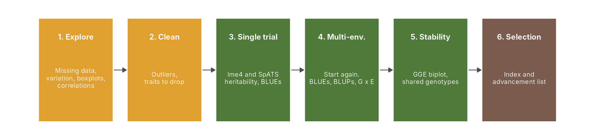{fig-align="center"}

**What is a Gy?** The gray (Gy) is the unit of radiation dose: 1 Gy is 1 joule of energy absorbed by each kilogram of tissue. In this example 20 Gy is a low dose, 40 Gy a medium dose and 60 Gy a high dose. A higher dose gives more mutations, but also more damage (smaller plants, more losses). The right dose comes from the radiosensitivity test (see below).

The example is a simulated chrysanthemum population: 120 lines (4 parents and 116 mutants irradiated with 20, 40 or 60 Gy), 4 environments, randomized complete blocks with row and column, 5 traits and 1,080 plots. The data have real problems on purpose: missing values, a flooded block and wrong values. Wheat (partially replicated) and bean are also available. The data were simulated in R with the package `FieldSimR` (spatial error, blocks and several environments), correlated genetic effects from `MASS::mvrnorm`, and problems added on purpose. The true genetic values are kept by the instructor, so we can check the selection at the end. The radiosensitivity data were simulated in base R from a dose-response curve and a logistic survival curve. All functions are in `helpers_mutant.R` and use only free packages: `ggplot2`, `lme4` and `SpATS`.

```{r}
#| eval: false
source("helpers_mutant.R")
d <- load_mutant("data/chrysanthemum_mutant_trials.csv")
TRAITS <- c("days_to_flowering", "plant_height_cm", "flower_diameter_cm",
            "flower_number", "stem_weight_g")
```

### 1. Explore

Look at missing data, variation, boxplots, field maps and correlations **before** any model.

```{r}
#| eval: false
plot_missing(d, TRAITS)
check_traits(d, TRAITS)     # % missing, mean, sd, CV and keep
```

A trait with more than 20 to 25% of missing values, or with almost no variation (CV below 1%), is not worth analysing.

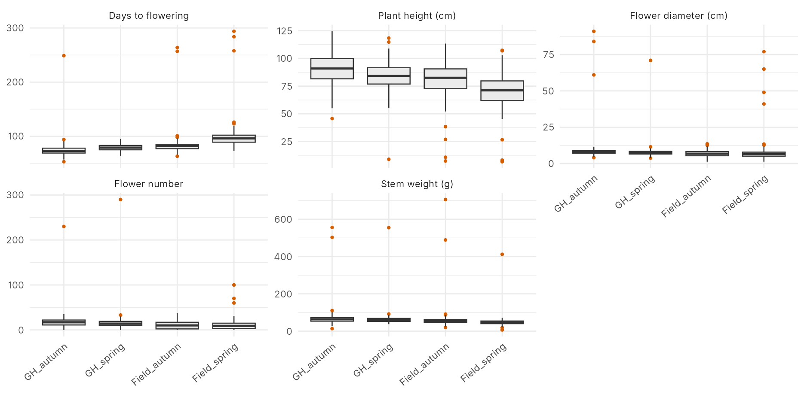{fig-align="center"}

The orange points are impossible values (a decimal point in the wrong place). They stretch the axis and hide the real variation. The raw correlations are close to zero for the same reason.

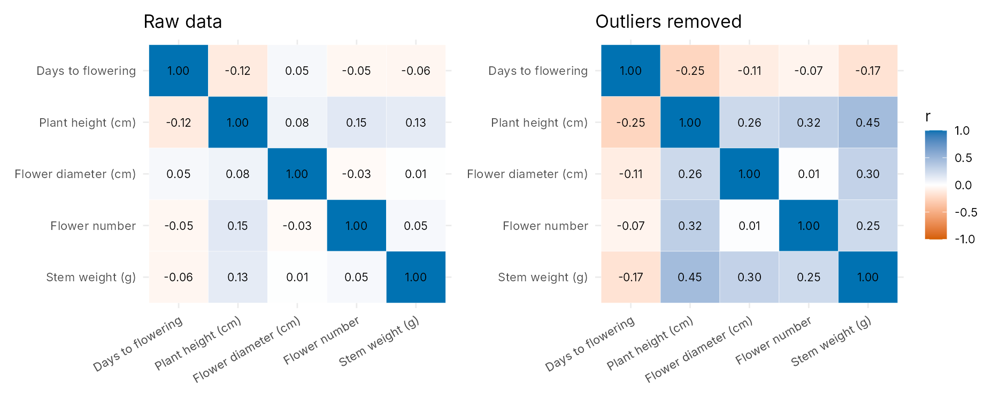{fig-align="center"}

The field maps show the **flooded block** (grey squares) and any trend in rows or columns.

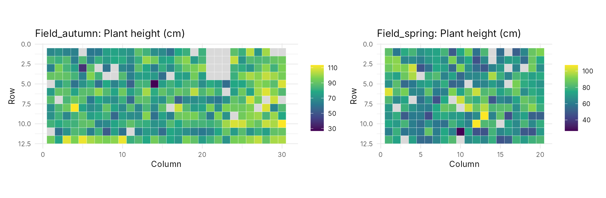{fig-align="center"}

### 2. Clean

```{r}
#| eval: false
flags <- flag_outliers(d, TRAITS)     # robust z in each trial, then a model residual
```

A value is flagged in two steps: first a gross error (very far from the trial median), then a residual of a model with genotype and block as random terms (only when lines have at least 1.5 plots). In the simulated data 32 outliers were inserted and 31 were found.

**A flag is a question, not a decision.** Removing every outlier is not always the best choice. In a mutant population the most interesting line can be the one that looks strange. A line that is extreme in all its plots may be a **potential mutant** or a new accession for a second stage. `review_outliers()` helps to decide. For each flagged value it checks the limits of what is possible (that you give) and the other plots of the same line:

```{r}
#| eval: false
rev <- review_outliers(d, flags, limits = list(plant_height_cm = c(10, 200)))
table(rev$suggestion)
d2 <- remove_outliers(d, rev[!grepl("Possible mutant", rev$suggestion), ])   # optional
```

| Flagged value is | What we see | Suggestion |
|-----------------|-------------------------|---------------------------|
| Impossible | Outside the limits you give | Remove |
| Isolated | The other plots of the line are normal | Check the field book, then remove |
| Repeated | The line is extreme in its other plots too | Keep it. Possible mutant |

With a more sensitive cut-off (`cutoff = 3`) 55 values are flagged: 28 are impossible, 25 are isolated and 2 are repeated. One of them is line M066 (60 Gy), flagged for plant height. Because the data are simulated we know that M066 is the shortest line of the whole population (59 cm, while its parent has 87 cm): a dwarf mutant that would have been lost by removing every outlier. The breeder decides, and removing outliers is optional.

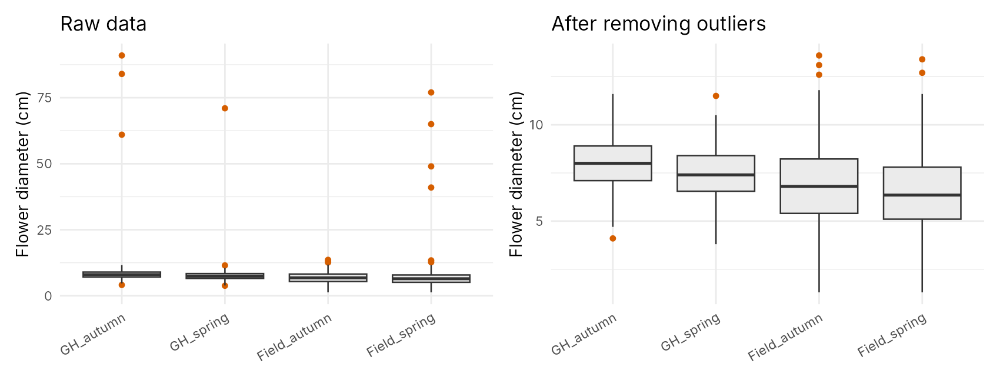{fig-align="center"}

### 3. Single trial analysis

Each trial and trait is analysed with `lme4` and with `SpATS`. In `lme4` we can try four versions of the random terms. Genotype is always random:

| Model | Random terms | When |
|--------------|--------------------------------|---------------------------|
| block | block | Design only. The starting point. |
| rowcol | block, row, column | Row and column as crossed random effects. |
| nested | block, row inside block, column inside block | Row or column numbers are repeated in every block. |
| rowcol_nb | row, column | No block term, when blocks are too small to estimate. |

```{r}
#| eval: false
lmer(y ~ (1 | g) + (1 | block) + (1 | row) + (1 | col))     # BLUPs and heritability
lmer(y ~ g + (1 | block) + (1 | row) + (1 | col))           # BLUEs

compare_lme4_models(x, "plant_height_cm")    # AIC, heritability and variances of the four models

# SpATS, design and field trend
SpATS(response = "y", genotype = "g", genotype.as.random = TRUE,
      spatial = ~ PSANOVA(col, row), random = ~ block, data = x)

st <- single_trials(d2, TRAITS)       # all traits in all trials, all models
```

In our trials the blocks are strips of columns, so the column is already inside the block and the row crosses the blocks. Other layouts need other choices. Try the models and compare them. We keep the model with the **lowest AIC** (a difference below 2 is a tie) and we also look at the heritability.

**Do the rows and columns explain variance?** Yes. In plant height of `Field_autumn` row and column take a large part of the variance that was in the residual, and the AIC of the block-only model is much higher.

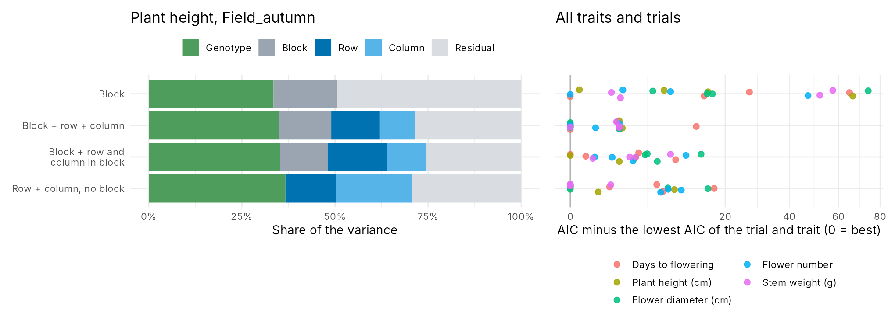{fig-align="center"}

Which model wins depends on the trial and the trait: in our 20 cases *rowcol* wins 8 times, *rowcol_nb* 8, *block* 2 and *nested* 2. For plant height in `Field_autumn` the heritability goes from 0.64 (block) to 0.73 (block, row and column). `SpATS` gives 0.71.

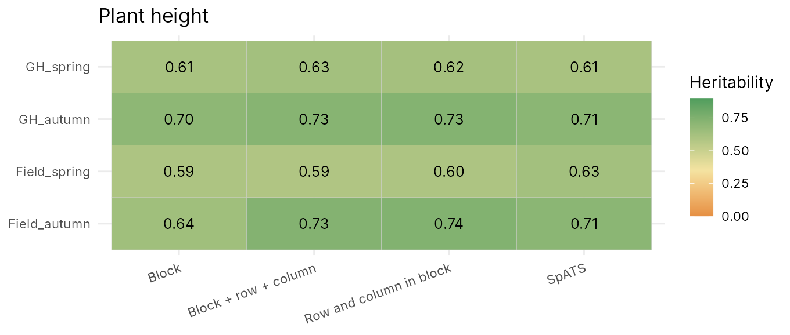{fig-align="center"}

`SpATS` also gives a heritability based on the spatial surface. The heritability of the `lme4` models is calculated from the prediction error variance of the BLUPs (one minus the mean variance of the prediction error divided by the genetic variance).

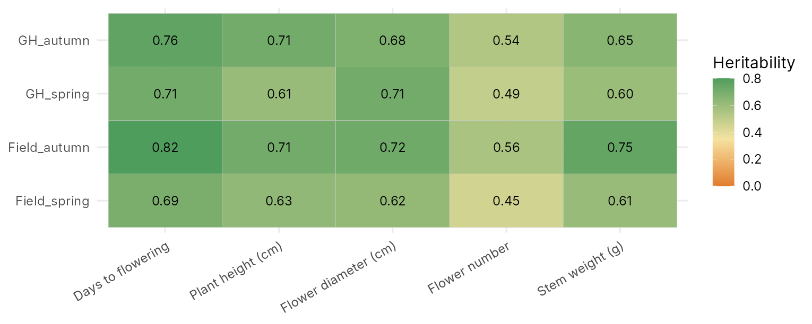{fig-align="center"}

The heritability of a trial tells how well the line means reflect the genotype. A simple traffic light:

| Heritability | Decision |
|-----------------|-------------------------------------------|
| Above 0.5 | Good. Use it for selection. |
| 0.2 to 0.5 | Use with care. Less weight in the index. |
| Below 0.2 | Do not trust the ranking in this trial. Drop the trial or the trait. |

These limits are a guide, not a law.

In the comparison, each point is one trait in one trial (5 traits in 4 trials, 20 points). On average the heritability is 0.64 with the best `lme4` model and 0.65 with `SpATS`.

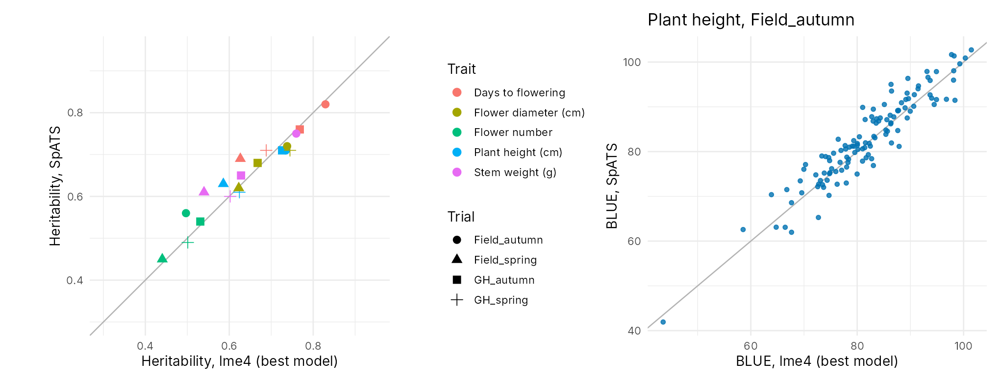{fig-align="center"}

**BLUE or BLUP.** BLUEs (genotype fixed) are used to compare lines and as input of a two-stage analysis. BLUPs (genotype random) are used for ranking. BLUPs of a single trial are **not** an input for the multi-environment model, because they are already shrunk.

**Early generations.** In M2 and M3 many lines have one plot. The BLUP pulls a line with one plot towards the mean, because one plot is a weak signal and a high value can be luck. Keep more lines than you think you need in the first generations and repeat the best ones in the next stage.

### 4. Multi-environment analysis

Start again from the plot data. Do not reuse the single-trial BLUPs.

```{r}
#| eval: false
# trial is fixed. Block, genotype and genotype by trial are random
lmer(y ~ trial + (1 | block_id) + (1 | g) + (1 | g:trial))

mets <- lapply(TRAITS, function(tr) met_fit(d2, tr))
met_summary(mets[[1]])                 # variances and heritability
```

A model over environments needs **lines in common** (the bridges). With few shared lines the G × E estimate is weak. In the example all 120 lines are in all 4 environments. In real programmes plan some common lines (the parents and a few good lines) in every trial.

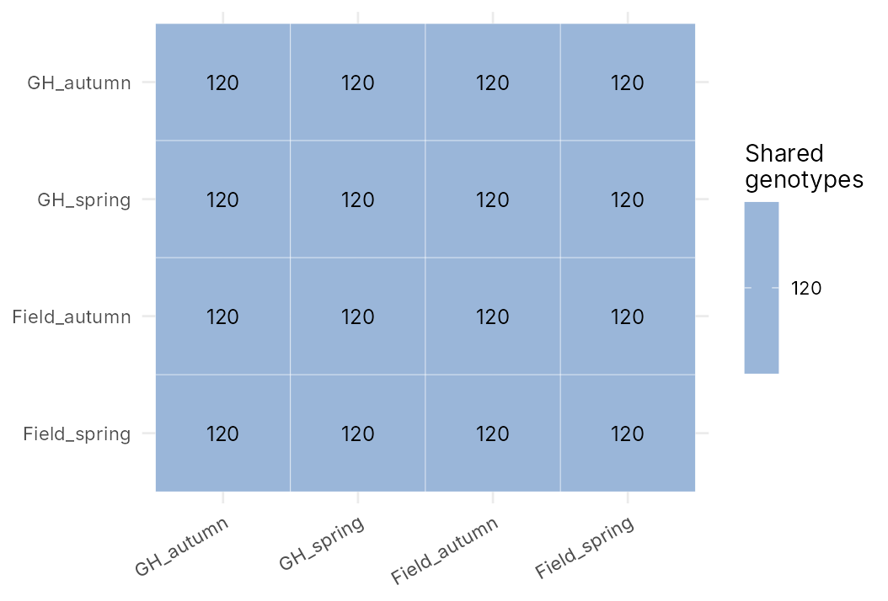{fig-align="center" width="55%"}

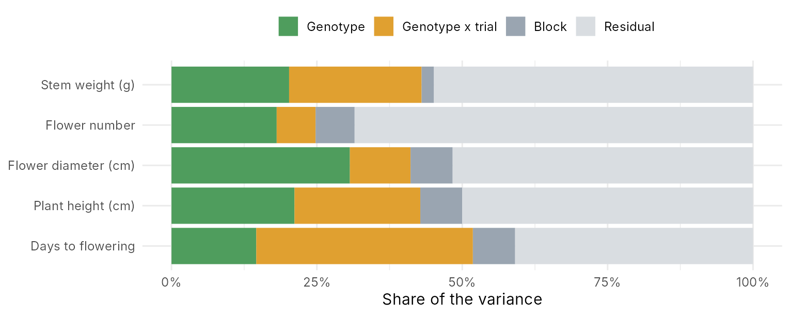{fig-align="center"}

When G × E is large compared with the genotype variance (here days to flowering), a good line in one place is not always good everywhere. The genotypic correlation between environments and between traits helps to decide. The correlation between trials is shown for stem weight (left) and flower number (right).

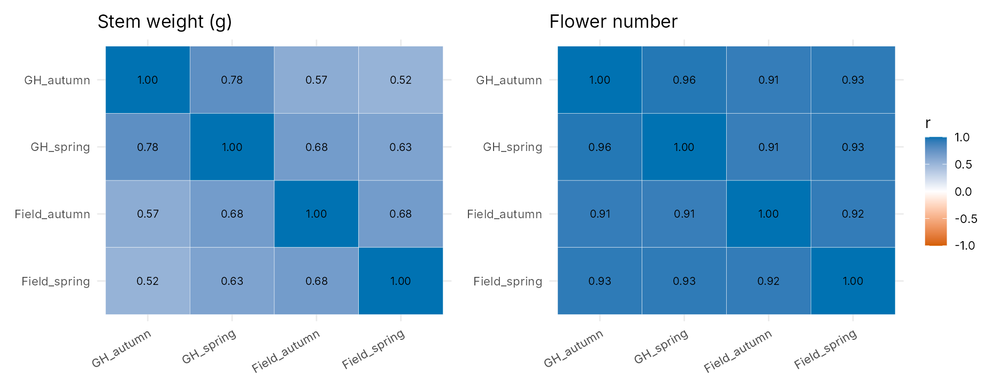{fig-align="center"}

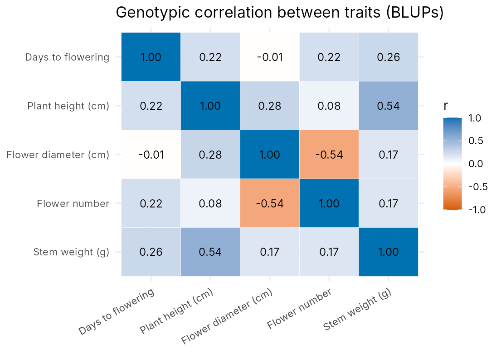{fig-align="center" width="70%"}

Flower number and flower diameter have a negative correlation (r = -0.54). This is a trade-off that the selection index must handle. Correlations from BLUPs tend to be a little high because of shrinkage.

### 5. Stability

The GGE biplot is built with a singular value decomposition of the matrix of BLUEs (lines in rows, environments in columns). Lines at the right have a high mean. Lines near the horizontal axis are stable.

```{r}
#| eval: false
f <- gge_fit(W)        # W: lines x environments matrix of BLUEs
plot_gge(f)
```

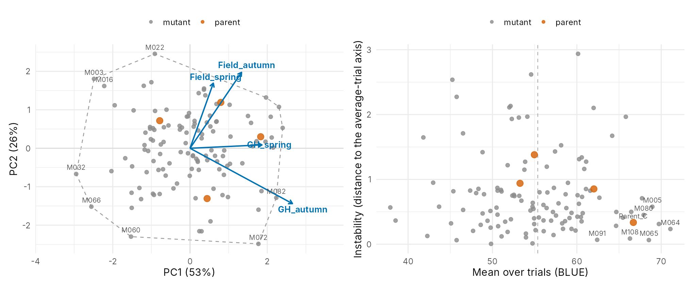{fig-align="center"}

### 6. Selection

We combine the standardised BLUPs in a selection index. The weights are the product profile and must be defined with the breeder, the grower and the market. The example weights are +10 flower number, +10 flower diameter, +5 stem weight and -5 days to flowering.

```{r}
#| eval: false
B <- all_blups(d2, TRAITS)
S <- selection_table(B, weights, pct = 0.25)    # advance the top 25%
```

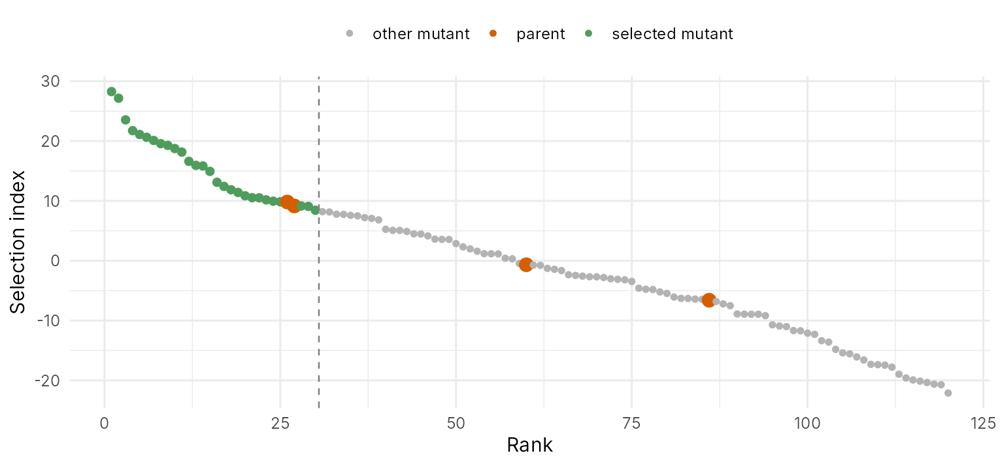{fig-align="center"}

Because the data are simulated, we can check the choice. Of the 30 lines selected, 19 are truly in the best 25%. This is the uncertainty that we always have.

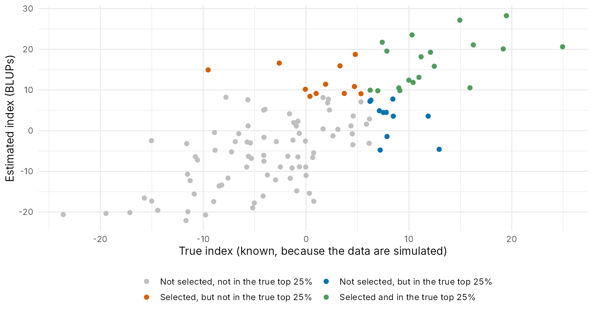{fig-align="center"}

## Radiosensitivity analysis

Before the large irradiation we test a range of doses on a small sample. A dose that is too low gives few mutations. A dose that is too high kills the plants. Mutation breeding **follows conventional breeding**: the parent must already be a good variety, and the mutant only has to add one or two useful changes.

| | Meaning | Measured on |
|---------|------------------------------|--------------------------|
| **LD50** | Dose that kills 50% of the plants | Survival |
| **GR50** | Dose that reduces growth by 50% | Height, weight or root length of the survivors |

Both depend on the crop, the tissue (seed, cutting, in vitro) and the trait.

```{r}
#| eval: false
source("radio_helpers.R")
d <- read.csv("data/chrysanthemum_radiosensitivity.csv")   # one row per plant
dose_summary(d)                                            # mean and reduction by dose
fit <- fit_dose_response(d, "height_cm")                   # growth = D / (1 + (dose / e)^b), e is GR50
dose_for_reduction(fit, 0.5)                               # GR50 with a 95% interval
sv <- fit_survival(d)                                      # logistic regression
ld50(sv)
dose_table(sort(unique(d$dose_Gy)), fit, sv)               # reduction and survival by dose
```

A straight line `height ~ dose` is a quick approximation (GR50 = 53 to 55 Gy here) and it works only near the middle of the range. The curve uses all plants and gives an interval.

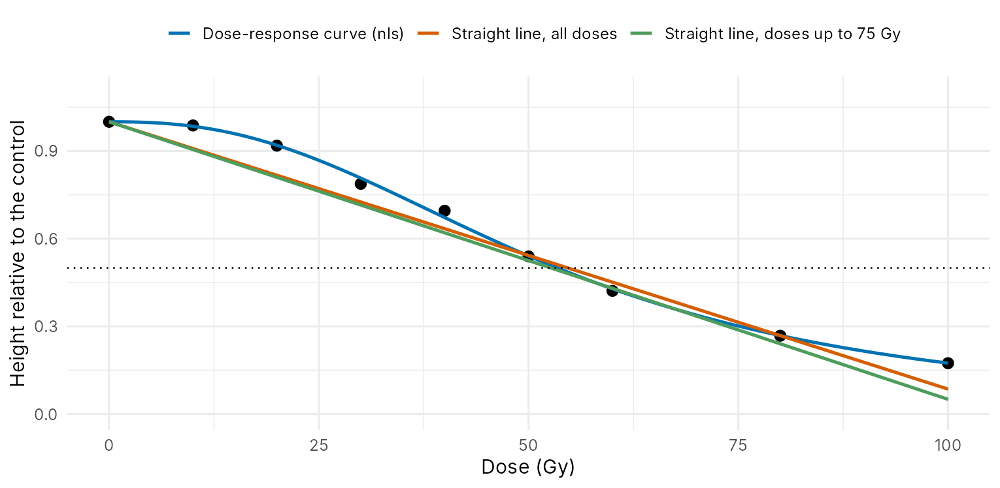{fig-align="center"}

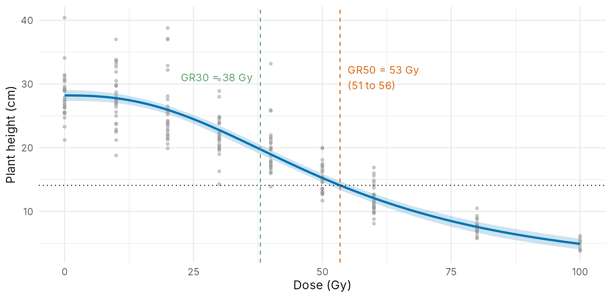{fig-align="center"}

In the chrysanthemum example GR50 is 53 Gy (95% interval 51 to 56), GR30 is 38 Gy and LD50 is 89 Gy (81 to 99).

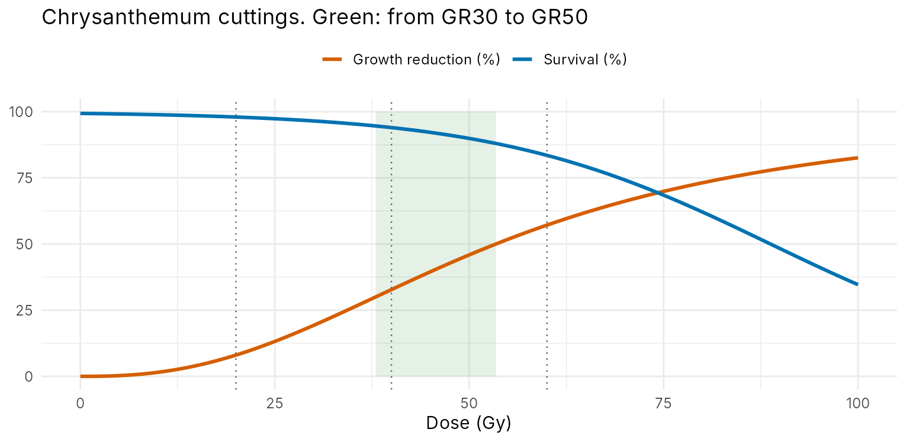{fig-align="center"}

Many programmes work with a dose between **GR30 and GR50** that still keeps good survival (about 90% here, 40 to 55 Gy). This is a **guide, not a rule**. Check the literature for your crop and confirm with the mutation frequency in the next generation. The GR50 depends on the trait: for fresh weight it is 39 Gy, lower than for height. Report the trait you used, or both.

The same code works for wheat seeds. The doses are different, the method is the same (GR50 = 216 Gy, LD50 = 348 Gy).

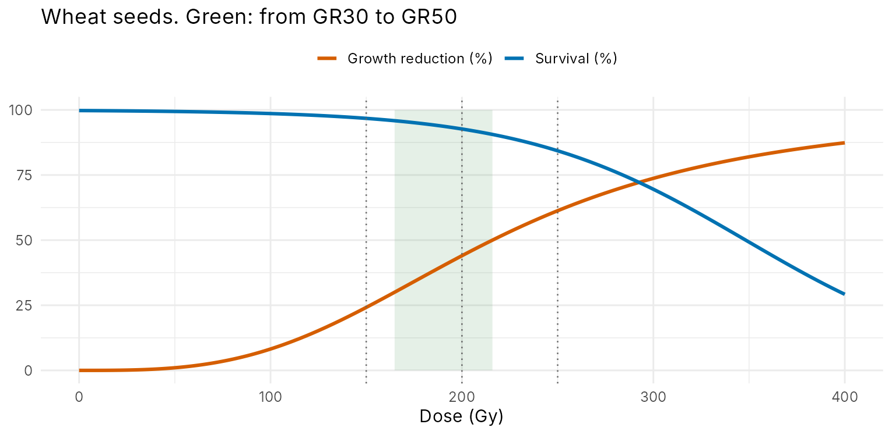{fig-align="center"}

## Interpretation for breeding decisions

- Keep **more lines** than you need when a line has one plot.
- Review the **outliers** before removing them. A line that is extreme in all its plots can be a potential mutant.
- Drop trials or traits with **low heritability** before the multi-environment step.
- Look at **G × E** before you select. Decide where the variety will be grown.
- Use an index that follows the **product profile**, and accept the uncertainty.
- Choose a dose with a **good effect on growth and good survival**.

## Exercise

1. Download `Mutant_pipeline_practical.zip`, run the pipeline for chrysanthemum and answer the 13 questions in the file.
2. Change one line to run it for wheat or bean. What changes?
3. Download `Radiosensitivity_practical.zip`, estimate GR50 and LD50 for chrysanthemum and for wheat, and choose a dose.

## Key takeaways

1. A mutant population needs the same statistics, with more care.
2. Explore and clean before you model.
3. Use `SpATS` and `lme4` in each trial and check the heritability.
4. The multi-environment model starts again from the plot data.
5. Study G × E and stability before choosing.
6. Choose the dose with a curve, not only a straight line, and report an interval.

## References

- Piepho, H.P. and Möhring, J. (2007). Computing heritability and selection response from unbalanced plant breeding trials. *Genetics* 177, 1881 to 1888.
- Rodríguez-Álvarez, M.X., Boer, M.P., van Eeuwijk, F.A. and Eilers, P.H.C. (2018). Correcting for spatial heterogeneity in plant breeding experiments with P-splines. *Spatial Statistics* 23, 52 to 71.
- Bates, D., Mächler, M., Bolker, B. and Walker, S. (2015). Fitting linear mixed-effects models using lme4. *Journal of Statistical Software* 67(1).
- Yan, W. and Kang, M.S. (2003). *GGE Biplot Analysis*. CRC Press.
