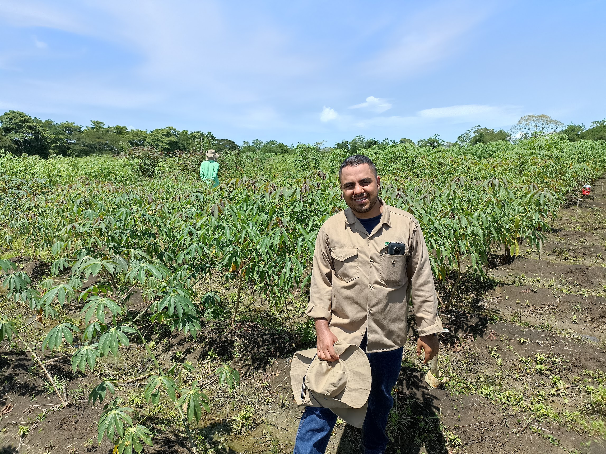
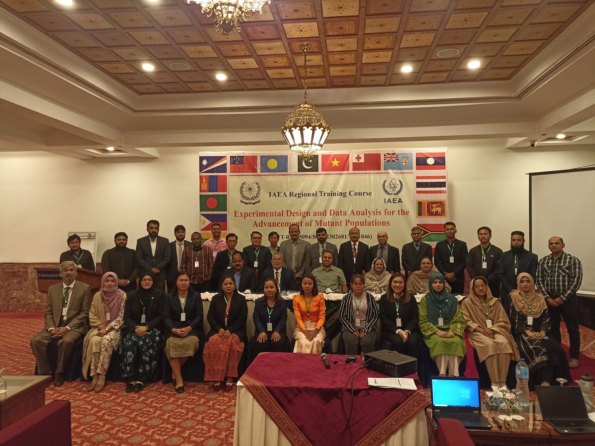
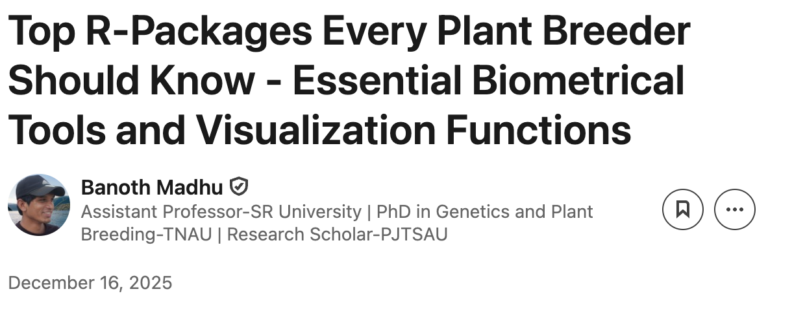
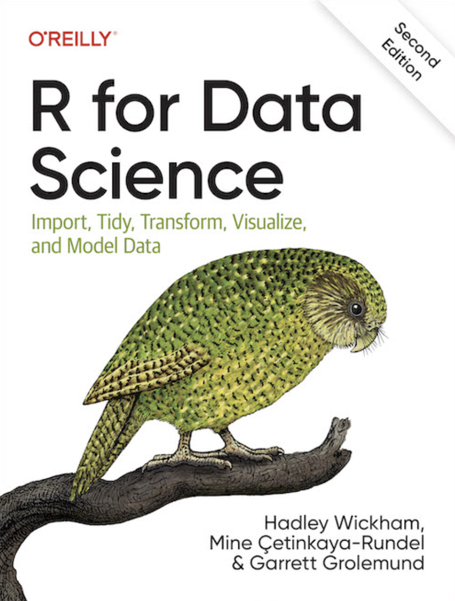

```{r}
#| label: setup
#| include: false
# run the code from the project folder, so paths like "data/..." work
knitr::opts_knit$set(root.dir = if (dir.exists("data")) "." else "..")
library(readr)
library(dplyr)
library(ggplot2)

theme_rtc <- theme_minimal(base_size = 14) +
  theme(panel.grid.minor = element_blank(),
        plot.title.position = "plot")
```

## About me

:::::: columns
:::: {.column width="35%"}
::: {.photo .tall}

:::
::::

::: {.column width="65%"}
**Luis Fernando Delgado Muñoz**, Cali, Colombia

- Agroindustrial Engineer and **MSc in Agricultural Sciences**, Universidad Nacional de Colombia, Palmira (Best Master Thesis Award, 2019)
- **Associate Professor**, Universidad de San Buenaventura Cali, Faculty of Engineering
- **Director of the Biological Engineering Program**, Universidad de San Buenaventura Cali
- **Lecturer of Experimental Design with R Programming**, Universidad Central del Valle del Cauca (since 2020)
- Working areas: experimental design, statistical modelling, data science and AI for agriculture
:::
::::::

------------------------------------------------------------------------

## Before: data science at CIAT

:::::: columns
::: {.column width="60%"}
**Data Scientist, Cassava Program**, Alliance of Bioversity International and CIAT (2022 to 2025)

- **50 years of historical trials** curated and analysed
- **Genetic gain** of all breeding populations (cassava, beans, rice and forages for CGIAR)
- **Standard analysis pipelines** from early trials to advanced yield trials
- **BioFlow**, analysis tools of the OneCG Breeding Analytics group

**Postharvest Quality Lab** (2020 to 2022): cassava cooking quality and the first sensory panel of the program
:::

:::: {.column width="40%"}
::: {.photo .short}

:::
::::
::::::

------------------------------------------------------------------------

## IAEA mission: Pakistan, 2023

:::::: columns
::: {.column width="50%"}
- Invited trainer of the **IAEA** in **Faisalabad** (November 2023)
- Short course on **Experimental Design and Data Analysis for advancing mutant plant breeding populations**
- Participants from **Southeast Asia, Samoa and Papua New Guinea**
- Same goal as this course: from field data to selection decisions in mutant populations
:::

:::: {.column width="40%"}
::: photo

:::
::::
::::::

------------------------------------------------------------------------

## Now it is your turn

In one minute, tell us:

::: incremental
1.  Your **name, institution and country**
2.  The **crop** you work with
3.  What **generation** of mutant material you are evaluating (M2, M3, M4...)
4.  **One problem** you have with your data today
:::

------------------------------------------------------------------------

## The course at a glance

| When | What |
|---------------------------|---------------------------------------------|
| **28 October**, online | Session 1: software setup and R basics (today) |
| **4 November**, online | Session 2: tidy data and digital data collection apps |
| **9 to 13 November**, Skopje | Week 1: field data, designs, ANOVA, mixed models, spatial analysis, imaging, G×E, machine learning |
| **16 to 20 November**, Skopje | Week 2: analysis pipeline, mutation breeding and **your own dataset** |

> The goal: at the end you analyse **your own data** and present a selection decision supported by statistics.

------------------------------------------------------------------------

## Plan for today (15:00 to 17:00 CEST)

| Activity                                                   |
|------------------------------------------------------------|
| Introductions                                              |
| **Block 1.** Installation check                            |
| **Blocks 2 to 5.** R concepts with plant breeding examples |
| **Live coding** in RStudio with the course data            |
| Homework and questions                                     |

------------------------------------------------------------------------

## Block 1 {.divider}

Installation check

------------------------------------------------------------------------

## What you need before we start

- [x] **R** (version 4.3 or newer) from <https://cran.r-project.org>
- [x] **RStudio Desktop** from <https://docs.posit.co/ide/user/download.html>
- [x] The **course packages** installed with `R/install_packages.R`
- [x] The **course repository** downloaded (datasets and scripts)
- [x] Free accounts in **two AI assistants** (ChatGPT, Claude, Gemini, DeepSeek or Qwen), used in week 2

::: keybox
Something failed? Write the error message in the chat. We solve it together after the session or on Day 1 at 08:00 (installation help desk).
:::

------------------------------------------------------------------------

## Installing the course packages

```{r}
#| eval: false
source("R/install_packages.R")   # installs only the missing packages
```

The script prints `OK` or `FAILED` for each package. The first installation can take 10 to 20 minutes.

. . .

**A plant breeding analogy:**

| Command | Analogy | How often |
|------------------------|------------------------------|------------------|
| `install.packages("dplyr")` | buying the seed | once per computer |
| `library(dplyr)` | sowing it in this season's trial | every R session |

------------------------------------------------------------------------

## Posit Cloud: RStudio in the browser

For computers with less than 4 GB of RAM or wit non administrator rights:

1.  Create a free account at <https://posit.cloud/plans/free>
2.  **New Project** then **New RStudio Project**
3.  Upload the course files with **Upload** (Files pane)
4.  Run `source("R/install_packages.R")`

**The free plan has limited memory and hours per month: enough for the course exercises, but it needs a stable internet connection.**

48 hours/month with 32 GB RAM, reset at midnight UTC.

------------------------------------------------------------------------

## Block 2 {.divider}

R and RStudio

------------------------------------------------------------------------

## Why R for plant breeding?

::::: columns
::: {.column width="50%"}
- **Free and open source**, used by breeding programs worldwide
- **Reproducible**: the script is the record of your analysis
- Packages built for breeders:
  - `FielDHub`: field designs and layouts
  - `lme4`, `emmeans`: mixed models, BLUEs and BLUPs
  - `SpATS`: spatial analysis of trials
  - `metan`, `statgenGxE`: G×E and stability
  - `pliman`: image analysis of plants
:::

::: {.column width="50%"}
**From field to decision in one script:**

1.  Field book (CSV or Excel)
2.  Quality control
3.  Statistical model
4.  Genotype means or BLUPs
5.  **Selection decision**
:::
:::::

------------------------------------------------------------------------

## R for plant breeding?

:::::: columns
:::: {.column width="60%"}
::: {style="text-align: justify;"}
Plant breeding is increasingly data-driven, leveraging multi-environment trials, genomic selection, QTL mapping, and mating designs like diallels and line × tester analyses.

R has emerged as an essential platform for breeders offering robust analytics, visualization, and reproducible workflows.

This document presents the top 10 R packages for plant breeding, including tools for correlations, heatmaps, plots, and regression trends in research.
:::
::::

::: {.column width="40%"}
[](https://www.linkedin.com/pulse/top-r-packages-every-plant-breeder-should-know-essential-madhu-uxkfc/) [Linked In post](https://www.linkedin.com/pulse/top-r-packages-every-plant-breeder-should-know-essential-madhu-uxkfc/){.uri}
:::
::::::

------------------------------------------------------------------------

## The RStudio interface

{fig-align="center" width="80%"}

Write your code in a **script** (File, New File, R Script) and run a line with **Ctrl + Enter** (Windows) or **Cmd + Enter** (macOS).

------------------------------------------------------------------------

## Projects and the working directory

The most common error for beginners:

```         
Error: cannot open file 'data.csv': No such file or directory
```

R is looking in the wrong folder. **Solution: always work inside an RStudio project.**

::::: columns
::: {.column width="50%"}
```         
rtc-course/
├── rtc-course.Rproj
├── data/      # raw data
├── R/         # scripts
└── output/    # tables and figures
```
:::

::: {.column width="50%"}
- File, New Project, New Directory
- Use **relative paths**: `"data/trial.csv"`
- Avoid `setwd("C:/Users/maria/Desktop")`: it only works on one computer
:::
:::::

------------------------------------------------------------------------

## Block 3 {.divider}

Objects and data structures

------------------------------------------------------------------------

## Objects and functions

:::::: columns
::: {.column width="55%"}
**Objects** store values. Create them with `<-`:

```{r}
plot_area_m2  <- 6     # harvested area of the plot
grain_kg      <- 2.7   # grain harvested in the plot
kg_m2_to_t_ha <- 10    # 1 kg/m² = 10 t/ha

yield_t_ha <- grain_kg / plot_area_m2 * kg_m2_to_t_ha
yield_t_ha
```

**Functions** do something with objects:

```{r}
round(yield_t_ha, 1)
```
:::

:::: {.column width="45%"}
**Your own function**, for every plot of the trial:

```{r}
to_t_ha <- function(grain_kg, area_m2) {
  grain_kg / area_m2 * 10
}

plots_kg <- c(2.7, 3.1, 2.2, 2.9)   # four plots
to_t_ha(plots_kg, area_m2 = 6)
```

::: keybox
Write the calculation **once**, apply it to **all plots**: no copying cells as in Excel.
:::
::::
::::::

------------------------------------------------------------------------

## Vectors: one trait, many plants

A **vector** holds values of the same type. Each column of a field book is a vector.

:::::: columns
::: {.column width="55%"}
```{r}
plant  <- c("M3-01", "M3-02", "M3-03", "M3-04", "M3-05")  # character
height <- c(92.5, 88.0, 101.3, 95.1, 84.7)                 # numeric (cm)

mean(height)
```

. . .

```{r}
short <- height < 90    # logical: TRUE / FALSE for each plant
short
plant[short]            # candidate semi-dwarf mutants
mean(short)             # proportion selected
```
:::

:::: {.column width="45%"}
| Type      | Example               |
|-----------|-----------------------|
| numeric   | `92.5`, `88.0`        |
| character | `"M3-01"`, `"Parent"` |
| logical   | `TRUE`, `FALSE`       |

. . .

::: keybox
**Truncation selection** in one line: keep the plants that pass a threshold. Here, 2 of 5 plants (**40%**) are selected.
:::
::::
::::::

------------------------------------------------------------------------

## Factors: genotypes, replicates and blocks

A **factor** is a vector of categories. Genotype, replicate, block, row and column **must be factors** in a model.

```{r}
rep <- c(1, 1, 2, 2, 3, 3)
class(rep)          # numeric: R would treat replicate 3 as "three times" replicate 1
rep <- factor(rep)
levels(rep)
```

::: keybox
If replicate is numeric, an ANOVA estimates **one slope** (1 degree of freedom) instead of **one effect per replicate** (2 degrees of freedom). The results are wrong without any error message.
:::

------------------------------------------------------------------------

## Matrices: a genotype × environment table

All values of the same type, arranged in rows and columns.

```{r}
gxe <- matrix(c(4.1, 3.8, 4.5,
                3.6, 3.9, 4.0,
                4.4, 3.2, 4.9),
              nrow = 3, byrow = TRUE,
              dimnames = list(c("M4-01", "M4-02", "Parent"),
                              c("Skopje", "Bitola", "Strumica")))
gxe
rowMeans(gxe)    # mean yield of each genotype across environments
```

------------------------------------------------------------------------

## Data frames: your field book in R

Each **row is a plot**, each **column is a variable**.

```{r}
field_book <- data.frame(
  plot  = 1:4,
  rep   = factor(c(1, 1, 2, 2)),
  geno  = c("M4-01", "Parent", "Parent", "M4-01"),
  yield = c(4.6, 4.3, 4.1, 4.9)
)
field_book
field_book[field_book$geno == "M4-01", ]
```

------------------------------------------------------------------------

## Block 4 {.divider}

Importing field data

------------------------------------------------------------------------

## The course datasets

| File | Content | Why we use it |
|----------------------|--------------------------|-------------------------|
| `precourse_trial.csv` | 10 M4 lines + parent + check, RCBD, 3 reps | Learning the basics |
| `precourse_trial_eu.csv` | Same data, `;` and decimal comma | European Excel files |
| `precourse_trial.xlsx` | Same data, Excel | Reading Excel |
| `Example_Beans.csv` | Real bean trial, 380 lines, 792 plots | Real data problems |
| `Example_rice.csv` | Rice trial, Latin-1 encoding | Accents and special letters |

------------------------------------------------------------------------

## Comma, semicolon and decimal mark

Many European versions of Excel save CSV files like this:

```         
"location";"year";"generation";"plot";"rep";...;"yield_t_ha"
"Skopje";2025;"M4";1;1;...;4,6
```

::::: columns
::: {.column width="50%"}
**Comma separator, decimal point**

```{r}
#| eval: false
trial <- read_csv("data/precourse_trial.csv")
```
:::

::: {.column width="50%"}
**Semicolon separator, decimal comma**

```{r}
#| eval: false
trial <- read_csv2("data/precourse_trial_eu.csv")
```
:::
:::::

Other combinations: `read_delim(file, delim = "\t", locale = locale(decimal_mark = ","))`

------------------------------------------------------------------------

## Reading and checking the practice trial

```{r}
trial <- read_csv("data/precourse_trial.csv")
glimpse(trial)
```

------------------------------------------------------------------------

## Accents and special letters: encoding

```{r}
rice <- read_csv("data/Example_rice.csv")
unique(rice$TRAT)        # accents are not displayed correctly
```

```{r}
rice <- read_csv("data/Example_rice.csv", locale = locale(encoding = "latin1"))
unique(rice$TRAT)
```

For names with č, š, ž or ğ saved in Central European Windows, use `encoding = "windows-1250"`. Best solution: save from Excel as **CSV UTF-8**.

------------------------------------------------------------------------

## A real trial: common bean, Colombia, 2016

```{r}
beans <- read_csv("data/Example_Beans.csv")
dim(beans)
colSums(is.na(beans))[10:18]   # missing values per trait
```

- **380 lines**, alpha-lattice with **2 replicates**, 18 incomplete blocks of 22 plots
- Field grid of **66 rows × 12 columns**
- 16 lines repeated in each replicate as **checks**

------------------------------------------------------------------------

## Checklist for any new data file

::: incremental
1.  Read the file and check the dimensions: `dim()`
2.  Check column names and types: `glimpse()`
3.  Count missing values per column: `colSums(is.na())`
4.  Convert design variables to factors
5.  Check repeated genotypes and balance across replicates
6.  Check that names and accents are displayed correctly
:::

------------------------------------------------------------------------

## Block 5 {.divider}

Data manipulation and a first plot

------------------------------------------------------------------------

## Five verbs of `dplyr`

| Verb | What it does | Breeding example |
|------------------|--------------------------|----------------------------|
| `select()` | keep columns | keep design columns and yield |
| `filter()` | keep rows | plots of the parent only |
| `mutate()` | create columns | yield in kg/ha |
| `arrange()` | sort rows | rank genotypes by yield |
| `group_by()` + `summarise()` | summaries by group | mean yield per genotype |

The **pipe** `|>` reads as "and then" (Ctrl/Cmd + Shift + M).

------------------------------------------------------------------------

## Which lines beat the parent?

```{r}
geno_means <- trial |>
  group_by(geno, check) |>
  summarise(n = sum(!is.na(yield_t_ha)),
            yield = mean(yield_t_ha, na.rm = TRUE), .groups = "drop") |>
  arrange(desc(yield))

parent_yield <- geno_means |> filter(geno == "Parent") |> pull(yield)

geno_means |> filter(check == "no", yield > parent_yield)
```

. . .

> Two of these lines have more than 0.5 t/ha over the parent. **Is the difference real or noise?** That question is the reason for Days 2 and 3 (ANOVA, Dunnett test and mixed models).

------------------------------------------------------------------------

## A first plot with `ggplot2`

**data** + **aesthetics** `aes()` + **geometry** `geom_...()`

```{r}
#| fig-width: 10
#| fig-height: 4
ggplot(trial, aes(x = geno, y = yield_t_ha)) +
  geom_boxplot(fill = "#EAD9BC") +
  geom_point(colour = "#1F3A5F") +
  labs(x = "Genotype", y = "Grain yield (t/ha)") +
  theme_rtc
```

------------------------------------------------------------------------

## The bean trial as a field map

```{r}
#| fig-width: 11
#| fig-height: 3.6
beans |>
  ggplot(aes(x = row, y = col, fill = YdHa_clean)) +
  geom_tile() +
  scale_fill_viridis_c() +
  coord_equal() +
  labs(x = "Row", y = "Column", fill = "Yield\n(kg/ha)") +
  theme_rtc
```

Patterns in the field are the reason to use **blocks** (Day 2) and **spatial models** (Day 4).

------------------------------------------------------------------------

## Live coding {.divider}

Let's open RStudio

[We now run the code of the course manual, chapter 1, step by step with the course data.]{.small-note}

------------------------------------------------------------------------

## Homework before Session 2

Use `data/precourse_trial.csv` inside an RStudio project:

1.  Import `precourse_trial_eu.csv` and check that `yield_t_ha` is numeric
2.  How many plots have a missing `disease_score`?
3.  Mean days to flowering per genotype, sorted from early to late
4.  Mutant lines (not the parent or check) with a mean yield higher than the parent
5.  A boxplot of disease score by replicate

Solutions are in the course manual, chapter 1.

------------------------------------------------------------------------

## Next session: 4 November

- **15:00 to 17:00 CEST**, online
- **Preparing your data in tidy format**: one row per plot, one column per variable
- Mandatory metadata: location, year, generation, design, replicate, block, row, column, genotype, check
- **Field Book** and **GridScore NEXT** apps for digital data collection
- **Bring one of your datasets**: we review real examples together

------------------------------------------------------------------------

## Resources

::::: columns
::: {.column width="55%"}
- **R for Data Science**, 2nd edition: <https://r4ds.hadley.nz>
- **RStudio User Guide**: <https://docs.posit.co/ide/user>
:::

::: {.column width="45%"}
{width="70%"}
:::
:::::

------------------------------------------------------------------------

## Thank you! {.divider}

**Luis Fernando Delgado Muñoz**

[📧 [lfdelgadom@unal.edu.co](mailto:lfdelgadom@unal.edu.co)]{.small-note}

[💼 [linkedin.com/in/lfdelgadom](https://www.linkedin.com/in/lfdelgadom)]{.small-note}