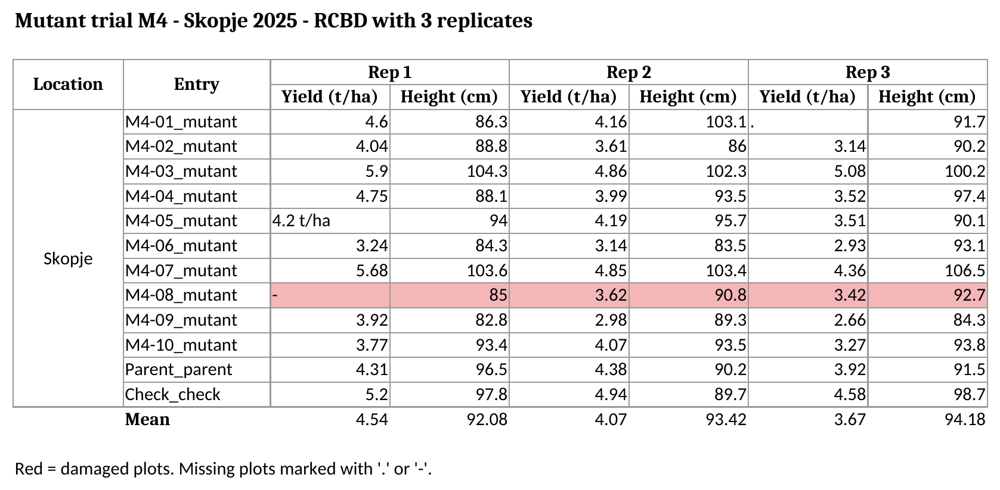

```{r}
#| label: setup
#| cache: false
#| include: false
# run the code from the project folder, so paths like "data/..." work
knitr::opts_knit$set(root.dir = if (dir.exists("data")) "." else "..")
library(readr)
library(readxl)
library(dplyr)
library(tidyr)
```

## Plan for today (15:00 to 17:00 CET)

| Time | Activity |
|-----------------|---------------------------------------|
| 0:00 to 0:10 | Welcome and questions from Session 1 |
| 0:10 to 1:15 | **Blocks 1 to 5.** Messy and tidy data, from messy to tidy in R, the course template |
| 1:15 to 1:45 | **Block 6.** Digital data collection: Field Book and GridScore NEXT |
| 1:45 to 2:00 | Homework, your dataset and questions |

::: keybox
**Goal of today:** every participant leaves knowing how to prepare **their own dataset** for the course.
:::

------------------------------------------------------------------------

## Block 1 {.divider}

Why data organization matters

------------------------------------------------------------------------

## Most of the work is before the statistics

:::::: columns
::: {.column width="50%"}
A field book that is easy to read for a **person** (titles, merged cells, colours, totals) is usually very hard to read for a **computer**.

- **Lost time:** hours of copying and reshaping before any analysis
- **Silent errors:** results that look fine but are wrong
- **No record:** manual changes in Excel cannot be repeated or checked
:::

:::: {.column width="50%"}
::: keybox
If the data are organized well **when they are recorded**, the analysis in R is a few lines of code.
:::
::::
::::::

------------------------------------------------------------------------

## A silent error: a missing plot typed as 0

Three plots of the same mutant line. The third plot was lost.

::::: columns
::: {.column width="50%"}
**Missing plot typed as `0`**

```{r}
yield <- c(4.6, 4.2, 0)
mean(yield)
```
:::

::: {.column width="50%"}
**Missing plot left empty (`NA`)**

```{r}
yield <- c(4.6, 4.2, NA)
mean(yield, na.rm = TRUE)
```
:::
:::::

. . .

> With the `0`, the mean drops from 4.4 to 2.9 t/ha: the line looks **a third worse** than it is, and could be discarded. No error message warns you.

------------------------------------------------------------------------

## Block 2 {.divider}

What messy data looks like

------------------------------------------------------------------------

## The Session 1 trial, written as a typical field book

{fig-align="center" width="95%"}

File: `data/messy_trial.xlsx`. Clear for a person... but R cannot read it.

------------------------------------------------------------------------

## Seven problems in one sheet

| Problem | In the example | Why it is a problem |
|---------------------|-----------------------|----------------------------|
| **Title above the header** | Row 1 | R takes it as the column name |
| **Double header** | Replicate on top, trait below | R needs one row of names |
| **Merged cells** | `Location`, `Rep 1`, `Rep 2`, `Rep 3` | The other cells are read as empty |
| **One variable in several columns** | Yield and height for each replicate | The replicate is hidden in the names |
| **Two variables in one column** | `M4-01_mutant` | Cannot filter by genotype or type |
| **Units and codes in cells** | `4.2 t/ha`, `.`, `-` | The column becomes text |
| **Colours, comments, summary rows** | Red row, comment, `Mean` | Lost when reading, or read as a plot |

::: notes
Also frequent: dates in different formats, several tables in one sheet, the same genotype written in different ways (M4-01, M4 01, m4-01).
:::

------------------------------------------------------------------------

## A warning from real life

:::::: columns
::: {.column width="55%"}
**Never save a course CSV file from Excel.**

A bean trial file was opened and saved in Excel with European settings:

```         
before:  ...,109.512,938.067907,1013.11334
after:   ...;109.512;938.067.907;101.311.334
```

The separators changed and the **numbers were destroyed**.
:::

:::: {.column width="45%"}
::: keybox
To look at a CSV file:

- open it in RStudio (**View File**), or
- run `View(data)` in R, or
- close Excel **without saving**
:::
::::
::::::

------------------------------------------------------------------------

## Block 3 {.divider}

The three rules of tidy data

------------------------------------------------------------------------

## Tidy data (R for Data Science)

::: incremental
1.  **Each variable is a column**, and each column is one variable
2.  **Each observation is a row**, and each row is one observation
3.  **Each value is a cell**, and each cell contains one value
:::

. . .

::: keybox
In a field trial, the observation is usually **the plot**: one row per plot, one column for each design variable (location, replicate, block, row, column, genotype) and each trait.
:::

Wickham, Çetinkaya-Rundel & Grolemund (2023), chapter *Data tidying*: <https://r4ds.hadley.nz/data-tidy.html>

------------------------------------------------------------------------

## The same trial, tidy

```{r}
trial <- read_csv("data/precourse_trial.csv")
trial |>
  select(location, rep, row, col, geno, check, yield_t_ha, plant_height_cm) |>
  head(6)
```

- The replicate is now a **column**, not part of the column names
- 12 genotypes × 3 replicates = **36 rows**, one per plot
- The model formula comes directly from the names: `yield_t_ha ~ rep + geno`

------------------------------------------------------------------------

## Long or wide?

::::: columns
::: {.column width="50%"}
**Long (tidy): store and analyse**

```{r}
trial |>
  select(geno, rep, yield_t_ha) |>
  arrange(geno) |>
  head(4)
```
:::

::: {.column width="50%"}
**Wide: present results**

```{r}
trial |>
  select(geno, rep, yield_t_ha) |>
  pivot_wider(names_from = rep,
              values_from = yield_t_ha,
              names_prefix = "rep_") |>
  head(3)
```
:::
:::::

------------------------------------------------------------------------

## Block 4 {.divider}

From messy to tidy in R

------------------------------------------------------------------------

## Step 1. Look at the sheet as R sees it

```{r}
raw <- read_excel("data/messy_trial.xlsx", col_names = FALSE,
                  .name_repair = "minimal")
head(raw, 8)
```

Title, empty row, two header rows and merged cells (`NA`) are all visible.

------------------------------------------------------------------------

## Step 2. Read only the data, with clear names

```{r}
trial_wide <- read_excel(
  "data/messy_trial.xlsx",
  range     = "A5:H16",                     # only the plot data
  col_names = c("location", "entry",
                "R1_yield", "R1_height", "R2_yield", "R2_height",
                "R3_yield", "R3_height"),
  na        = c("", ".", "-")               # the missing-value codes
)
head(trial_wide, 4)
```

------------------------------------------------------------------------

## Steps 3 to 5. Merged cells, units and combined columns

```{r}
trial_wide <- trial_wide |>
  fill(location) |>                                   # 3. merged cells
  mutate(R1_yield = parse_number(R1_yield)) |>        # 4. "4.2 t/ha" -> 4.2
  separate_wider_delim(entry, delim = "_",            # 5. "M4-01_mutant"
                       names = c("geno", "type"))
trial_wide |> select(location, geno, type, R1_yield) |> head(5)
```

------------------------------------------------------------------------

## Step 6. One row per plot: `pivot_longer()`

```{r}
trial_tidy <- trial_wide |>
  pivot_longer(cols      = starts_with("R"),
               names_to  = c("rep", ".value"),    # "R1" -> rep, "yield" -> column
               names_sep = "_") |>
  mutate(rep = parse_number(rep)) |>
  rename(yield_t_ha = yield, plant_height_cm = height)
head(trial_tidy, 6)
dim(trial_tidy)
```

------------------------------------------------------------------------

## Step 7. Did we recover the original data?

```{r}
clean <- trial |> select(geno, rep, yield_t_ha, plant_height_cm)
anti_join(clean, trial_tidy,
          by = c("geno", "rep", "yield_t_ha", "plant_height_cm"))
```

. . .

**0 rows: the two datasets are identical.**

::: keybox
The red row and the comment (*M4-08 damaged by hail*) **cannot be recovered**. Store that information as data: a column `damaged` with `yes` / `no`.
:::

------------------------------------------------------------------------

## The toolbox

| Problem | Solution in R |
|--------------------------------|----------------------------------------|
| Title, headers, summary rows | `read_excel(range = "A5:H16")` or `skip =` |
| Missing-value codes | `read_excel(na = c("", ".", "-"))` |
| Merged cells | `tidyr::fill()` |
| Units inside cells | `readr::parse_number()` |
| Two variables in one column | `tidyr::separate_wider_delim()` |
| One variable in several columns | `tidyr::pivot_longer()` |
| A wide table for a report | `tidyr::pivot_wider()` |

. . .

> R can fix a messy file, but it is much better to **record the data tidy from the beginning**.

------------------------------------------------------------------------

## Block 5 {.divider}

Your data: template, metadata and dictionary

------------------------------------------------------------------------

## The course template: rules

File: `data/template_field_book.xlsx`, with three sheets: `instructions`, `field_book` and `dictionary`.

- Header in **row 1 only**, no titles above it
- **No merged cells**: repeat the value in every row
- **Only numbers** in trait columns; the unit goes in the name (`yield_t_ha`)
- **Leave missing values empty**: not `.`, `-`, `NA` or `0`
- **No colours or comments** as information: add a column
- **No totals or means** inside the data
- Names in lower case, without spaces or accents
- Genotype names **always written the same way**

------------------------------------------------------------------------

## The course template: columns

One row per plot, with these columns:

::::: columns
::: {.column width="50%"}
| Column       | Example       |
|--------------|---------------|
| `location`   | Skopje        |
| `year`       | 2025          |
| `trial`      | M4_yield_2025 |
| `generation` | M4            |
| `design`     | RCBD          |
| `plot`       | 17            |
:::

::: {.column width="50%"}
| Column       | Example      |
|--------------|--------------|
| `rep`        | 2            |
| `block`      | 5            |
| `row`, `col` | 3, 8         |
| `geno`       | M4-07        |
| `check`      | yes / no     |
| traits       | `yield_t_ha` |
:::
:::::

------------------------------------------------------------------------

## Why the metadata matter

Each design column becomes a **term of the statistical model**:

| Column | Used for |
|--------------------|----------------------------------------------------|
| `rep`, `block` | Separating environmental from genetic variation (Days 2 and 3) |
| `row`, `col` | Spatial analysis of field trends (Day 4) |
| `location`, `year` | Multi-environment trials and G×E (Day 5) |
| `generation`, `check` | Mutant lines vs parent (Dunnett test, Day 2) and advancement decisions (week 2) |

. . .

::: keybox
A trial without `row` and `col` cannot be corrected for spatial trends. A trial without `rep` cannot be analysed as a designed experiment. **Record them in the field.**
:::

------------------------------------------------------------------------

## The data dictionary

Is `DF` days to flowering or dry fruit weight? A **data dictionary** describes every column (file `data/precourse_trial_dictionary.csv`).

```{r}
#| echo: false
dictionary <- read_csv("data/precourse_trial_dictionary.csv", na = character())
dictionary |>
  filter(variable %in% c("rep", "geno", "yield_t_ha", "plant_height_cm", "disease_score")) |>
  select(variable, description, unit, values_or_scale) |>
  knitr::kable()
```

For scores, write what each value means: **1 = no symptoms, 9 = very severe**.

------------------------------------------------------------------------

## Check your file: `check_dataset()`

```{r}
#| eval: false
source("R/check_dataset.R")
check_dataset("data/my_trial.csv")      # or an Excel file
```

Result for the messy field book (only the problem lines):

```{r}
#| echo: false
source("R/check_dataset.R")
out <- capture.output(check_dataset("data/messy_trial.xlsx"))
cat(grep("\\[!\\]|problem\\(s\\)", out, value = TRUE), sep = "\n")
```

**Correct every `[!]` line** before sending your data. The clean trial gives *"No problems found. Your file looks tidy."*

------------------------------------------------------------------------

## Block 6 {.divider}

Digital data collection: Field Book and GridScore NEXT

------------------------------------------------------------------------

## Recording data on the phone

|   | Field Book | GridScore NEXT |
|-----------------|---------------------------|---------------------------|
| Developed by | PhenoApps (open source) | James Hutton Institute (open source) |
| Devices | Android | Any device with a web browser; works offline |
| Field layout | Imported from a CSV file | A grid of rows and columns |

**Workflow:**

1.  Generate the field layout with **FielDHub** (Day 2): `plot`, `rep`, `row`, `col`, `geno`
2.  Import the layout into the app
3.  Define the traits with type, unit and **valid range** (from your data dictionary)
4.  Collect the data plot by plot
5.  Export, read in R and check with `check_dataset()`

------------------------------------------------------------------------

## Homework: prepare your dataset

::: incremental
1.  Organize one of your datasets with `template_field_book.xlsx`: **one row per plot**
2.  Complete the `dictionary` sheet: description, unit and scale of every column
3.  Save the field book as **CSV UTF-8** and run `check_dataset()`
4.  Correct every `[!]` line
5.  **Send the file and the dictionary to the instructors before 9 November**
:::

. . .

Exercises with solutions: course manual, chapter 2.

------------------------------------------------------------------------

## Before we meet in Skopje

- [x] R, RStudio and the course packages installed (`source("R/install_packages.R")`)
- [x] Session 1 homework done
- [x] Your dataset in the template, checked and **sent**
- [x] Free accounts in two AI assistants
- [x] An Android phone with **Field Book**, or any phone with **GridScore NEXT**

::: keybox
**Day 1: Monday 9 November, 08:00**, installation help desk. Opening session at 08:30.
:::

------------------------------------------------------------------------

## Resources

- **Course manual**, chapter 2: theory, code and exercises of this session
- **R for Data Science**, chapter *Data tidying*: <https://r4ds.hadley.nz/data-tidy.html>
- Broman, K. W. & Woo, K. H. (2018). Data organization in spreadsheets. *The American Statistician*, 72(1), 2-10. <https://doi.org/10.1080/00031305.2017.1375989>
- Field Book: <https://github.com/PhenoApps/Field-Book>
- GridScore NEXT: <https://github.com/cropgeeks/gridscore-next-client>

------------------------------------------------------------------------

## Thank you! {.divider}

**Luis Fernando Delgado Muñoz**

[📧 [lfdelgadom\@unal.edu.co](mailto:lfdelgadom@unal.edu.co)]{.small-note}

[💼 [linkedin.com/in/lfdelgadom](https://www.linkedin.com/in/lfdelgadom)]{.small-note}
