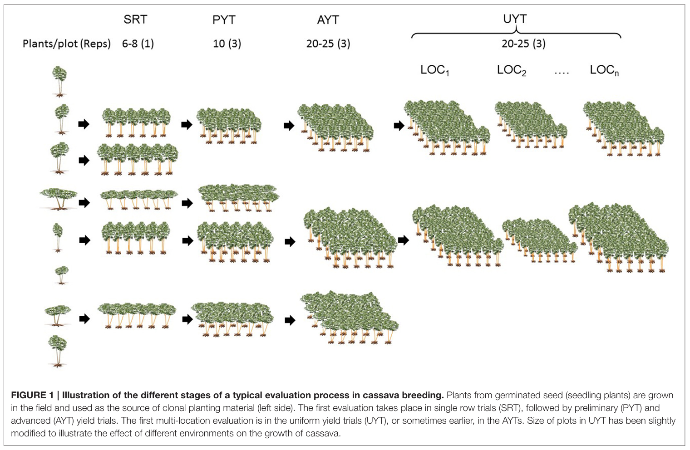

```{r}
#| label: setup
#| cache: false
#| include: false
knitr::opts_knit$set(root.dir = if (dir.exists("data")) "." else "..")
library(dplyr)
library(tidyr)
library(ggplot2)
library(lme4)
library(emmeans)
library(agridat)
library(FielDHub)
library(cowplot)
theme_set(theme_minimal(base_size = 14))
```

```{r}
#| label: schematics
#| cache: false
#| include: false
source("R/design_schematics.R")   # small schematic layouts used in Block 2
theme_set(theme_minimal(base_size = 14))
```

## Content

| Block | Topic |
|------------------|------------------------------------------------------|
| 1 | Why experimental design matters: replication, randomization, local control |
| 2 | The main designs, and the alpha-lattice in plain words |
| 3 | Three words we need: variance, residual variance, SED |
| 4 | Comparing designs on a real field (uniformity trial) |
| 5 | Early generations: augmented vs p-rep |
| 6 | Choosing a design and **FielDHub practical** (after the break) |

::: keybox
**Goal:** leave able to choose a design for your own trial and generate its layout in FielDHub. This afternoon: how to analyse it.
:::

------------------------------------------------------------------------

## Before we start (10 minutes)

1.  Download the exercise folder: [**Day 2 morning exercises (ZIP)**](../downloads/Day2_morning_design_layouts.zip)
2.  Unzip it (do not work inside the ZIP)
3.  Open `Day2_morning.Rproj` in RStudio
4.  Run `00_install_packages.R` and **let it run while we talk**: FielDHub takes a few minutes to install

::: keybox
After the break we start coding with these files. They are your own copy, separate from the course project, so a Git update never clashes with your work.
:::

------------------------------------------------------------------------

## Block 1 {.divider}

Why design matters

------------------------------------------------------------------------

## Three principles (Fisher, 1920s)

| Principle | What it means | Why |
|:-----------------------|:-----------------------|:-----------------------|
| **Randomization** | Assigns experimental units to treatments at random | Prevents systematic advantage and supports a valid estimate of experimental error |
| **Blocking** | Groups similar experimental units together | Controls for known sources of variation |
| **Replication** | Repeats each treatment enough times | Allows experimental error to be estimated and improves the precision of treatment means |

------------------------------------------------------------------------

## A field without genotypes

::::: columns
::: {.column width="40%"}
A **uniformity trial** uses one variety sown everywhere.

Therefore, every observed difference is due to the **field**, not the genotype.

[Williams and Luckett (1988), barley uniformity trial, 720 plots, `agridat::williams.barley.uniformity`]{style="font-size: 0.6em;"}
:::

::: {.column width="60%"}
```{r}
#| label: williams
#| echo: false
#| warning: false
#| message: false
#| fig-width: 7
#| fig-height: 4.5
#| out-width: "100%"

williams <- williams.barley.uniformity |>
  mutate(yield = yield / 100)  # t/ha

ggplot(williams, aes(col, row, fill = yield)) +
  geom_tile() +
  scale_fill_viridis_c() +
  coord_equal() +
  labs(
    x = "Column",
    y = "Row",
    fill = "t/ha"
  )
```
:::
:::::

------------------------------------------------------------------------

## Spatial variation in the field

A LOESS surface reveals gradual spatial variation across the field.

```{r}
#| label: w3d-interactive
#| echo: false
#| warning: false
#| message: false

library(agridat)
library(dplyr)
library(tidyr)
library(plotly)
library(viridisLite)

w3d <- agridat::williams.barley.uniformity |>
  mutate(yield_t_ha = yield / 100)

model <- loess(
  yield_t_ha ~ col * row,
  data = w3d,
  span = 0.15
)

w3d <- w3d |>
  mutate(fit = predict(model))

surface_data <- w3d |>
  select(row, col, fit) |>
  arrange(row, col) |>
  pivot_wider(
    names_from = col,
    values_from = fit
  )

y_values <- surface_data$row
x_values <- as.numeric(names(surface_data)[-1])
z_values <- as.matrix(surface_data[, -1])

plot_ly(
  x = x_values,
  y = y_values,
  z = z_values,
  type = "surface",
  colors = viridisLite::viridis(100),
  colorbar = list(
    title = "Yield<br>(t/ha)",
    thickness = 12,
    len = 0.65
  ),
  hovertemplate = paste(
    "Column: %{x}",
    "<br>Row: %{y}",
    "<br>Yield: %{z:.2f} t/ha",
    "<extra></extra>"
  )
) |>
  layout(
    scene = list(
      xaxis = list(title = "Column"),
      yaxis = list(title = "Row"),
      zaxis = list(title = "Yield (t/ha)"),
      camera = list(
        eye = list(x = 1.5, y = -1.6, z = 1.1)
      ),
      aspectratio = list(
        x = 2.4,
        y = 1,
        z = 0.8
      )
    ),
    margin = list(l = 0, r = 0, b = 0, t = 0)
  ) |>
  config(
    displaylogo = FALSE,
    scrollZoom = TRUE,
    responsive = TRUE
  )
```

------------------------------------------------------------------------

## How big is the field variation?

```{r}
williams |> summarise(min = min(yield), max = max(yield), sd = sd(yield))
```

- One variety: **1.45 to 3.29 t/ha**, SD 0.29 t/ha
- Two genotypes that are different by 0.3 t/ha could easily be switched up based on where they're located.
- Neighbouring plots are **more similar** than distant ones
- Variation is **not the same in rows and in columns**

::: keybox
Field variation is the noise in which we look for genetic differences.
:::

------------------------------------------------------------------------

## Variation caused by management

```{r, echo=FALSE}
#| label: seeder
#| fig-align: center
williams |>
  group_by(col) |>
  summarise(yield = mean(yield)) |>
  mutate(position = factor((col - 1) %% 3 + 1)) |>
  ggplot(aes(col, yield)) +
  geom_line(colour = "grey60") +
  geom_point(aes(colour = position), size = 2.5) +
  labs(x = "Column", y = "Mean yield (t/ha)", colour = "Position in\nseeder pass")
```

Sown with a **three-plot seeder**: first-position columns yield about 0.1 to 0.2 t/ha less. Small blocks can capture this; large blocks cannot.

::: keybox
This trial shows that a field that looks the same might not be the same. Some of that variation may be caused by the machinery. So, when we compare different genotypes later, we need to make sure the groups are random, that we have multiple replicates, and that we have blocks to avoid mixing up the effect of management or location with the genetic effect.
:::

------------------------------------------------------------------------

## Breeding trials are special

- **Many entries**: 100 to thousands of lines, not 4 treatments
- **Costly replication**: in early generations, seed for **one plot** only
- **Heterogeneous field** in more than one direction

::: keybox
300 genotypes in a complete block = a block too large to be uniform.\
Solution: **incomplete blocks**, smaller than the number of genotypes.
:::

------------------------------------------------------------------------

## Different stages of a typical evaluation process in cassava breeding. 

[](https://doi.org/10.3389/fpls.2016.01227)

------------------------------------------------------------------------

## Block 2 {.divider}

The main designs

------------------------------------------------------------------------

## Classical designs

| Design | Structure | Use in breeding |
|--------------------|-------------------------|--------------------------|
| **CRD** | Random allocation, no blocks | Uniform conditions only: growth chamber, some greenhouse trials |
| **RCBD** | Every block has every genotype once | Few genotypes (up to about 20 to 30), advanced trials |
| **Augmented** | New lines in 1 plot, checks in every block | Early generations, many lines |

------------------------------------------------------------------------

## Classical designs on the field

```{r}
#| label: classical-layouts
#| echo: false
#| fig-width: 10
#| fig-height: 3
plot_grid(p_crd, p_rcbd, p_aug, nrow = 1, rel_widths = c(1, 1, 1.25))
```

Each box is a plot; letters are genotypes (schematic examples).

- **CRD:** genotypes anywhere, no blocks
- **RCBD:** each block (here a row) has every genotype once
- **Augmented:** checks A and B in every block; each new line (n) in one plot only

------------------------------------------------------------------------

## Designs with incomplete blocks

| Design | Blocks in | Complete replicates (resolvable) |
|----|----|----|
| **Alpha-lattice** | One direction | Yes |
| **Row-column** | Rows and columns | No |
| **Resolvable row-column** | Rows and columns | Yes |
| **p-rep** | Rows, columns, spatial terms | No |

- **Alpha-lattice:** t = s x k entries, s blocks of k plots per replicate (Patterson and Williams, 1976)
- **Row-column:** every row and every column is an incomplete block
- **p-rep:** only a fraction of the lines replicated (Cullis et al., 2006)

------------------------------------------------------------------------

## Incomplete blocks on the field

```{r}
#| label: incomplete-layouts
#| echo: false
#| fig-width: 11
#| fig-height: 3.1
plot_grid(p_alpha, p_rowcol, p_rrc, p_prep, nrow = 1, rel_widths = c(1.15, 1.2, 1.1, 1.2))
```

Numbers are entries (schematic examples). Thick black line: replicate. Thin blue line: incomplete block. Orange: one row and one column.

- **Alpha-lattice:** each replicate is cut into small blocks
- **Row-column:** every row and every column is a block
- **p-rep:** dark plots are lines in two plots, light plots are lines in one plot

------------------------------------------------------------------------

## Alpha-lattice in plain words

```{r}
#| label: alpha-john
#| echo: false
#| fig-width: 11
#| fig-height: 3.3
p_john
```

-   **t**: the number of entries (genotypes). Here t = 24
-   **k**: plots per incomplete block, the block size. Here k = 4
-   **s**: blocks per replicate, s = t / k. Here s = 6
-   **r**: the number of replicates. Here r = 3
-   **Total plots**: t × r = 72

[This is the real oat trial of the exercise this afternoon (`john.alpha`).]{.small-note}

------------------------------------------------------------------------

## Incomplete and resolvable

-   **Incomplete block:** a block that holds only some of the genotypes, 4 of the 24. Blocks stay small and uniform, but each one has only a few genotypes.
-   **Resolvable:** every replicate still contains all 24 genotypes, so each replicate can be treated as a complete block. The blocks inside it are the incomplete ones.

::: keybox
In FielDHub: `alpha_lattice(t = 24, k = 4, r = 3)`. **t must be divisible by k.** (We try k = 5 in the exercise and see what happens.)
:::

------------------------------------------------------------------------

## Every design has its model

Each restriction of the randomization (replicate, block, row, column) becomes **one term** in the model of the trial.

-   *Y*: observed response of a plot, for example yield (t/ha)
-   *μ*: overall mean of the trial
-   *G*<sub>k</sub>: effect of **genotype** k. This is what we compare.
-   *R*<sub>i</sub>: effect of **replicate** i
-   *B*<sub>j(i)</sub>: effect of **incomplete block** j inside replicate i. "j(i)" reads "j within i".
-   *Row*<sub>j(i)</sub>, *Col*<sub>l(i)</sub>: effect of **row** j and **column** l inside replicate i
-   *ε*: **experimental error**: what the model cannot explain

::: keybox
*G* is what we compare. *R*, *B*, *Row* and *Col* are there to remove field variation, so the comparison between genotypes is fairer.
:::

------------------------------------------------------------------------

## Models of the classical designs

**CRD:** *Y*<sub>ik</sub> = *μ* + *G*<sub>k</sub> + *ε*<sub>ik</sub>

-   No block: genotype k in plot i, anywhere in the field. All the field variation goes to the error.

**RCBD:** *Y*<sub>ik</sub> = *μ* + *R*<sub>i</sub> + *G*<sub>k</sub> + *ε*<sub>ik</sub>

-   *R*<sub>i</sub> is the complete block (replicate) i. It removes the differences between blocks.

**Augmented:** *Y*<sub>jk</sub> = *μ* + *B*<sub>j</sub> + *G*<sub>k</sub> + *ε*<sub>jk</sub>

-   *B*<sub>j</sub> is block j (or rows and columns when the layout is a grid). *G*<sub>k</sub> covers the checks and the new lines. The repeated checks give the estimate of the error.

------------------------------------------------------------------------

## Models: incomplete-block designs

**Alpha-lattice:** *Y*<sub>ijk</sub> = *μ* + *R*<sub>i</sub> + *B*<sub>j(i)</sub> + *G*<sub>k</sub> + *ε*<sub>ijk</sub>

-   Replicate i, and incomplete block j **within** replicate i.

**Resolvable row-column:** *Y*<sub>ijlk</sub> = *μ* + *R*<sub>i</sub> + *Row*<sub>j(i)</sub> + *Col*<sub>l(i)</sub> + *G*<sub>k</sub> + *ε*<sub>ijlk</sub>

-   Rows and columns are blocks in two directions, both **within** the replicate.

**p-rep:** *Y*<sub>jlk</sub> = *μ* + *Row*<sub>j</sub> + *Col*<sub>l</sub> + *G*<sub>k</sub> + *ε*<sub>jlk</sub>

-   One field without replicates: rows and columns of the whole field. The lines in two plots give the error.

::: small-note
This afternoon each model becomes a line of R code.
:::

------------------------------------------------------------------------

## Block 3 {.divider}

Three words we need

------------------------------------------------------------------------

## Variance: how spread out are the values?

```{r}
#| label: var-demo
#| echo: false
#| fig-height: 3.1
set.seed(11)
s20 <- williams |> slice_sample(n = 20) |> mutate(id = row_number())
m20 <- mean(s20$yield)
ggplot(s20, aes(id, yield)) +
  geom_hline(yintercept = m20, colour = "#F28E2B", linewidth = 1) +
  geom_segment(aes(xend = id, yend = m20), colour = "grey55") +
  geom_point(size = 3, colour = "#1F3A5F") +
  labs(x = "20 plots of the same variety", y = "Yield (t/ha)")
```

-   Orange: the mean. Grey: the distance of each plot to the mean
-   **Variance** = the average of the squared distances. Its square root is the **standard deviation (SD)**, in the same units as the data
-   Whole field, one variety: SD = `r round(sd(williams$yield), 2)` t/ha, variance = `r round(var(williams$yield), 3)` (t/ha)²

::: keybox
One variety everywhere, so all this spread is **noise**, not genetics.
:::

------------------------------------------------------------------------

## How a model reduces unexplained variation {.compact}

```{=html}
<style>
.reveal section.compact h2 { font-size: 1.15em; margin-bottom: 0.1em; }
.reveal section.compact > p { font-size: 0.72em; margin: 0.2em 0; }
.reveal section.compact .keybox { font-size: 0.72em; padding: 0.3em 0.8em; margin-top: 0.2em; }
.reveal section.compact .keybox p { margin: 0.15em 0; }
.reveal section.compact .keybox p:first-child { font-size: 1.3em; }
</style>
```

Residual variance is the variation left after accounting for the effects included in the model.

```{r}
#| label: resid-demo
#| echo: false
#| fig-width: 12
#| fig-height: 4.6
#| fig-dpi: 110
#| fig-align: center
#| out.width: "100%"
c8 <- williams |> filter(col %in% 1:8) |>
  group_by(col) |> mutate(cm = mean(yield)) |> ungroup()
ov <- mean(c8$yield)
v_all <- round(var(c8$yield), 3)
v_res <- round(sigma(lm(yield ~ factor(col), data = c8))^2, 3)
red   <- round(100 * (v_all - v_res) / v_all)
# four illustrative observations: far from the overall mean, close to their own column mean
pick <- c8 |> mutate(gain = abs(yield - ov) - abs(yield - cm)) |>
  group_by(col) |> slice_max(gain, n = 1, with_ties = FALSE) |> ungroup() |>
  slice_max(gain, n = 4) |> mutate(sel = TRUE)
ylim <- range(c8$yield) + c(-0.05, 0.05)
navy <- "#1F3A5F"; org <- "#F28E2B"
base <- function() list(
  scale_x_continuous(breaks = 1:8, limits = c(0.4, 8.6)),
  coord_cartesian(ylim = ylim),
  labs(x = "Column", y = "Yield (t/ha)"),
  theme_minimal(base_size = 14),
  theme(plot.title = element_text(face = "bold", size = 12.5, colour = navy),
        panel.grid.minor = element_blank()))
p1 <- ggplot(c8, aes(col, yield)) +
  geom_point(colour = navy, size = 1.9, alpha = .9) +
  geom_segment(data = pick, aes(xend = col, yend = ov), colour = "grey30", linewidth = 1.3) +
  geom_hline(yintercept = ov, colour = org, linewidth = 1.2) +
  annotate("label", x = 4.5, y = ov, label = "Overall mean", colour = org, fontface = "bold",
           size = 4.2, fill = "white", label.size = 0) +
  ggtitle("1. Simple model: one overall mean") + base()
p2 <- ggplot(c8, aes(col, yield)) +
  geom_point(colour = navy, size = 1.9, alpha = .9) +
  geom_segment(data = pick, aes(xend = col, yend = cm), colour = "grey30", linewidth = 1.3) +
  geom_segment(data = distinct(c8, col, cm), aes(x = col - .38, xend = col + .38, y = cm, yend = cm),
               colour = org, linewidth = 1.6) +
  annotate("label", x = 7, y = ylim[1] + .07, label = "Predicted column mean", colour = org,
           fontface = "bold", size = 4.2, fill = "white", label.size = 0) +
  ggtitle("2. Improved model: one predicted mean per column") + base() +
  theme(axis.title.y = element_blank())
badge <- ggplot() + theme_void() +
  scale_x_continuous(limits=c(-1,1)) + annotate("label", x = 0, y = 0, label = paste0(red, "% less unexplained\nvariance"),
           fill = "#2E7D32", colour = "white", fontface = "bold", size = 3.6,
           label.padding = unit(.45, "lines"), label.r = unit(.8, "lines"), label.size = 0)
fig <- ggdraw() +
  draw_plot(p1, 0.00, 0.26, 0.43, 0.74) +
  draw_plot(p2, 0.57, 0.26, 0.43, 0.74) +
  draw_line(c(0.445, 0.555), c(0.62, 0.62), size = 1.6, colour = "grey30",
            arrow = arrow(length = unit(.22, "in"), type = "closed")) +
  draw_label("Add column position\nto the model", 0.5, 0.74, size = 12.5, fontface = "bold", colour = navy) +
  draw_label("The model now\nrecognizes systematic\ndifferences among\ncolumns.", 0.5, 0.47, size = 11, colour = "grey25") +
  draw_label(expression(hat(Y)[i] == bar(Y) ~~~~ e[i] == Y[i] - hat(Y)[i]), 0.215, 0.17, size = 14, colour = navy) +
  draw_label(expression(hat(Y)[ij] == bar(Y)[j] ~~~~ e[ij] == Y[ij] - hat(Y)[ij]), 0.785, 0.17, size = 14, colour = navy) +
  draw_label(bquote(bold("Unexplained variance: ")*bold(.(v_all))*bold(" (t/ha)")^bold(2)), 0.215, 0.05, size = 14, colour = "grey15") +
  draw_label(bquote(bold("Residual variance: ")*bold(.(v_res))*bold(" (t/ha)")^bold(2)), 0.72, 0.05, size = 14, colour = "grey15") +
  draw_plot(badge, 0.855, 0.0, 0.13, 0.11)
fig
```

::: keybox
**Residual = observed value − predicted value**

A relevant explanatory variable helps the model account for systematic variation, leaving less unexplained variation.
:::

------------------------------------------------------------------------

## SED and LSD

-   **SED**: standard error of the difference between two means: how much a difference moves by chance
-   For equal replication: SED ≈ √(2 × residual variance / r), where r is the number of replicates
-   **LSD** ≈ 2 × SED: a difference must be larger than this to be called real

```{r}
#| label: sed-demo
#| echo: false
expand.grid(`residual variance` = c(0.16, 0.08), replicates = c(2, 4)) |>
  mutate(SED = round(sqrt(2 * `residual variance` / replicates), 2),
         `LSD (t/ha)` = round(2 * SED, 2)) |>
  arrange(desc(`residual variance`), replicates) |>
  knitr::kable()
```

::: keybox
Halving the residual variance, or doubling the replicates, shrinks the SED by the same factor. **A smaller SED means we can detect smaller differences.**
:::

------------------------------------------------------------------------

## From residual variance to a decision

Two varieties: *Ȳ*<sub>A</sub> = 3.10 t/ha and *Ȳ*<sub>B</sub> = 2.70 t/ha. Observed difference: **0.40 t/ha**. Is A really better, **or** is it only field and experimental variation?

-   **SED**: how much a difference between two means moves **by chance**. It measures the uncertainty around the difference, not the difference itself
-   **LSD** ≈ 2 × SED: the smallest difference we call real

| Case | SED | LSD | Observed 0.40 t/ha |
|--------------|-------------|-------------|--------------------------------|
| Precise trial | 0.15 | 0.30 | larger than the LSD: **different** |
| Noisy trial | 0.25 | 0.50 | smaller than the LSD: **cannot say** |

::: keybox
Residual variance → SED → LSD → comparison of means. Same difference, different decision.
:::

------------------------------------------------------------------------

## Where the SED formula comes from

Each treatment has *r* replicates and the model leaves a residual variance σ².

1.  **One mean** (average of *r* plots): variance = σ² / *r*
2.  **Difference of two means** (independent, same precision): the variances add, σ² / *r* + σ² / *r* = **2σ² / *r***
3.  **Square root** gives the standard error of the difference:

::: keybox
**SED = √(2σ² / *r*)**
:::

-   More replicates (*r* up) or a smaller residual variance (σ² down) means a smaller SED
-   With incomplete blocks or rows and columns, the SED is not the same for every pair of genotypes: the model reports an **average SED**

------------------------------------------------------------------------

## Where the LSD comes from

**LSD** = Least Significant Difference: the value that the difference between two means must exceed to call them different.

::: keybox
**LSD = t × SED**, with *t* = *t*<sub>α/2, df</sub>
:::

-   ***t***: critical value of the *t* distribution
-   **α**: significance level, usually 0.05 (two-sided test, so α/2 in each tail)
-   **df**: degrees of freedom of the error (the model reports them)
-   **SED**: standard error of the difference

```{r}
#| label: t-values
#| echo: false
dfs <- c(5, 10, 20, 30, 60, 120)
rbind(`error df` = as.character(dfs),
      `t (α = 0.05)` = sprintf("%.2f", qt(0.975, dfs))) |>
  knitr::kable(col.names = NULL, align = "lrrrrrr")
```

-   With enough degrees of freedom *t* is close to 2, so we use **LSD ≈ 2 × SED**
-   **Decision rule:** if |Ȳ<sub>A</sub> − Ȳ<sub>B</sub>| > LSD, the two means are significantly different

------------------------------------------------------------------------

## Block 4 {.divider}

Comparing designs on a real field

------------------------------------------------------------------------

## The idea

**Lay each design over the uniformity trial** as if 360 genotypes had been sown in 2 replicates (720 plots).

- One variety only: the true genotype differences are **zero**
- Everything the model calls error is **real field variation** the design did not remove
- **Nothing is simulated**

We measure each design by the **average SED** (previous slide). Smaller is better.

------------------------------------------------------------------------

## Generate the layouts with FielDHub {visibility="hidden"}

```{r}
#| label: layouts
nt <- 360
crd    <- CRD(t = nt, reps = 2, seed = 2026)
rcbd   <- RCBD(t = nt, reps = 2, seed = 2026)
alpha  <- alpha_lattice(t = nt, k = 15, r = 2, seed = 2026)
rowcol <- row_column(t = nt, nrows = 15, r = 2, iterations = 50, seed = 2026)

head(alpha$fieldBook, 4)
```

Each design returns a **field book**: replicate, block, entry, plot.

------------------------------------------------------------------------

## Put the layouts on the field {visibility="hidden"}

```{r}
#| label: on-field
fill_columns <- function(fb) {
  fb |> group_by(REP) |> mutate(i = row_number(),
         col = (REP - 1) * 24 + ceiling(i / 15), row = (i - 1) %% 15 + 1) |> ungroup()
}
on_field <- function(fb) {
  fb |> inner_join(williams, by = c("row", "col")) |>
    mutate(across(c(REP, TREATMENT), factor), rowf = factor(row), colf = factor(col))
}

d_crd    <- crd$fieldBook |> mutate(REP = 1) |> fill_columns() |> on_field()
d_rcbd   <- rcbd$fieldBook |> fill_columns() |> on_field()
d_alpha  <- alpha$fieldBook |> mutate(col = (REP - 1) * 24 + IBLOCK, row = UNIT) |>
  on_field() |> mutate(IBLOCK = factor(IBLOCK))
d_rowcol <- rowcol$fieldBook |> mutate(col = (REP - 1) * 24 + COLUMN, row = ROW) |> on_field()
```

------------------------------------------------------------------------

## The alpha-lattice on the field {visibility="hidden"}

```{r}
#| label: alpha-map
#| fig-height: 3.4
ggplot(d_alpha, aes(col, row, fill = factor(as.integer(IBLOCK) %% 2))) +
  geom_tile(colour = "white") +
  geom_vline(xintercept = 24.5, linewidth = 1) +
  scale_fill_manual(values = c("grey70", "grey88"), guide = "none") +
  coord_equal() + labs(x = "Column", y = "Row")
```

2 replicates, 24 incomplete blocks of 15 plots each (one block per column).

------------------------------------------------------------------------

## One model per design {visibility="hidden"}

```{r}
#| label: fits
fit_crd    <- lm(yield ~ TREATMENT, data = d_crd)
fit_rcbd   <- lm(yield ~ REP + TREATMENT, data = d_rcbd)
fit_alpha  <- lmer(yield ~ REP + (1 | REP:IBLOCK) + TREATMENT, data = d_alpha)
fit_rowcol <- lmer(yield ~ REP + (1 | REP:rowf) + (1 | REP:colf) + TREATMENT,
                   data = d_rowcol)
```

- `TREATMENT` (the genotypes) and `REP`: the terms we use to compare
- `(1 | ...)`: blocks, rows and columns. They are only there to remove field variation; we never compare them. (Models with a term like this are called mixed models: Day 3)
- Rows and columns are **nested in replicate**: `REP:rowf`

------------------------------------------------------------------------

## Result: precision of each design

```{r}
#| label: sed
#| echo: false
average_sed <- function(fit) {
  V <- vcov(emmeans(fit, "TREATMENT", lmer.df = "asymptotic"))
  n <- nrow(V)
  sqrt(2 * (mean(diag(V)) - (sum(V) - sum(diag(V))) / (n * (n - 1))))
}

tibble(design = c("CRD", "RCBD", "Alpha-lattice", "Resolvable row-column"),
       sed = c(average_sed(fit_crd), average_sed(fit_rcbd),
               average_sed(fit_alpha), average_sed(fit_rowcol))) |>
  mutate(LSD = 2 * sed, `efficiency vs RCBD (%)` = round(100 * (sed[2] / sed)^2),
         across(c(sed, LSD), \(x) round(x, 3))) |>
  knitr::kable()
```

::: keybox
Same field, same plots, same seed. The resolvable row-column design is as precise as an RCBD with about **twice** the replicates.
:::

------------------------------------------------------------------------

## What we learned

- **RCBD gains nothing over CRD here.** Two large blocks (the two halves of the field) have almost the same mean, so they remove almost no variation.
- **Small blocks help.** Alpha blocks follow the columns and capture column-to-column variation, including the seeder pattern.
- **Blocking in two directions helps most.** This field varies along rows and columns.

[A different randomization changes the numbers slightly, not the ranking.]{style="font-size: 0.7em;"}

------------------------------------------------------------------------

## Block 5 {.divider}

Early generations: augmented and p-rep

------------------------------------------------------------------------

## M2 to M4: many lines, little seed

Most lines can be sown in **one plot only**.

| Design | Replicated | Error estimated from |
|------------------|----------------------------|---------------------------|
| **Augmented** | Only the **checks** (at least the parent) | Check plots |
| **p-rep** | 10% to 30% of the **test lines** (2 plots) | Replicated test lines |

::: keybox
Both test 460 entries in 500 plots. Which one is better? We can measure it on a real uniformity trial.
:::

------------------------------------------------------------------------

## The Mercer and Hall field {visibility="hidden"}

Wheat uniformity trial, Rothamsted, 1911: 500 plots, 20 rows by 25 columns (`agridat::mercer.wheat.uniformity`).

- **Augmented** (`diagonal_arrangement()`): 460 lines plus 4 checks in 39 plots
- **p-rep** (`partially_replicated()`): 40 lines in 2 plots, 420 lines in 1 plot

```{r}
#| label: prep-aug
mercer <- mercer.wheat.uniformity |> rename(ROW = row, COLUMN = col)

prep <- partially_replicated(nrows = 20, ncols = 25, repGens = c(40, 420),
                             repUnits = c(2, 1), seed = 2026)
aug  <- diagonal_arrangement(nrows = 20, ncols = 25, lines = 460, checks = 4, seed = 2026)
```

------------------------------------------------------------------------

## The two layouts

```{r}
#| label: prep-aug-map
#| echo: false
#| fig-height: 4
bind_rows(
  prep$fieldBook |> add_count(TREATMENT) |>
    transmute(ROW, COLUMN, design = "p-rep", type = if_else(n > 1, "replicated", "single plot")),
  aug$fieldBook |>
    transmute(ROW, COLUMN, design = "augmented", type = if_else(CHECKS > 0, "replicated", "single plot"))
) |>
  ggplot(aes(COLUMN, ROW, fill = type)) +
  geom_tile(colour = "white") + facet_wrap(~design) +
  scale_fill_manual(values = c(replicated = "grey25", `single plot` = "grey85")) +
  coord_equal() + labs(x = "Column", y = "Row", fill = NULL)
```

Dark: checks (augmented) or replicated test lines (p-rep).

------------------------------------------------------------------------

## How to measure precision on a blank field {visibility="hidden"}

Same model for both: entries are compared, rows and columns only remove field variation. For the **unreplicated** lines, two numbers:

- **Model SED:** what the breeder would see in the output
- **True SED:** true differences are zero, so the spread of the estimated means is pure error: `sqrt(2 * var(means))`

```{r}
#| label: sed-fn
sed_single_plots <- function(fb) {
  d <- fb |> filter(TREATMENT != "Filler") |>
    inner_join(mercer, by = c("ROW", "COLUMN")) |>
    mutate(TREATMENT = factor(TREATMENT), rowf = factor(ROW), colf = factor(COLUMN))
  fit <- lmer(grain ~ TREATMENT + (1 | rowf) + (1 | colf), data = d)
  em  <- emmeans(fit, "TREATMENT", lmer.df = "asymptotic")
  single <- table(d$TREATMENT)[as.character(summary(em)$TREATMENT)] == 1
  V <- vcov(em)[single, single]; n <- nrow(V)
  c(model_sed = sqrt(2 * (mean(diag(V)) - (sum(V) - sum(diag(V))) / (n * (n - 1)))),
    true_sed  = sqrt(2 * var(summary(em)$emmean[single])))
}
```

------------------------------------------------------------------------

## Ten randomizations of each design {visibility="hidden"}

```{r}
#| label: sed-prep-aug
seeds <- 1:10
results <- bind_rows(
  lapply(seeds, \(s) sed_single_plots(
    partially_replicated(nrows = 20, ncols = 25, repGens = c(40, 420),
                         repUnits = c(2, 1), seed = s)$fieldBook)) |>
    bind_rows() |> mutate(design = "p-rep"),
  lapply(seeds, \(s) sed_single_plots(
    diagonal_arrangement(nrows = 20, ncols = 25, lines = 460, checks = 4,
                         seed = s)$fieldBook)) |>
    bind_rows() |> mutate(design = "augmented")
)
results |> group_by(design) |> summarise(across(c(model_sed, true_sed), mean))
```


------------------------------------------------------------------------

## Block 6 {.divider}

Choosing a design and FielDHub practical

------------------------------------------------------------------------

## Choosing a design by breeding stage

| Stage | Entries | Seed | Design |
|------------------|---------------|---------------|------------------------|
| M2 to M3, early generations | 100s to 1000s | 1 plot per line | Augmented (parent as check) or p-rep; spatial analysis |
| Preliminary yield trial | 100 to 400 | 2 replicates | Alpha-lattice or resolvable row-column |
| Advanced yield trial | 20 to 60 | 3 or 4 replicates | Alpha-lattice; RCBD only if few entries, uniform field |
| Multi-location | 10 to 50 | 2 to 4 per location | Alpha-lattice or resolvable row-column per location |
| Greenhouse, platform | Any | Benches, trays | Row-column: bench rows and columns are real blocks |

------------------------------------------------------------------------

## Two practical rules

::: keybox
**1. Choose the block size from the field**, not from the number of entries. Blocks of 5 to 20 plots are common.
:::

::: keybox
**2. Write the layout before sowing** (replicate, block, row, column) and **keep the row and column of every plot**. Without coordinates, field effects cannot be modelled later.
:::

------------------------------------------------------------------------

## FielDHub

R package and Shiny app (Murillo et al., 2021).

```{r}
#| eval: false
FielDHub::run_app()   # opens the app in the browser
```

| Design | Function |
|----------------------------|--------------------------------------------|
| CRD, RCBD | `CRD(t, reps)`, `RCBD(t, reps)` |
| Augmented | `RCBD_augmented(...)`, `diagonal_arrangement(nrows, ncols, lines, checks)` |
| Alpha-lattice | `alpha_lattice(t, k, r)` |
| Resolvable row-column | `row_column(t, nrows, r)` |
| p-rep | `partially_replicated(nrows, ncols, repGens, repUnits)` |

Always set `seed`: same seed, same layout, reproducible randomization.

------------------------------------------------------------------------

## The exercises in the ZIP

1.  **Exercise 0 (20 min):** `Exercise0_variance_and_SED.Rmd`. Calculate a variance, a residual variance and an SED yourself, on a real barley field
2.  **Exercise 1:** `Exercise1_generate_designs.Rmd`. Generate CRD, RCBD, alpha-lattice and row-column layouts for 24 entries, read the field book, and see what happens when k does not fit
3.  **Exercise 2 (if time allows, or homework):** `Exercise2_my_own_design.Rmd`. Design a trial for your own material, with a seed, and export the field book
4.  Write your findings at the end of each file. Knit only at the end, if time allows

::: keybox
Stuck? Ask. Every box has a `# HINT` line above the blank.
:::

------------------------------------------------------------------------

## Practical: a field book with your entries

```{r}
#| label: fieldbook
entries <- data.frame(ENTRY = 1:30,
                      NAME  = c("Parent", paste0("M3-", sprintf("%03d", 1:29))))

design <- alpha_lattice(t = 30, k = 5, r = 3, seed = 2026, data = entries)

field_book <- design$fieldBook |>
  transmute(location = "Skopje", year = 2027, rep = REP, block = IBLOCK,
            plot = PLOT, geno = TREATMENT)
head(field_book)
```

```{r}
#| eval: false
plot(design)                                          # layout map
write.csv(field_book, "my_alpha_field_book.csv", row.names = FALSE)
```

Column names as in the course template (Pre-course Session 2).

------------------------------------------------------------------------

## Your turn (20 min)

Design a trial for **your own** material, in the app or in R:

1.  How many entries? How much seed? How many plots per line?
2.  Which design from the table? Why?
3.  Generate the layout with a `seed`, export the field book
4.  List the restrictions of your layout (replicate, block, row, column): this afternoon they become terms of the model

::: keybox
Hint: 150 M3 lines + parent + 2 checks, seed for 1 to 2 plots per line? Think augmented or p-rep.
:::

------------------------------------------------------------------------

## Key takeaways

- **Replication** estimates the error, **randomization** makes it valid, **blocking** removes field variation
- Breeding trials have many entries and heterogeneous fields: use **incomplete blocks** (alpha-lattice, row-column)
- **A smaller residual variance gives a smaller SED**: we detect smaller differences
- On a real field, the resolvable row-column design was about **twice as efficient as the RCBD** with the same plots and seed
- Early generations: augmented and p-rep have the same true precision, but augmented **overstates** it; use spatial models
- Generate layouts in **FielDHub**, set the seed, keep row and column of every plot

::: keybox
This afternoon: how to analyse each design (the model that goes with the layout).
:::

------------------------------------------------------------------------

## Resources

- **Course manual**, chapter 5: theory, code and exercises of this session
- Murillo, D. A. et al. (2021). FielDHub. *Journal of Open Source Software*, 6(61), 3122. <https://doi.org/10.21105/joss.03122>
- Patterson, H. D. & Williams, E. R. (1976). A new class of resolvable incomplete block designs. *Biometrika*, 63(1), 83-92.
- Cullis, B. R., Smith, A. B. & Coombes, N. E. (2006). On the design of early generation variety trials with correlated data. *JABES*, 11(4), 381-393.
- Williams, E. R. & Luckett, D. J. (1988). Uniformity data in the design and analysis of cotton and barley variety trials. *Aust. J. Agric. Res.*, 39(3), 339-350.
- FielDHub app and documentation: <https://didiermurillof.github.io/FielDHub/>

------------------------------------------------------------------------

## Thank you! {.divider}

**Luis Fernando Delgado Muñoz**

[📧 [lfdelgadom\@unal.edu.co](mailto:lfdelgadom@unal.edu.co)]{.small-note}

[💼 [linkedin.com/in/lfdelgadom](https://www.linkedin.com/in/lfdelgadom)]{.small-note}
