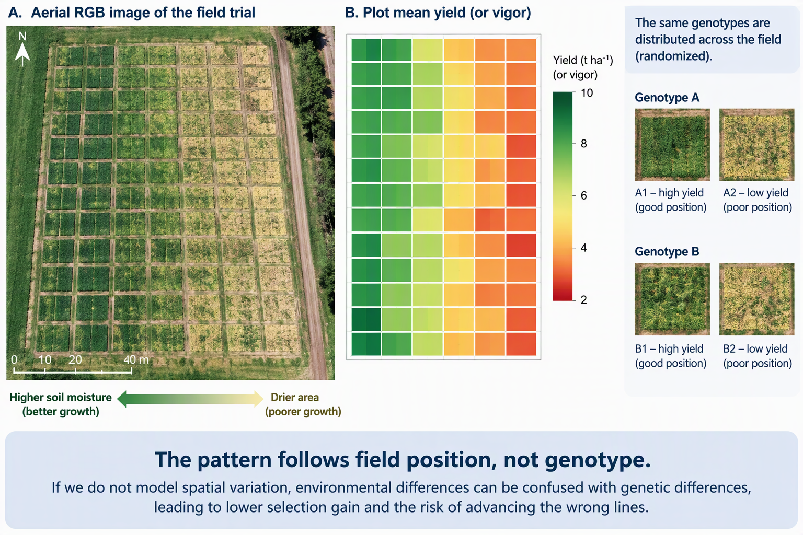

```{r}
#| label: setup
#| cache: false
#| include: false
knitr::opts_knit$set(root.dir = if (dir.exists("data")) "." else "..")
library(dplyr)
library(tidyr)
library(readr)
library(ggplot2)
library(lme4)
library(SpATS)
theme_set(theme_minimal(base_size = 14))
fmt <- function(x, d = 0) format(round(x, d), big.mark = ",", scientific = FALSE, nsmall = d)
```

```{r}
#| label: data
#| include: false
beans <- read_csv("data/Example_Beans.csv", show_col_types = FALSE) |>
  mutate(rep   = factor(rep),
         line  = factor(line),
         rb    = factor(paste(rep, block, sep = ":")),
         rowf  = factor(row),
         colf  = factor(col),
         yield = YdHa_clean)

m_block  <- lmer(yield ~ rep + (1 | line) + (1 | rb), data = beans)
resid_df <- beans |> filter(!is.na(yield)) |> mutate(residual = resid(m_block))

fit_spats <- function(data, trait = "yield", genotype_random = TRUE,
                      nseg = c(6, 32), random = ~ rowf + colf + rb) {
  d <- data
  d$y <- d[[trait]]
  SpATS(response = "y", genotype = "line", genotype.as.random = genotype_random,
        spatial = ~ PSANOVA(col, row, nseg = nseg, nest.div = 2),
        fixed = ~ rep, random = random, data = d,
        control = list(tolerance = 1e-03, monitoring = 0))
}
m_sp <- fit_spats(beans)

h2_cullis <- function(model, genotype) {
  X <- getME(model, "X"); Z <- getME(model, "Z"); s2 <- sigma(model)^2
  vc <- as.data.frame(VarCorr(model)); fl <- getME(model, "flist"); Gp <- getME(model, "Gp")
  v <- unlist(lapply(names(fl), function(g) rep(vc$vcov[vc$grp == g], nlevels(fl[[g]]))))
  W <- cbind(X, Z); C <- crossprod(W) / s2; idx <- ncol(X) + seq_along(v)
  C[cbind(idx, idx)] <- C[cbind(idx, idx)] + 1 / v
  Cinv <- solve(as.matrix(C)); k <- match(genotype, names(fl))
  gi <- ncol(X) + (Gp[k] + 1):Gp[k + 1]; P <- Cinv[gi, gi]; n <- nrow(P)
  vdiff <- 2 * (n * sum(diag(P)) - sum(P)) / (n * (n - 1))
  1 - vdiff / (2 * vc$vcov[vc$grp == genotype])
}

single_trial <- function(data, trait, spatial = TRUE) {
  d <- data |> mutate(y = .data[[trait]]) |> filter(!is.na(y)) |> droplevels()
  if (spatial) {
    m <- SpATS(response = "y", genotype = "line", genotype.as.random = TRUE,
               spatial = ~ PSANOVA(col, row, nseg = c(6, 32), nest.div = 2),
               fixed = ~ rep, random = ~ rowf + colf + rb, data = d,
               control = list(tolerance = 1e-03, monitoring = 0))
    p  <- predict(m, which = "line")
    sg <- m$var.comp[["line"]]
    tab <- tibble(line = as.character(p$line),
                  BLUP = p$predicted.values + m$coeff[["repR2"]] / 2,
                  SE   = p$standard.errors)
    h2 <- m$eff.dim[["line"]] / (nlevels(d$line) - 1)
  } else {
    m  <- lmer(y ~ rep + (1 | line) + (1 | rb), data = d)
    sg <- as.data.frame(VarCorr(m))$vcov[1]
    pv <- as.data.frame(ranef(m, condVar = TRUE))
    tab <- tibble(line = as.character(pv$grp[pv$grpvar == "line"]),
                  BLUP = fixef(m)[1] + fixef(m)["repR2"] / 2 + pv$condval[pv$grpvar == "line"],
                  SE   = pv$condsd[pv$grpvar == "line"])
    h2 <- h2_cullis(m, "line")
  }
  n_pl <- count(d, line)
  tab <- tab |>
    mutate(reliability = 1 - SE^2 / sg,
           rank = rank(-BLUP, ties.method = "first"),
           check = line %in% n_pl$line[n_pl$n > 2]) |>
    arrange(rank)
  list(model = m, table = tab, h2 = h2)
}
```

## Content

| Time | Activity |
|:------------------|:----------------------------------------------------|
| 08:30 | **Lecture and demo.** Fields are not uniform; residual maps and the semivariogram; spatial models with SpATS; Mr.Bean; does it pay? |
| 10:30 | **Practical.** |

::: keybox
**Goal:** Learn to view a trial as a **map**, decide whether a spatial model is needed, apply it, and explain how much it improves precision.
:::

------------------------------------------------------------------------

## Block 1 {.divider visibility="hidden"}

Why the position of a plot matters

------------------------------------------------------------------------

## Before we start

1.  Download: [**Day 4 morning practical (ZIP)**](../downloads/Day4_morning_spatial_analysis.zip)
2.  Unzip it (do not work inside the ZIP) and open `Day4_morning.Rproj`
3.  Run `00_install_packages.R` **once**: it installs `SpATS` and the other packages

- Follow the lecture: we write the code together

------------------------------------------------------------------------

## Fields are not uniform

- A slope can create a moisture gradient
- A line of trees can produce an edge effect
- A road or canal can divide the trial
- A river or drainage line can create a diagonal band

```{r}
#| echo: false
#| fig-width: 10
#| fig-height: 4

g <- expand.grid(row = 1:60, col = 1:12)

g$`Moisture gradient`      <- -0.8 * g$row / 60 * 10
g$`Tree line (edge)`       <- -8 * exp(-(g$col - 1) / 2)
g$`Road or canal`          <- ifelse(g$row > 30, -5, 0)
g$`River or drainage line` <- -7 * exp(-((g$row - 5 * g$col - 5) / 6)^2)

pivot_longer(g, 3:6, names_to = "source", values_to = "effect") |>
  mutate(source = factor(source, levels = names(g)[3:6])) |>
  ggplot(aes(row, col, fill = effect)) +
  geom_tile() +
  facet_wrap(~ source, nrow = 1) +
  scale_fill_viridis_c(guide = "none") +
  labs(x = "Row", y = "Column")
```

[Schematic surfaces, not data. Darker is lower yield.]{.small-note}

------------------------------------------------------------------------

## Why spatial variation matters for selection

- We want to select lines with **better genetics**
- However, field conditions also affect plant performance
- Good areas can favor some lines
- Poor areas can penalize others

::: keybox
Spatial analysis helps us separate genetic differences from field variation.
:::

------------------------------------------------------------------------



------------------------------------------------------------------------

## The bean trial 🫘

- 380 lines, 2 replicates, **792 plots** in a field of **66 rows x 12 columns**
- Columns 1 to 6 are replicate 1, columns 7 to 12 are replicate 2
- Incomplete blocks of 22 plots: 11 rows x 2 columns
- 16 checks repeated 4 times; yield `YdHa_clean` (kg/ha)

```{r}
#| echo: false
#| fig-width: 11
#| fig-height: 3
ggplot(beans, aes(row, col, fill = yield)) +
  geom_tile(colour = "white", linewidth = 0.2) +
  geom_hline(yintercept = 6.5, linewidth = 0.8) +
  scale_fill_viridis_c(na.value = "grey80") +
  scale_y_continuous(breaks = c(1, 6, 7, 12)) +
  coord_equal() +
  labs(x = "Row", y = "Column", fill = "Yield")
```

------------------------------------------------------------------------

## First diagnostic: mean yield by column

```{r}
#| echo: false
#| fig-width: 10
#| fig-height: 3.6
check_lines <- beans |> filter(!is.na(yield)) |> count(line) |> filter(n > 2) |> pull(line)
profile <- bind_rows(
  beans |> filter(!is.na(yield)) |> group_by(col) |>
    summarise(yield = mean(yield), .groups = "drop") |> mutate(set = "All lines (66 plots per column)"),
  beans |> filter(!is.na(yield), line %in% check_lines) |> group_by(col) |>
    summarise(yield = mean(yield), .groups = "drop") |> mutate(set = "Checks only (same lines everywhere)")
)
ggplot(profile, aes(col, yield)) +
  geom_col(width = 0.8, col = "black") + geom_vline(xintercept = 6.5, linewidth = 0.8) +
  scale_x_continuous(breaks = 1:12) + facet_wrap(~ set) +
  labs(x = "Column", y = "Mean yield (kg/ha)")
```

```{r}
#| include: false
cm <- filter(profile, grepl("^All", set))
```

::: keybox
Within replicate 1, mean yield increases by 463 kg/ha from column 1 to column 6. The repeated checks show a similar positional pattern, providing evidence of environmental variation across columns.
:::

------------------------------------------------------------------------

## Models so far: from the design to the field {.compact}

```{=html}
<style>
.fx { color:#2a5db0; font-weight:600; }
.rd { color:#c0392b; font-weight:600; }
.reveal section.compact h2 { font-size: 1.15em !important; margin-bottom: 0.1em; }
.reveal section.compact table { font-size: 0.92em; }
.reveal section.compact table th, .reveal section.compact table td { padding: 3px 10px; }
.reveal section.compact > p, .reveal section.compact li { font-size: 0.9em; }
.reveal section.compact ul { margin: 0.2em 0; }
.reveal section.compact .keybox { font-size: 0.88em; padding: 0.3em 0.8em; margin-top: 0.2em; }
.reveal section.compact .keybox p { margin: 0.15em 0; }
</style>
```

| Design | Model for the yield of one plot |
|:--------------------------|:--------------------------------------------|
| Complete blocks | y~ik~ = [μ]{.fx} + [b~k~]{.rd} + [G~i~]{.rd} + [ε~ik~]{.rd} |
| Replicates and incomplete blocks (**our Day 3 model**) | y~ijk~ = [μ]{.fx} + [Rep~j~]{.fx} + [b~k(j)~]{.rd} + [G~i~]{.rd} + [ε~ijk~]{.rd} |
| Rows and columns | y~ijk~ = [μ]{.fx} + [Row~j~]{.rd} + [Col~k~]{.rd} + [G~i~]{.rd} + [ε~ijk~]{.rd} |
| Replicates, rows and columns | y~ijkm~ = [μ]{.fx} + [Rep~m~]{.fx} + [Row~j(m)~]{.rd} + [Col~k(m)~]{.rd} + [G~i~]{.rd} + [ε~ijkm~]{.rd} |

- [Blue]{.fx}: fixed (overall mean μ, replicate). [Red]{.rd}: random (block b, row, column, line G, residual ε). y: yield of the plot

::: keybox
All these models assume that the random terms are **independent**. But plots that are close in the field are often alike.
:::

[Adapted from Wageningen University & Research, course material (2021).]{.small-note}

------------------------------------------------------------------------

## Sources of spatial variation {.compact}

```{r}
#| echo: false
#| fig-width: 11
#| fig-height: 2.9
g <- expand.grid(col = 1:24, row = 1:24)
g$`1. Design` <- ifelse(g$col > 12, 4, 0) + ifelse((g$row - 1) %/% 6 %% 2 == 0, 3, 0) +
  c(2, -2, 0, 3, -3, 1, -1, 2, -2, 0, 1, -1)[(g$col - 1) %% 12 + 1]
g$`2. Global trend` <- 0.5 * g$col + 0.35 * g$row
g$`3. Local trend` <- 9 * exp(-((g$col - 6)^2 + (g$row - 7)^2) / 14) +
  8 * exp(-((g$col - 17)^2 + (g$row - 17)^2) / 18) - 6 * exp(-((g$col - 18)^2 + (g$row - 6)^2) / 10)
pivot_longer(g, 3:5, names_to = "source", values_to = "effect") |>
  ggplot(aes(col, row, fill = effect)) +
  geom_raster() + facet_wrap(~ source, nrow = 1) + coord_equal() +
  scale_fill_gradient2(low = "#2166ac", mid = "white", high = "#b2182b", midpoint = 0, guide = "none") +
  labs(x = "Column", y = "Row", caption = "Schematic: red adds yield, blue takes yield away")
```

- **Design:** the layout itself: replicates, blocks, rows and columns. We put these in the model
- **Global trend:** a slope or gradient over the whole field (water, fertility, light)
- **Local trend:** patches where neighbouring plots are alike (a wet corner, a compacted strip)

::: keybox
Blocks, rows and columns handle the first. For the other two we need a **smooth surface of the field**.
:::

------------------------------------------------------------------------

## Block 2 {.divider visibility="hidden"}

Looking for spatial patterns

------------------------------------------------------------------------

## Did the block model remove the spatial pattern?

```{r}
#| echo: true
m_block <- lmer(
  yield ~ rep + (1 | line) + (1 | rb),
  data = beans
)

resid_df <- beans |>
  filter(!is.na(yield)) |>
  mutate(residual = resid(m_block))
```

- Replicate accounts for the average difference between replicates
- Line represents genetic differences among bean lines
- Replicate–block accounts for differences among incomplete block sections
- Residuals represent the variation that the model did not explain

::: keybox
If the block model is sufficient, residuals should look randomly scattered across the field.

If residuals form patches, bands, or gradients, some spatial variation remains.
:::

------------------------------------------------------------------------

## Residual map

```{r}
#| echo: false
#| fig-width: 11
#| fig-height: 3.3
ggplot(resid_df, aes(row, col, fill = residual)) +
  geom_tile(colour = "white", linewidth = 0.2) +
  geom_hline(yintercept = 6.5, linewidth = 0.8) +
  scale_fill_gradient2(low = "#2166ac", mid = "white", high = "#b2182b", midpoint = 0) +
  scale_y_continuous(breaks = c(1, 6, 7, 12)) +
  coord_equal() +
  labs(x = "Row", y = "Column", fill = "Residual\n(kg/ha)")
```

- Blue: yield was lower than predicted
- White: yield was close to the predicted value
- Red: yield was higher than predicted
- Similar colors appear together in some areas of the field

::: keybox
The block model removed part of the field variation, but some spatial pattern remains in the residuals.
:::

------------------------------------------------------------------------

## What is left inside the blocks {visibility="hidden"}

```{r}
#| echo: false
#| fig-width: 10
#| fig-height: 3.4
col_res <- resid_df |> group_by(col) |> summarise(res = mean(residual), .groups = "drop")
ggplot(col_res, aes(col, res)) +
  geom_col(width = 0.8) + geom_vline(xintercept = 6.5, linewidth = 0.8) +
  scale_x_continuous(breaks = 1:12) +
  labs(x = "Column", y = "Mean residual (kg/ha)")
```

::: keybox
Blocks of two columns (1-2, 3-4, 5-6): the residual still rises from `r fmt(col_res$res[1])` to `r fmt(col_res$res[2])`, from `r fmt(col_res$res[3])` to `r fmt(col_res$res[4])` and from `r fmt(col_res$res[5])` to `r fmt(col_res$res[6])` kg/ha. A block cannot remove a gradient that runs inside it.
:::

------------------------------------------------------------------------

## Are neighbouring plots independent? {.compact}

```{r}
#| echo: false
#| fig-width: 11
#| fig-height: 3.9
ggplot(filter(beans, !is.na(yield)), aes(row, yield)) +
  geom_point(size = 0.7, colour = "grey35") +
  geom_smooth(method = "loess", span = 0.4, se = FALSE, colour = "#b2182b", linewidth = 0.8) +
  facet_wrap(~ col, nrow = 2, labeller = label_both) +
  labs(x = "Row (position along the column)", y = "Yield (kg/ha)")
nb <- function(d, v, by = "row") {
  a <- d |> select(row, col, x = all_of(v))
  b <- a |> mutate(!!by := .data[[by]] - 1)
  j <- inner_join(a, b, by = c("row", "col"), suffix = c("", "_n"))
  if (by == "col") j <- filter(j, col != 6)
  cor(j$x, j$x_n, use = "complete.obs")
}
yd <- beans |> filter(!is.na(yield))
```

- Each panel is one column of the field: the yield of the 66 plots, from row 1 to row 66. The red line is a smooth curve through them
- The lines are **not flat**: yield rises and falls along the field. Plots that are next to each other are alike
- Correlation between neighbouring plots: yield `r fmt(nb(yd, "yield"), 2)` (along rows) and `r fmt(nb(yd, "yield", "col"), 2)` (along columns). Residuals of the Day 3 model: `r fmt(nb(resid_df, "residual"), 2)` and `r fmt(nb(resid_df, "residual", "col"), 2)`

::: keybox
The traditional fix is to let the residual of a plot be correlated with its neighbour (an autoregressive model, AR1 × AR1), usually fitted in ASReml (licence needed) and hard to tune. We use **SpATS**.
:::

------------------------------------------------------------------------

## The semivariogram

- Compares the residuals of two plots as a function of **the distance** between them
- Plots that are close are more alike than distant plots: the semivariance **increases** with distance
- Independent residuals: a flat line (the dashed line is the residual variance)

```{r}
#| echo: false
#| fig-width: 10
#| fig-height: 3.4
semivariogram <- function(d, max_lag = 25) {
  same <- outer(d$col, d$col, "==")
  lag  <- abs(outer(d$row, d$row, "-"))
  half <- 0.5 * outer(d$residual, d$residual, "-")^2
  keep <- same & lag > 0 & lag <= max_lag & upper.tri(same)
  tibble(lag = lag[keep], gamma = half[keep]) |>
    group_by(lag) |> summarise(gamma = mean(gamma), .groups = "drop")
}
vg <- semivariogram(resid_df)
ggplot(vg, aes(lag, gamma)) +
  geom_hline(yintercept = var(resid_df$residual), linetype = 2) +
  geom_point() + geom_line() +
  labs(x = "Distance between plots along the rows", y = "Semivariance")
```

[Weak local correlation along the rows: the main structure is the gradient across the columns.]{.small-note}

------------------------------------------------------------------------

## What does each semivariogram point represent?

$$
\text{Semivariance for one pair}
=
\frac{1}{2}(e_i-e_j)^2
$$

| Point | Distance | Plot pairs within each column |
|------:|---------:|:------------------------------|
|     1 |        1 | rows 1–2, 2–3, 3–4, …         |
|     2 |        2 | rows 1–3, 2–4, 3–5, …         |
|     3 |        3 | rows 1–4, 2–5, 3–6, …         |
| \(h\) |    \(h\) | rows 1–(1+h), 2–(2+h), …      |

::: keybox
Each point is the average dissimilarity between the residuals of all plot pairs separated by the same distance.
:::

------------------------------------------------------------------------

## Do rows and columns explain variance? {.compact}

```{r}
#| echo: true
m_rc <- lmer(yield ~ rep + (1 | rep:rowf) + (1 | rep:colf) + (1 | line), data = beans)
```

```{r}
#| echo: false
vc <- as.data.frame(VarCorr(m_rc))
vc_tab <- tibble(Term = c("Lines (genetics)", "Rows within replicate", "Columns within replicate", "Residual"),
                 Variance = vc$vcov[match(c("line", "rep:rowf", "rep:colf", "Residual"), vc$grp)]) |>
  mutate(`Share of the total` = paste0(round(100 * Variance / sum(Variance)), " %"),
         Variance = fmt(Variance))
knitr::kable(vc_tab, align = "lrr")
pct <- function(g) round(100 * vc$vcov[vc$grp == g] / sum(vc$vcov))
```

::: keybox
Rows explain `r pct("rep:rowf")` % of the variance and columns `r pct("rep:colf")` %: **as much as the lines** (`r pct("line")` %). The field is a large part of what we measure, so it must be in the model.
:::

- Variance = how much the term moves the yield: the bigger, the more the field matters

------------------------------------------------------------------------

## When is a spatial correction justified?

Use it when **at least two** of these are true:

1.  The residual map shows patches or bands
2.  The semivariogram increases with distance
3.  Row or column effects are a sizeable part of the genetic variance
4.  The spatial model improves the fit (AIC) or the heritability by a useful amount

::: keybox
If the residuals look random, the extra model buys nothing and costs complexity.
:::

------------------------------------------------------------------------

## Block 3 {.divider visibility="hidden"}

Spatial models with SpATS

------------------------------------------------------------------------

## The idea: a smooth surface of the field {.compact}

```{r}
#| echo: false
#| fig-width: 12
#| fig-height: 2.5
g <- expand.grid(col = 1:20, row = 1:20)
cc <- (g$col - 10) / 10; rr <- (g$row - 10) / 10
g$`f(col)`        <- 2 * sin(2.5 * cc)
g$`f(row)`        <- 2 * cos(2 * rr + 0.5)
g$`f(col) x row`  <- 2 * sin(2.5 * cc) * rr
g$`col x f(row)`  <- 2 * cc * cos(3 * rr)
g$`f(col) x f(row)` <- 3 * sin(4 * cc) * sin(4 * rr)
pivot_longer(g, 3:7, names_to = "part", values_to = "effect") |>
  mutate(part = factor(part, unique(part))) |>
  ggplot(aes(col, row, fill = effect)) +
  geom_raster() + facet_wrap(~ part, nrow = 1) + coord_equal() +
  scale_fill_gradient2(low = "#2166ac", mid = "white", high = "#b2182b", midpoint = 0, guide = "none") +
  theme(axis.text = element_blank(), axis.title = element_blank()) +
  labs(caption = "Schematic of the five parts of the surface")
```

- A **spline** is a flexible curve made of small pieces joined smoothly. In 2D it is a flexible **surface**. A **penalty** keeps it smooth, so it follows a gradient or a patch, not the noise of one plot
- SpATS splits the surface into parts, like an ANOVA: change across **columns**, change along **rows**, two **tilts** (the trend in one direction changes along the other), and **local patches**
- The data decide how smooth the surface is. Random rows, columns and blocks are added as before

[Rodriguez-Alvarez, Boer, van Eeuwijk & Eilers (2018). *Spatial Statistics* 23: 52-71.]{.small-note}

------------------------------------------------------------------------

## The model in R

```{r}
#| eval: false
SpATS(response = "yield",
      genotype = "line", genotype.as.random = TRUE,
      spatial  = ~ PSANOVA(col, row, nseg = c(6, 32), nest.div = 2),
      fixed    = ~ rep,
      random   = ~ rowf + colf + rb,
      data     = beans)
```

| Argument | Meaning |
|:-----------------|:-----------------------------------------------------|
| `genotype.as.random` | `TRUE` gives BLUPs, `FALSE` gives BLUEs |
| `PSANOVA(col, row, nseg)` | the surface; `nseg` about half the number of columns and rows |
| `fixed` | the replicate |
| `random` | row, column and block as **factors** |

::: keybox
`col` and `row` as numbers go in `PSANOVA()` (distance). `rowf` and `colf` as factors go in `random`.
:::

------------------------------------------------------------------------

## The standard SpATS plot {.compact}

```{r}
#| echo: false
#| fig-width: 11
#| fig-height: 5.4
plot(m_sp, all.in.one = TRUE)
```

Top: **raw data**, **fitted data**, **residuals** (what the model cannot explain). Bottom: **spatial trend** (the field effect), **line predictions** (what we select on) and their **histogram**.

------------------------------------------------------------------------

## Reading the output: effective dimensions {.compact}

```{r}
#| echo: false
sm <- grepl("^f\\(|^col:f", names(m_sp$eff.dim))
get_d <- function(v, nm) if (nm == "surface") sum(v[sm]) else v[[nm]]
tab_ed <- tibble(
  Term = c("Lines", "Rows", "Columns", "Incomplete blocks", "Smooth surface"),
  key  = c("line", "rowf", "colf", "rb", "surface")) |>
  rowwise() |>
  mutate(Effective = round(get_d(m_sp$eff.dim, key), 1),
         Model     = get_d(m_sp$dim, key),
         Nominal   = get_d(m_sp$dim.nom, key)) |>
  ungroup() |>
  mutate(Ratio = round(Effective / Nominal, 2),
         `In words` = c("ratio = heritability", "differ a lot",
                        "matter little now", "almost nothing left",
                        "the field effect")) |>
  select(-key)
knitr::kable(tab_ed)
```

- **Model**: how many separate values the term has (380 lines, 66 rows, 12 columns, 36 blocks)
- **Nominal**: the most it could use (a little less: the mean and replicate take some)
- **Effective**: how many the data really use. A simple, smooth pattern uses few
- **Ratio** = Effective / Nominal. Lines use 244 of 379: **0.64 is the heritability**

------------------------------------------------------------------------

## Where is the complexity of the surface? {.compact}

```{r}
#| echo: false
#| fig-width: 10
#| fig-height: 3.3
parts <- tibble(part = c("f(col)", "f(row)", "f(col) x row", "col x f(row)", "f(col) x f(row)"),
                nm = c("f(col)", "f(row)", "f(col):row", "col:f(row)", "f(col):f(row)")) |>
  mutate(ed = unname(m_sp$eff.dim[nm]), share = ed / sum(ed))
ggplot(parts, aes(ed, factor(part, rev(part)))) +
  geom_col(width = 0.7, fill = "#3E6FA8") +
  geom_text(aes(label = paste0(round(ed, 1), "  (", round(100 * share), " %)")), hjust = -0.1, size = 4.2) +
  scale_x_continuous(expand = expansion(mult = c(0, 0.3))) +
  labs(x = "Effective dimension", y = NULL)
```

- The **effective dimension** of each part tells how much that part adds to the field effect
- Most of the surface is **local patches** (`r round(100 * parts$share[5])` %). Change along rows and across columns is small
- A part with an effective dimension near 0 is not needed in this field

------------------------------------------------------------------------

## What was removed from the plots {.compact}

```{r}
#| echo: false
#| fig-width: 8
#| fig-height: 3.5
tr <- obtain.spatialtrend(m_sp)
trend <- expand.grid(col = tr$col.p, row = tr$row.p) |> mutate(trend = as.vector(tr$fit))
ggplot(trend, aes(row, col, fill = trend)) +
  geom_raster() +
  scale_fill_gradient2(low = "#2166ac", mid = "white", high = "#b2182b", midpoint = 0) +
  scale_y_continuous(breaks = c(1, 6, 7, 12)) + coord_equal() +
  labs(x = "Row", y = "Column", fill = "Field effect\n(kg/ha)")
```

- Each cell is the estimated effect of the **field** on yield, in kg/ha, whatever line is there
- **Red**: the field adds yield here (more than the average of the trial). **Blue**: the field takes yield away
- SpATS subtracts this from every plot before it compares the lines
- Here: high in the middle of the field (columns 5 to 8), low in the outer columns (1 and 12)

------------------------------------------------------------------------

## What was removed: the row effects {.compact}

```{r}
#| echo: false
#| fig-width: 10
#| fig-height: 3.3
row_eff <- tibble(row = 1:66, effect = m_sp$coeff[paste0("rowf", 1:66)])
ggplot(row_eff, aes(row, effect)) + geom_col(width = 0.8, fill = "#3E6FA8") +
  geom_hline(yintercept = 0) +
  labs(x = "Row", y = "Row effect (kg/ha)")
```

- Each bar is one **row**. Its height is how many kg/ha the plots of that row yield **above** (bar up) or **below** (bar down) the average, only because of the row
- Positive: more than expected. Negative: less than expected
- They are small here (the largest is `r fmt(max(abs(row_eff$effect)))` kg/ha): the surface already took most of the field effect

------------------------------------------------------------------------

## BLUEs and BLUPs {visibility="hidden"}

```{r}
blup_sp <- predict(m_sp, which = "line") |>
  select(line, BLUP = predicted.values, SE = standard.errors) |>
  mutate(BLUP = BLUP + m_sp$coeff[["repR2"]] / 2)

m_sp_fix <- fit_spats(beans, genotype_random = FALSE)
blue_sp <- predict(m_sp_fix, which = "line") |>
  select(line, BLUE = predicted.values, SE_BLUE = standard.errors) |>
  mutate(BLUE = BLUE + m_sp_fix$coeff[["repR2"]] / 2)

left_join(blue_sp, blup_sp, by = "line") |> arrange(desc(BLUP)) |> head(5)
```

- BLUEs for a next stage (multi-environment analysis); BLUPs to rank within this trial

------------------------------------------------------------------------

## Block 4 {.divider visibility="hidden"}

Mr.Bean: SpATS without code

------------------------------------------------------------------------

## Mr.Bean

- Free Shiny application from the Alliance of Bioversity International and CIAT (Aparicio et al. 2024)
- Has a module that fits **the same SpATS model**: BLUEs, BLUPs and heritability without writing R

1.  **Import** the trial file (`Example_Beans.csv` is ready: one row per plot)
2.  **Tell the app** which column is the genotype, row, column, replicate, block and trait
3.  **Choose the model**: spatial (SpATS) or without space; genotype fixed or random
4.  **Run, inspect, download**: heritability, variance components, spatial trend, residuals, BLUEs or BLUPs

::: keybox
Good to share an analysis with colleagues who do not use R, and to check your own code. Limit: the analysis is not saved as a script.
:::

------------------------------------------------------------------------

## Running Mr.Bean

- Web version on shinyapps.io (<https://beanteam.shinyapps.io/MrBean_BETA/>)
- Or in R: `remotes::install_github("AparicioJohan/MrBeanApp")`, then `library(MrBean)` and `run_app()`
- Project page: `apariciojohan.github.io/MrBeanApp`

- Step-by-step guide with screenshots: [Mr.Bean tutorial](tutorial-mrbean-spatial.html) (about 35 min)

**Practical:** run the beans file in the app and in R, and compare the heritability and the top lines.

------------------------------------------------------------------------

## Block 5 {.divider visibility="hidden"}

Spatial against non-spatial: does it pay?

------------------------------------------------------------------------

## Four ways to analyse the same trial

```{r}
#| echo: false
m_rowcol  <- lmer(yield ~ rep + (1 | line) + (1 | rb) + (1 | rowf) + (1 | colf), data = beans)
m_rc_only <- lmer(yield ~ rep + (1 | line) + (1 | rowf) + (1 | colf), data = beans)
comp <- tibble(
  Model = c("Incomplete blocks (Day 3)", "Blocks + rows + columns",
            "Rows + columns, no blocks", "SpATS"),
  `Residual SD` = c(sigma(m_block), sigma(m_rowcol), sigma(m_rc_only), sqrt(m_sp$psi[1])),
  Heritability = c(h2_cullis(m_block, "line"), h2_cullis(m_rowcol, "line"),
                   h2_cullis(m_rc_only, "line"), m_sp$eff.dim[["line"]] / (nlevels(beans$line) - 1)),
  AIC = c(AIC(m_block), AIC(m_rowcol), AIC(m_rc_only), NA)
)
comp |> mutate(across(where(is.numeric), \(x) round(x, 2)))
```

- **Residual SD:** unexplained plot-to-plot variation, smaller is better
- **Heritability:** generalized (Cullis); for SpATS, effective dimension of the lines over their number minus one
- **AIC:** only among the `lme4` models, lower is better

::: keybox
Residual SD from `r fmt(comp[[2]][1])` to `r fmt(comp[[2]][4])` kg/ha; heritability of yield from `r round(comp[[3]][1], 2)` to `r round(comp[[3]][4], 2)`.
:::

------------------------------------------------------------------------

## Does the ranking change? {visibility="hidden"}

```{r}
#| echo: false
rn <- rownames(ranef(m_block)$line)
rank_cmp <- tibble(line = rn, BLUP_block = ranef(m_block)$line[, 1],
                   BLUP_spats = blup_sp$BLUP[match(rn, blup_sp$line)] - mean(blup_sp$BLUP))
k <- round(0.10 * nrow(rank_cmp))
top <- \(x) rank_cmp$line[order(-x)][1:k]
round(c(correlation = cor(rank_cmp$BLUP_block, rank_cmp$BLUP_spats),
        selected = k,
        in_both = length(intersect(top(rank_cmp$BLUP_block), top(rank_cmp$BLUP_spats)))), 2)
```

- The rankings are similar, but **`r k - length(intersect(top(rank_cmp$BLUP_block), top(rank_cmp$BLUP_spats)))` of the `r k` selected lines change**
- Which list is better? We cannot know the true values, but we can test the predictions

------------------------------------------------------------------------

## A check with the other replicate {visibility="hidden"}

- Fit each model with **replicate 1 only**, predict the line means of **replicate 2**, and the other way round
- The replicates are in different columns: two independent samples of the field

```{r}
#| echo: false
check_one <- function(train, test) {
  train <- droplevels(train)
  truth <- tapply(test$yield, test$line, mean, na.rm = TRUE)
  raw <- tapply(train$yield, train$line, mean, na.rm = TRUE)
  m1 <- lmer(yield ~ (1 | line) + (1 | rb), data = train)
  b1 <- setNames(ranef(m1)$line[, 1], rownames(ranef(m1)$line))
  m2 <- lmer(yield ~ (1 | line) + (1 | rb) + (1 | rowf) + (1 | colf), data = train)
  b2 <- setNames(ranef(m2)$line[, 1], rownames(ranef(m2)$line))
  m3 <- SpATS(response = "yield", genotype = "line", genotype.as.random = TRUE,
              spatial = ~ PSANOVA(col, row, nseg = c(4, 32), nest.div = 2),
              random = ~ rowf + colf + rb, data = train,
              control = list(tolerance = 1e-03, monitoring = 0))
  p3 <- predict(m3, which = "line")
  b3 <- setNames(p3$predicted.values, p3$line)
  common <- Reduce(intersect, list(names(truth), names(raw), names(b1), names(b2), names(b3)))
  ok <- common[!is.na(truth[common])]
  out <- sapply(list(`Raw means` = raw, `Incomplete blocks` = b1,
                     `Blocks + rows + columns` = b2, SpATS = b3),
                function(s) cor(s[ok], truth[ok]))
  tibble(Model = names(out), correlation = out)
}
r1 <- filter(beans, rep == "R1"); r2 <- filter(beans, rep == "R2")
cv <- bind_rows(check_one(r1, r2), check_one(r2, r1)) |>
  group_by(Model) |> summarise(`Correlation with the other replicate` = mean(correlation), .groups = "drop") |>
  arrange(desc(`Correlation with the other replicate`))
cv |> mutate(across(where(is.numeric), \(x) round(x, 3)))
```

::: keybox
Adjusting for the field beats raw means, and the spatial model is slightly better than the blocks alone. With two replicates, do not over-read small differences.
:::

------------------------------------------------------------------------

## When does it pay? Five traits {visibility="hidden"}

```{r}
#| echo: false
traits <- c(Yield = "yield", `Days to flowering` = "DF", `Days to maturity` = "DPM",
            `Plants per plot` = "PLHA", `100-seed weight` = "SW100")
gain <- bind_rows(lapply(names(traits), function(nm) {
  a <- single_trial(beans, traits[[nm]], spatial = FALSE)$h2
  b <- single_trial(beans, traits[[nm]], spatial = TRUE)$h2
  tibble(Trait = nm, `Incomplete blocks` = a, SpATS = b, Gain = b - a)
}))
gain |> mutate(across(where(is.numeric), \(x) round(x, 3)))
```

::: keybox
Large gain for **yield**, the trait most affected by soil and water. Almost nothing for flowering, maturity and seed weight. The spatial model is a tool for the traits that need it, not a default.
:::

------------------------------------------------------------------------

## Block 6 {.divider visibility="hidden"}

Design or analysis?

------------------------------------------------------------------------

## Fix it in the field or in the model? {visibility="hidden"}

| Problem | Design | Analysis |
|:------------------|:--------------------------|:--------------------------|
| Known gradient | Blocks across the gradient | Row/column effects, SpATS surface |
| Unknown patches | Small incomplete blocks, row-column | Spatial model, residual map |
| Border competition | Border plots, plot size | Do not analyse borders as data |
| Unreplicated or p-rep | Checks spread over the field | Checks as reference, surface |
| Large plot noise | Larger plots, more replicates | Not recoverable |

::: keybox
**Design for the precision you need; analyse for the heterogeneity that remains.**
:::

------------------------------------------------------------------------

## In the bean trial {visibility="hidden"}

- The gradient runs **across the width** of the field
- Blocks of 2 columns cut it in 3 strips per replicate: the block variance is as large as the genetic variance
- But each block still holds two columns at different yield levels
- **Design fixes that cost less than the analysis:**
  - blocks 1 column wide and 22 rows long, following the contours of the gradient
  - border plots in the outer columns (the lowest yield: columns 1 and 12)

------------------------------------------------------------------------

## Block 7 {.divider visibility="hidden"}

Single-trial workflow, exercise and discussion

------------------------------------------------------------------------

## A single-trial workflow {visibility="hidden"}

1.  **Raw data and QC** (Day 1) → 2. **Design and model** (Days 2 and 4) → 3. **BLUPs and heritability** (Day 3) → 4. **Selection-ready table** → 5. **Decision**

```{r}
res <- single_trial(beans, "yield")
round(res$h2, 3)
head(res$table, 5)
```

[A high BLUP with low reliability is a candidate to retest; with high reliability, a solid advance.]{.small-note}

------------------------------------------------------------------------

## Exercise {visibility="hidden"}

With the same trial:

1.  Draw the residual map of **days to maturity (DPM)** from the incomplete-block model. Bands or patches?
2.  Run `single_trial()` for DPM with and without space. Is the correction justified?
3.  How many of the 38 best lines for yield (10%) by the spatial model are among the 38 best by the Day 3 model? Which is the first line that enters only with the spatial model?

::: keybox
Hint: compare the heritability gain with the rule of this morning.
:::

------------------------------------------------------------------------

## Questions for discussion {visibility="hidden"}

- Look at the map of **your own trial**. Do you see a gradient, patches or an edge effect?
- Your trial has no coordinates. What would you record next season, and how?
- A spatial model changes several of the 38 selected lines. How do you decide which list to trust?
- Where would you place border plots and checks in your next trial?

------------------------------------------------------------------------

## Your turn: the practical (10:30)

The **same bean trial, yield only**, analysed twice. Download the folder: [Day4_morning_spatial_analysis.zip](../downloads/Day4_morning_spatial_analysis.zip)

1.  **In R** (about 80 min): open `Spatial_models_comparison.Rmd`. ANOVA with rows and columns, a ladder of mixed models (`lme4`), then SpATS; heritability, BLUEs and BLUPs, and the choice of model. Work **with your neighbour**
2.  **In Mr.Bean** (about 35 min): follow the [step-by-step tutorial](tutorial-mrbean-spatial.html) and compare the numbers with R

::: keybox
Run each box, replace the `___`, write your findings. The answers you should get are in the comments. At the end: when is it worth adding rows and columns, and when do we need SpATS?
:::

------------------------------------------------------------------------

## Key takeaways

- Plots that are close are more alike than plots that are far; blocks capture part of it, the rest stays in the residual
- **Look before you model:** map of the raw data, map of the residuals, semivariogram
- `SpATS` fits a smooth surface with random row, column and block effects, and returns BLUEs, BLUPs and heritability; Mr.Bean does it without code
- Most of the gain comes from adding rows and columns to the model; SpATS adds a little more precision (heritability 0.43, 0.54, 0.60, 0.64 along the ladder)
- Check against an independent replicate; report the heritability of the model you use
- **Design first, analysis second**

------------------------------------------------------------------------

## Resources

- **Course manual**, chapter 9: theory, code and the solved exercise
- Rodriguez-Alvarez, M. X., Boer, M. P., van Eeuwijk, F. A. & Eilers, P. H. C. (2018). Correcting for spatial heterogeneity in plant breeding experiments with P-splines. *Spatial Statistics*, 23, 52-71.
- Aparicio, J. et al. (2024). Mr.Bean: a comprehensive statistical and visualization application for modeling agricultural field trials data. *Frontiers in Plant Science*, 14, 1290078.
- Velazco, J. G. et al. (2017). Modelling spatial trends in sorghum breeding field trials using a two-dimensional P-spline mixed model. *Theoretical and Applied Genetics*, 130, 1375-1392.

------------------------------------------------------------------------

## Thank you! {.divider}

**Luis Fernando Delgado Muñoz**

[📧 [lfdelgadom\@unal.edu.co](mailto:lfdelgadom@unal.edu.co)]{.small-note}

[💼 [linkedin.com/in/lfdelgadom](https://www.linkedin.com/in/lfdelgadom)]{.small-note}
