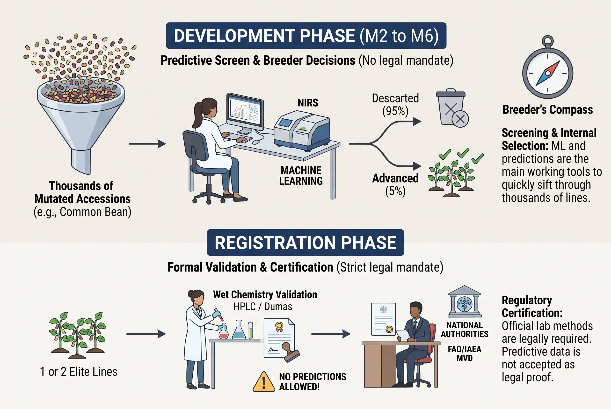
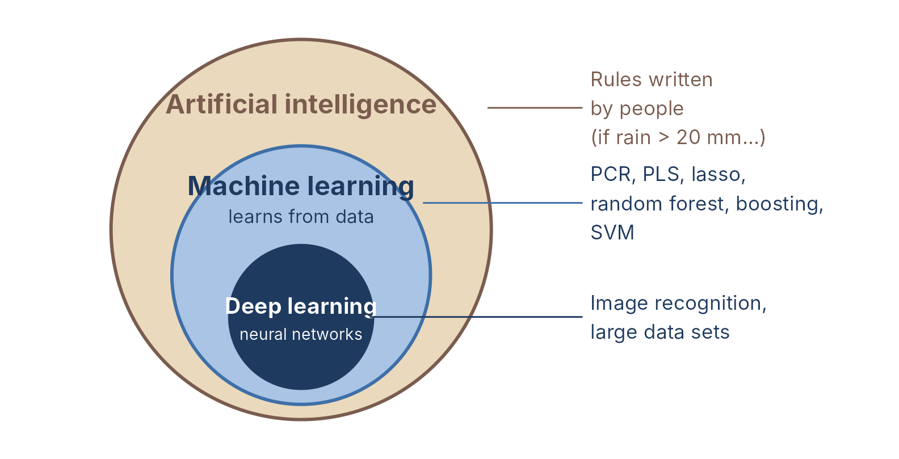
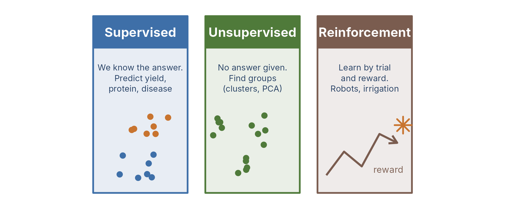
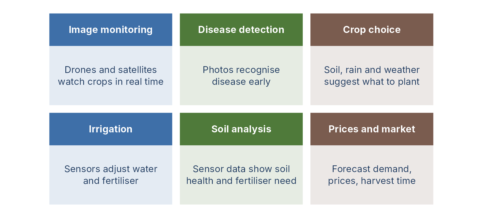
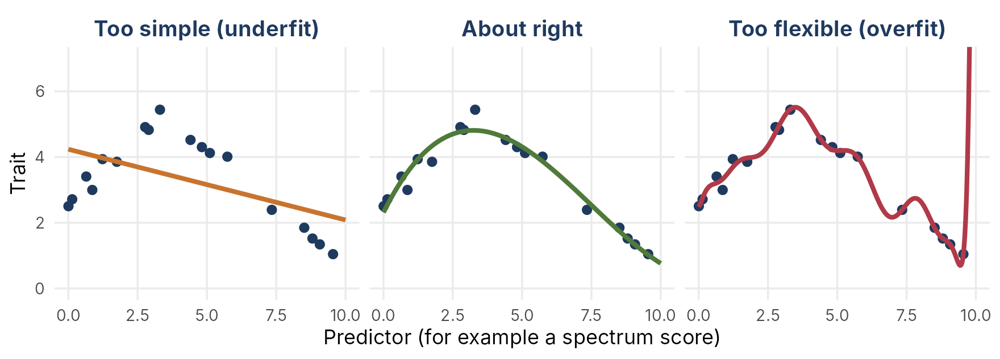
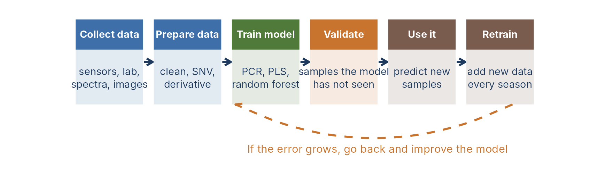
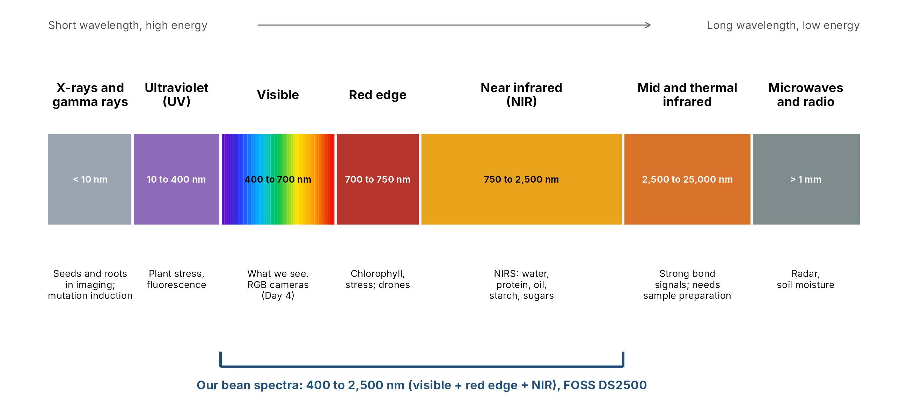
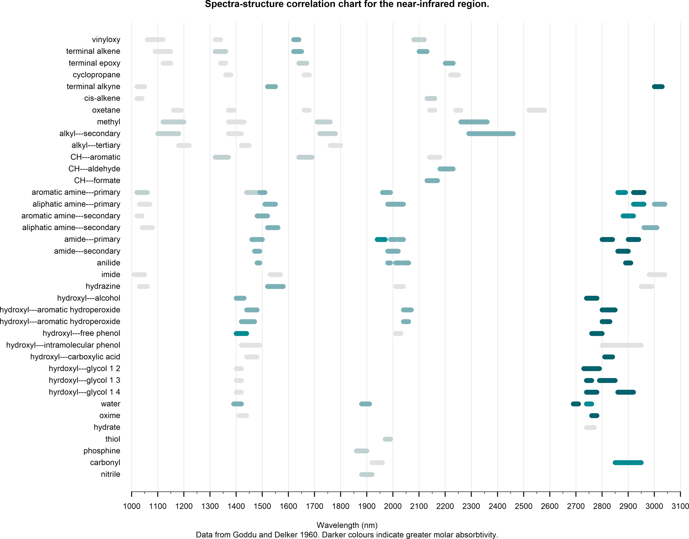
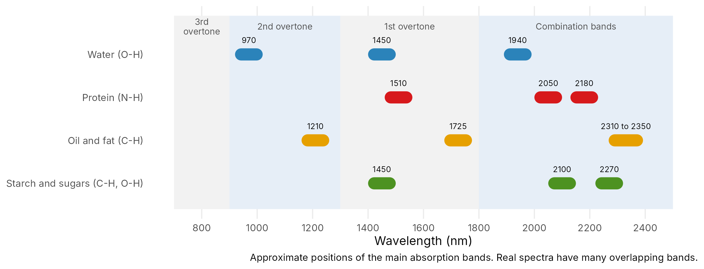

```{r}
#| label: setup
#| cache: false
#| include: false
knitr::opts_knit$set(root.dir = if (dir.exists("data")) "." else "..")
fmt <- function(x, d = 0) format(round(x, d), big.mark = ",", scientific = FALSE, nsmall = d)
```

```{r}
#| label: functions
#| cache: false
#| include: false
source("exercises/ML_NIRS_beans_practical/helpers.R")
source("slides/ml_deck_functions.R")
```

```{r}
#| label: data
#| include: false
bean <- load_bean_nir("data/bean_nirs.csv")   # list: lab, X, wl, line
lab  <- bean$lab
X    <- bean$X
wl   <- bean$wl
line <- bean$line
Z    <- prepare_spectra(X)                     # SNV + first derivative
Z5   <- thin(Z, 5)                             # fewer variables, faster models
```

## Plan for this session {.smaller}

::::: columns
::: {.column width="50%"}
**Part 1. The idea**

1.  Two different questions
2.  Where prediction pays in breeding
3.  Machine learning in general
4.  Light we see and light we do not see
5.  What NIR can "see" (and what it cannot)

**Part 2. The data**

6.  Beans from CIAT, 117 samples, 13 lab traits, 1,050 wavelengths
7.  Preparing the spectra
:::

::: {.column width="50%"}
**Part 3. The models**

8.  How good is a prediction? (RMSE, R², bias, RPD)
9.  First model, principal component regression (PCR)
10. More models (PLS, ridge, lasso, random forest, SVM, boosting)
11. Data leakage, the most common mistake

**Part 4. Take-home**

12. NIR works well for some traits, not for others
13. Your turn, the practical with beans
:::
:::::

## Two different questions

::::: columns
::: {.column width="50%"}
**Inference: "Why?"**

- Does the mutation change the trait?
- Which factors have an effect?
- Tools: linear models, ANOVA, mixed models (Days 1 to 3)
- Result: an effect and a p-value
:::

::: {.column width="50%"}
**Prediction: "What will it be?"**

- What is the phytate of this new bean line?
- Which lines should I keep?
- Tools: PCR, PLS, random forest, boosting
- Result: a number for a new sample, and an honest error
:::
:::::

::: keybox
A model that explains well can still predict badly, and the other way around. Today we only judge a model by **how well it predicts samples it has never seen**.
:::

## Where prediction pays {.smaller}

| Slow or costly measurement | Cheap measurement that predicts it |
|----|----|
| Laboratory analysis (phytate, sugars, protein) | NIR spectrum (a few seconds, no chemicals) |
| Scoring disease in the field | Drone or phone images |
| Phenotyping every line in every trial | Genomic markers (genomic selection), not common in mutation breeding |
| Counting grains, measuring leaf area | Image analysis |

- One expensive measurement is made on **a few samples**. A model learns the link to a cheap measurement.
- Then the cheap measurement is made on **all samples**.

## In a mutation breeding programme

- Thousands of M2, M3 plants or lines. Laboratory analysis is possible only for a few.
- A fast NIR scan of the seed lets you **screen** many lines for composition (protein, sugars, anti-nutrients).
- You keep the interesting ones and confirm them in the laboratory.

::: keybox
Prediction is a **screening tool**. It does not replace the laboratory. It tells you where to look.
:::

## Screening vs Certification in Mutation Breeding

{fig-align="center" width="8.04in"}

# Machine learning in general {.divider}

## What is machine learning?

{fig-align="center" height="410px"}

Machine learning: the machine **learns patterns from data**. Nobody writes the rules.

## Three ways a machine learns

{fig-align="center" height="400px"}

::: keybox
Almost everything in this lecture is **supervised**: we know the laboratory value, and we teach the model to predict it.
:::

## Machine learning in agriculture {.smaller visibility="hidden"}

{fig-align="center" height="420px"}

::: small-note
Examples as described by DeHaat and GeoPard (see "Read more").
:::

## Regression or classification? {.smaller visibility="hidden"}

```{r}
#| label: reg-class
#| echo: false
#| fig-height: 3.6
#| fig-width: 10
cols6 <- c(white = "#bfbfbf", cream = "#E8D9A8", `cream/red` = "#D9A07A", `red/cream` = "#C0594B", red = "#8B1E2D", green = "#4F7A3A")
g1 <- ggplot(data.frame(PC1 = prcomp(Z)$x[, 1], phytate = lab$phytate), aes(PC1, phytate)) +
  geom_point(colour = "#3E6FA8", size = 2.4) + geom_smooth(method = "lm", se = FALSE, colour = "#C8742F") +
  labs(title = "Regression: predict a number", x = "Spectrum score (PC1)", y = "Phytate (mg/g)")
g2 <- ggplot(data.frame(colour = lab$colour, PC1 = prcomp(Z)$x[, 1], PC2 = prcomp(Z)$x[, 2]), aes(PC1, PC2, colour = colour)) +
  geom_point(size = 2.6) + scale_colour_manual(values = cols6) + labs(title = "Classification: predict a class", colour = "Grain colour")
gridExtra::grid.arrange(g1, g2, nrow = 1)
```

**Regression**: the answer is a number. **Classification**: the answer is a class. Today we do regression.

## Underfitting and overfitting {.smaller}

{fig-align="center" height="390px"}

A too flexible model follows the noise: perfect on seen data, bad on new data. Always test on **unseen** samples.

## The life of a model {.smaller visibility="hidden"}

{fig-align="center" width="100%"}

A model is never "finished". With a new season, instrument or variety, check the error and retrain.

## Benefits and challenges {.smaller visibility="hidden"}

::::: columns
::: {.column width="50%"}
**Benefits**

- Faster and more consistent decisions
- Earlier warning of pests, diseases and stress
- Better use of water, fertiliser and lab time
- More lines screened with the same budget
:::

::: {.column width="50%"}
**Challenges**

- Cost of sensors, drones and instruments
- Training and digital skills; slow adoption
- Data privacy and security
- Models that are hard to explain
- Poor internet and technology in rural areas
:::
:::::

::: small-note
Summarised from DeHaat and GeoPard (see "Read more").
:::

# Light and NIR {.divider}

## Light we can and cannot see {.smaller}

{fig-align="center" width="95%"}

- Light is a wave. The **wavelength** (in nanometres, nm) tells us what kind of light it is.
- Our eyes see only 400 to 700 nm. A NIR instrument also uses light **we cannot see**.

## What a NIR instrument does

1.  It sends light from 400 to 2,500 nm on the seed or flour.
2.  The sample **absorbs** some wavelengths and reflects the rest.
3.  The instrument records how much light came back at each wavelength. This is the **spectrum**.
4.  Different molecules absorb at different wavelengths, so the spectrum carries information about the **chemistry** of the sample.

::: keybox
Fast (seconds), no chemicals, the sample is not destroyed. But a spectrum is **indirect**: we need a model to turn it into a number.
:::

## Which groups absorb, and where {.smaller}

{fig-align="center" height="440px"}

## A simple map for food and grain {.smaller visibility="hidden"}

{fig-align="center" width="85%"}

- NIR mostly "sees" **bonds with hydrogen**: O-H (water), N-H (protein), C-H (oil, starch, sugars).
- Bands are broad and **overlap**. This is why we need a model, and why we cannot read a compound from one wavelength.

## NIR sees bonds, not elements

::::: columns
::: {.column width="50%"}
**Works well (organic chemistry)**

- Water, protein, oil
- Starch, sugars
- Fibre, phenolics
- Phytate (partly, through its C-H and O-H bonds)
:::

::: {.column width="50%"}
**Works poorly (not organic bonds)**

- Minerals: iron, zinc (no bond to see; the model uses links with organic matter)
- Physical and cooking behaviour: cooking time, water absorption, hardness, texture (many causes, not one chemical)
:::
:::::

::: keybox
NIR is very good for **chemical** traits and weaker for **physico-chemical** traits. Always check before you trust a model for a new trait.
:::

# The data {.divider}

## A real data set of CIAT beans {.smaller}

- 117 samples of dry bean seed, **44 lines**, up to 3 repeats per line.
- NIR spectra from 400 to 2,500 nm (FOSS DS2500), here every 2 nm = 1,050 variables.
- 13 laboratory traits: minerals, anti-nutrients, sugars, cooking.

```{r}
#| label: structure
dim(X)
table(table(line))     # how many samples per line: number of repeats
names(lab)
```

## The laboratory values {.smaller visibility="hidden"}

::: {style="font-size: 0.62em; line-height: 1.1"}
```{r}
#| label: lab-table
#| echo: false
traits <- c("water_absorption", "cooking_time", "iron", "zinc", "phytate", "phenolics",
            "verbascose", "stachyose", "raffinose", "sucrose", "fructose",
            "total_sugars", "total_oligosaccharides")
tab <- data.frame(trait = traits,
                  mean = sapply(traits, function(t) mean(lab[[t]])),
                  sd   = sapply(traits, function(t) sd(lab[[t]])),
                  min  = sapply(traits, function(t) min(lab[[t]])),
                  max  = sapply(traits, function(t) max(lab[[t]])))
knitr::kable(tab, digits = 2, row.names = FALSE)
```
:::

::: small-note
Units: iron and zinc in mg/kg; phytate and sugars in mg/g; water absorption in %; cooking time in minutes.
:::

## The raw spectra, coloured by phytate {visibility="hidden"}

```{r}
#| label: raw-spectra
#| fig-height: 4.4
#| fig-width: 9
plot_spectra(X, colour_by = lab$phytate, n = 60, legend_title = "Phytate")
```

- The spectra look **almost the same**. The differences we need are small and hidden.

## Preparing the spectra {.smaller}

::::: columns
::: {.column width="50%"}
**Step 1. SNV**: each spectrum is centred and scaled by itself. This removes differences in level (grain size, light scatter).

**Step 2. First derivative**: removes a sloping baseline and sharpens the peaks.
:::

::: {.column width="50%"}
```{r}
#| label: prepare
#| eval: false
Z <- prepare_spectra(X)
```
:::
:::::

```{r}
#| label: prepared-plot
#| fig-height: 3.4
#| fig-width: 9
#| echo: false
plot_spectra(Z, colour_by = lab$phytate, n = 60, ylab = "SNV + first derivative", legend_title = "Phytate")
```

::: small-note
Each spectrum is treated on its own, so this step cannot leak information between samples.
:::

## A first look with PCA

```{r}
#| label: pca
#| fig-height: 4
#| fig-width: 9
#| echo: false
pca <- prcomp(Z, center = TRUE, scale. = FALSE)
var_exp <- 100 * pca$sdev^2 / sum(pca$sdev^2)
sc <- data.frame(PC1 = pca$x[, 1], PC2 = pca$x[, 2], colour = lab$colour)
ggplot(sc, aes(PC1, PC2, colour = colour)) + geom_point(size = 2.5) +
  labs(x = paste0("PC1 (", round(var_exp[1]), "%)"), y = paste0("PC2 (", round(var_exp[2]), "%)"), colour = "Grain colour")
```

- 1,045 variables are summarised by a few **principal components**. The first four hold `r round(sum(var_exp[1:4]))`% of the variation.
- Grain colour separates the samples: the spectrum "knows" about the seed.

# Prediction quality {.divider}

## Measuring prediction quality {.smaller}

| Measure | Meaning | Good when |
|----|----|----|
| **RMSE** | Typical size of the error (same unit as the trait) | small |
| **Bias** | Mean of (predicted − observed): too high or too low? | near 0 |
| **R²** | Share of the variation that the prediction explains | near 1 |
| **RPD** | sd of observed / RMSE: how much better than "always the mean" | large |

RPD guide (Williams): **\< 1.5** not useful; **1.5 to 2** rough screening; **2 to 2.5** approximate; **\> 2.5** good.

::: keybox
These numbers are only honest when they are computed on samples **the model did not see** (next slides).
:::

## Principal component regression (PCR) as a first model {.smaller}

::::: columns
::: {.column width="55%"}
**Three simple steps**

1.  **PCA** of the spectra: 1,045 variables become a few components
2.  **Regression**: a normal linear model of the trait on the first *k* components
3.  **Predict**: project a new spectrum on the same components, then use the regression

You choose only one number: *k*, the number of components.
:::

::: {.column width="45%"}
```{r}
#| label: pcr-code
#| eval: false
model <- fit_pcr(Z_train, y_train, ncomp = 12)
pred  <- predict_pcr(model, Z_new)
quality(y_new, pred)
```
:::
:::::

## What is a fold? {.smaller}

In **k-fold cross-validation** we cut the data into *k* parts. Each part is called a **fold**. Each fold is the **test** once, and the other folds build the model.

```{r}
#| label: fold-fig
#| echo: false
#| fig-height: 2.8
#| fig-width: 8
kk <- 5
fd <- expand.grid(fold = 1:kk, round = 1:kk)
fd$role <- ifelse(fd$fold == fd$round, "Test", "Training")
ggplot(fd, aes(fold, factor(round, levels = kk:1), fill = role)) + geom_tile(colour = "white", linewidth = 1.2) +
  scale_fill_manual(values = c(Test = "#d95f02", Training = "#9ecae1"), name = NULL) +
  labs(x = "Fold", y = "Round") + theme_minimal(base_size = 13) + theme(panel.grid = element_blank())
```

- With k = 5 there are 5 rounds. Every sample is tested exactly once.
- The test fold is never used to build the model in that round.
- The **fold** is the unit of the split. Next: what goes into each fold.

## How many components? {.smaller}

```{r}
#| label: curve
#| fig-height: 3.6
#| fig-width: 9
#| echo: false
y  <- lab$phytate
f_random  <- make_folds(line, by_line = FALSE)
f_by_line <- make_folds(line, by_line = TRUE)
cv_a <- cv_curve(Z, y, f_random,  25)
cv_b <- cv_curve(Z, y, f_by_line, 25)
curve <- rbind(transform(cv_a, folds = "random folds"), transform(cv_b, folds = "by-line folds"))
ggplot(curve, aes(components, RMSE, colour = folds)) + geom_line(linewidth = 1) + geom_point() +
  labs(x = "Number of components (k)", y = "RMSE of cross-validation (mg/g)", colour = NULL)
```

- Too few components: the model is too simple. Too many: it learns the noise (**overfitting**). Spectra often need 15 to 25 components.
- The honest curve (by line) is **higher**. We come back to this in the leakage slides.

## More model families {.smaller}

| Model | In one sentence |
|----|----|
| **PCR** | PCA first, then a linear regression on the components |
| **PLS** | Like PCR, but the components are built to relate to the trait. The NIR standard |
| **Ridge** | Linear model that shrinks all coefficients |
| **Lasso** | Shrinks and sets many coefficients to exactly 0: it selects wavelengths |
| **Elastic net** | A mix of ridge and lasso |
| **Random forest** | Many trees, each on a random part of the data; the average is the prediction |
| **Support vector machine (SVM)** | Finds a smooth curve that stays close to the data. A kernel lets it follow curved relations |
| **Boosting (GBM)** | Small trees built one after the other, each fixing the errors of the last |

::: small-note
Definitions follow Wadoux et al. (2021), chapter 9, and standard texts. PCR and PLS are the classic NIR tools. Trees and boosting come from machine learning.
:::

## Lasso, ridge and elastic net {.smaller}

All three start from a **linear model** with one coefficient for every wavelength, and they add a **penalty** for large coefficients.

- **Ridge**: makes all coefficients smaller, but none becomes zero.
- **Lasso**: pushes many coefficients to **exactly zero**. Only some wavelengths stay in the model.
- **Elastic net**: a mix of the two. The penalty strength (lambda) is chosen by **cross-validation**.

```{r}
#| label: lasso-path
#| echo: false
#| fig-height: 2.6
#| fig-width: 9
library(glmnet); library(ggplot2)
yy <- lab$phytate; Zs <- scale(Z5)
pth <- function(a, nm) {
  g <- glmnet(Zs, yy, alpha = a, nlambda = 40, standardize = FALSE)
  b <- as.matrix(g$beta)
  data.frame(model = nm, loglambda = rep(log(g$lambda), each = nrow(b)),
             wl = rep(seq_len(nrow(b)), times = ncol(b)), coef = as.vector(b))
}
pp <- rbind(pth(0, "Ridge: all shrink, none is zero"), pth(1, "Lasso: many become exactly zero"))
pp$model <- factor(pp$model, levels = unique(pp$model))
ggplot(pp, aes(loglambda, coef, group = wl)) + geom_line(alpha = 0.5, linewidth = 0.4, colour = "#2c6e91") +
  facet_wrap(~model, scales = "free") + labs(x = "log(lambda): stronger penalty to the right", y = "Coefficient") +
  theme_minimal(base_size = 11)
```

::: keybox
Lasso is useful when you want to know **which wavelengths** the model uses.
:::

## Performance of all models {.smaller}

Phytate, 10-fold validation with all samples of a line kept together.

```{r}
#| label: models
#| echo: false
models <- c("PCR", "PLS", "Ridge", "Lasso", "ENet", "RF", "GBM", "SVM")
P <- sapply(models, function(m) cv_model(m, Z5, y, f_by_line, line))
perf <- t(apply(P, 2, function(p) quality(y, p)))
perf <- rbind(perf, "Always the mean" = c(RMSE = sd(y) * sqrt(116 / 117), R2 = 0, bias = 0, RPD = 1))
knitr::kable(perf, digits = 2)
```

- Settings (components, penalties) are chosen inside each training set.
- All beat "always the mean". PCR is the weakest here. Lasso, elastic net, boosting and SVM do better (RPD about 1.7), but none reaches 2.

## Predicted against observed {visibility="hidden"}

```{r}
#| label: pred-obs
#| fig-height: 3.8
#| fig-width: 10
#| echo: false
pl <- do.call(rbind, lapply(c("PCR", "PLS", "Lasso", "RF"), function(m)
  data.frame(model = m, obs = y, pred = P[, m])))
ggplot(pl, aes(obs, pred)) + geom_abline(linetype = 2) +
  geom_point(colour = "#2c7fb8", alpha = 0.7) + facet_wrap(~model, nrow = 1) +
  labs(x = "Observed phytate (mg/g)", y = "Predicted phytate (mg/g)")
```

## Ways to split the data {.smaller visibility="hidden"}

| Method | How it works | Good for |
|----|----|----|
| **Train and test split** | One part builds the model, one part tests it | Large data sets |
| **k-fold cross-validation** | k parts; each part is the test once | Medium and small data sets (our case) |
| **Leave-one-out** | Every sample is the test once | Very small data sets, slow for large ones |
| **Bootstrap** | Random samples with replacement | Checking how stable the estimate is |

::: keybox
Whatever the method, the **unit left out** must be the unit you want to predict (a line, an environment, a year). That is the next topic.
:::

::: {.small-note style="font-size:0.6em; line-height:1.2"}
Yoosefzadeh Najafabadi et al. (2023). Machine learning-assisted approaches in modernized plant breeding programs. *Genes* 14(4): 777. DOI 10.3390/genes14040777
:::

# Data leakage {.divider}

## The idea of data leakage {.smaller}

A line has up to **3 samples** that are almost the same bean. What if a random split puts one in training and one in test?

```{r}
#| label: leak-table
#| echo: false
d9 <- data.frame(sample = lab$sample, line = line, fold_random = f_random, fold_by_line = f_by_line)
d9 <- d9[order(d9$line), ][1:9, ]
knitr::kable(d9, row.names = FALSE)
```

- **Random folds**: samples of the same line can sit in different folds. The model has already "seen" that line, so the test is too easy.
- **By-line folds**: all samples of a line sit in the same fold. The test line is truly new.

::: keybox
The question in breeding is: *will the model work on a **new line**?* So the validation must hold out **whole lines**.
:::

## Random against by-line results {.smaller}

```{r}
#| label: leak-result
#| echo: false
trait_pick <- c("phytate", "iron", "cooking_time")
leak <- do.call(rbind, lapply(trait_pick, function(t) {
  yy <- lab[[t]]
  k  <- 12
  c1 <- quality(yy, cv_predict(Z, yy, f_random,  k))
  c2 <- quality(yy, cv_predict(Z, yy, f_by_line, k))
  data.frame(trait = t, validation = c("random", "by line"), rbind(c1, c2)[, c("RMSE", "R2", "RPD")])
}))
knitr::kable(leak, digits = 2, row.names = FALSE)
```

- Random folds always look **better**. That is the leak, not a better model.
- Report the by-line numbers. They answer the breeder's real question.

## What about averaging replicates? {.smaller}

One option is to use the **mean spectrum and the mean value of each line**. Then each line is one point, and leakage cannot happen.

```{r}
#| label: line-means
#| echo: false
Zm <- rowsum(Z, line) / as.vector(table(line)[rownames(rowsum(Z, line))])
Lm <- rownames(Zm); fm <- make_folds(Lm, k = 10)
avg <- do.call(rbind, lapply(c("phytate", "iron", "cooking_time"), function(t) {
  yy <- lab[[t]]; ym <- tapply(yy, line, mean)[Lm]
  a <- quality(yy, cv_predict(Z, yy, f_by_line, 12))
  b <- quality(ym, cv_predict(Zm, ym, fm, 12))
  data.frame(trait = t, data = c("all samples, by line", "line means"), rbind(a, b)[, c("RMSE", "R2", "RPD")])
}))
knitr::kable(avg, digits = 2, row.names = FALSE)
```

- Averaging **reduces noise** and is fine for line-level decisions.
- But only 44 points remain, and the error is on another scale (the spread of means is different).
- Our advice: keep all samples, **validate by line**. Use means as a second check.

## The wrong way and the right way {.smaller}

::::: columns
::: {.column width="50%"}
**Wrong**: random split

```{r}
#| label: wrong
#| eval: false
folds <- make_folds(line, by_line = FALSE)
p <- cv_predict(Z, y, folds, ncomp = 12)
quality(y, p)
```
:::

::: {.column width="50%"}
**Right**: split by line

```{r}
#| label: right
#| eval: false
folds <- make_folds(line, by_line = TRUE)
p <- cv_predict(Z, y, folds, ncomp = 12)
quality(y, p)
```
:::
:::::

- Same data, same model, one argument changes: `by_line = TRUE`.
- The same idea holds for years, sites, plots, families or any group that is "the same thing" measured more than once.

# What NIR predicts well {.divider}

## Where NIR works, and where not {.smaller}

```{r}
#| label: traits
#| fig-height: 4.3
#| fig-width: 9
#| echo: false
type <- c(water_absorption = "Cooking / physical", cooking_time = "Cooking / physical",
          iron = "Minerals", zinc = "Minerals", phytate = "Organic compounds",
          phenolics = "Organic compounds", verbascose = "Organic compounds",
          stachyose = "Organic compounds", raffinose = "Organic compounds",
          sucrose = "Organic compounds", fructose = "Organic compounds",
          total_sugars = "Organic compounds", total_oligosaccharides = "Organic compounds")
res <- do.call(rbind, lapply(traits, function(t) {
  yy  <- lab[[t]]
  cur <- cv_curve(Z, yy, f_by_line, 25)
  k   <- which.min(cur$RMSE)
  data.frame(trait = t, type = type[[t]], R2 = r2(yy, cv_predict(Z, yy, f_by_line, k)))
}))
res$trait <- factor(res$trait, levels = res$trait[order(res$R2)])
ggplot(res, aes(R2, trait, fill = type)) + geom_col() +
  labs(x = "R² (PCR, validation by line)", y = NULL, fill = NULL)
```

## What the chart tells us {.smaller visibility="hidden"}

- **Sucrose, total sugars and phenolics**: best (R² about 0.8). Organic molecules with many C-H and O-H bonds.
- **Phytate and some oligosaccharides**: medium. Useful for screening, not for exact values.
- **Iron and zinc**: moderate (about 0.4). NIR cannot see a metal; it only sees what goes with it.
- **Cooking time and water absorption**: weak. They depend on the seed coat, storage, structure and many other things.
- **Exceptions**: fructose and verbascose are organic but weak. Not every organic compound works.

::: small-note
The number of components is chosen on the same validation folds, so these R² values are a little optimistic. A stricter test (nested validation) is used in the model comparison slide.
:::

## Compare with published work {.smaller}

| Study | What they found |
|----|----|
| Garcia et al. (2025), CIAT, common bean | **Nitrogen** predicted well (CCC 0.84); **iron and zinc** only about 0.4 |
| Vranić et al. (2019), Croatia, common bean | **Nitrogen** good (R² 0.89); phytic acid and phosphorus **usable**; iron and zinc **poor** |
| Our data (CIAT beans) | Sugars and phenolics **good**; phytate **medium**; minerals and cooking **weak** |

::: {.small-note style="font-size:0.6em; line-height:1.2"}
Garcia et al. (2025). Non-destructive prediction of nitrogen, iron and zinc content in diverse common bean seeds from a genebank using near-infrared spectroscopy. *Food Chemistry: Molecular Sciences* 11: 100316. DOI 10.1016/j.fochms.2025.100316

Vranić et al. (2019). Prediction of macro and microelements content in Croatian common bean landraces (*Phaseolus vulgaris* L.) by NIR spectroscopy. *Poljoprivreda* 25(1): 48-55. DOI 10.18047/poljo.25.1.7
:::

- Different studies, same message: **NIR is a chemistry tool**.

## Sensory traits in legumes {.smaller visibility="hidden"}

Taste, texture and appearance are slow to score with human panels.

| Sensor | Used for | Message from the review |
|----|----|----|
| NIR and Vis-NIR (with PLS) | Composition, some sensory scores | Works best for **composition**; weaker for appearance and texture |
| Colour images (RGB) | Seed colour, canning colour | Good for external traits only |
| Hyperspectral imaging | Flour quality, seed quality | Costly, needs large data |
| Electronic nose and tongue | Aroma, off-flavour | Still limited for large breeding populations |

- The human panel stays the **reference**. Sensors are fast proxies for early generations. Validate in diverse germplasm and years.

::: {.small-note style="font-size:0.6em; line-height:1.2"}
Ghaitaranpour et al. (2026). AI-assisted nondestructive phenotyping of sensory-related traits in modern legume breeding. *Smart Agricultural Technology* 15: 102668. DOI 10.1016/j.atech.2026.102668
:::

## What the model uses {.smaller visibility="hidden"}

A lasso model keeps only some wavelengths. Where are they?

```{r}
#| label: lasso-coef
#| echo: false
#| fig-height: 3.6
#| fig-width: 9
set.seed(1)
inner <- make_folds(line, k = 5, by_line = TRUE, seed = 7)
las  <- cv.glmnet(Z5, y, alpha = 1, foldid = inner)
beta <- as.numeric(coef(las, s = "lambda.min"))[-1]
grp  <- ceiling(seq_len(ncol(Z)) / 5)
wl5  <- as.numeric(tapply(as.numeric(colnames(Z)), grp, mean))
keep <- beta != 0
ggplot(data.frame(wavelength = wl5[keep], coefficient = beta[keep]), aes(wavelength, coefficient)) +
  geom_col(width = 8, fill = "#2c7fb8") + labs(x = "Wavelength (nm)", y = "Lasso coefficient")
```

- The lasso kept `r sum(keep)` of `r length(beta)` variables.
- Compare the positions with the band map: do they sit near O-H, N-H or C-H bands?
- A model can predict well and still be hard to explain. Check that it uses sensible wavelengths.

## Machine learning beyond spectra {.smaller visibility="hidden"}

The same workflow (cheap data, a model, honest validation) is used in many places in breeding.

| Data | Prediction | Note |
|----|----|----|
| Spectra (NIR) | Composition of seed or flour | What we did today |
| Image features | Plant traits, disease severity | Features first, then a model |
| Multi-environment trials | Yield and G×E in new environments | Use environment covariates (weather, soil) |
| Markers | Breeding values (genomic selection) | Very many variables, few lines: penalised models are common |

- Large data sets from imaging, sensors and trials are where flexible models can beat simple ones.
- With small data, simple models are often as good. Always compare with a baseline.

## Examples in breeding {.smaller visibility="hidden"}

| Crop and data | What was predicted | Result reported |
|----|----|----|
| Soybean, hyperspectral reflectance | Seed yield | Random forest best, 84% |
| Potato, light at chosen wavelengths | Virus infection | SVM, 89.8% accuracy |
| Wheat, drone sensors (multi-sensor) | Grain yield, early stage | Ensemble, R² up to 0.69 |
| Soybean, drone image time series | Relative maturity | CNN-LSTM beat local regression |
| Wheat, markers (multi-trait models) | End-use quality traits | +5.5% to +7.9%; flour protein up to +35% |

::: {.small-note style="font-size:0.6em; line-height:1.2"}
Yoosefzadeh Najafabadi et al. (2023). *Genes* 14(4): 777. DOI 10.3390/genes14040777

Yoosefzadeh-Najafabadi et al. (2025). Machine learning after a decade: is it still a missing keystone in genomic-based plant breeding? *Artificial Intelligence Review* 58: 260. DOI 10.1007/s10462-025-11274-y

Figures are as reported by these reviews for the original studies.
:::

## Machine learning or classical? {.smaller visibility="hidden"}

::::: columns
::: {.column width="50%"}
**Where machine learning helps**

- Non-linear links between data and a trait
- Many variables and samples (images, sensors)
- Several traits at once (multi-trait models)
- Environmental data for G×E
:::

::: {.column width="50%"}
**Where it does not win by default**

- In genomic prediction it has **not consistently beaten** classical models such as GBLUP
- Small data sets: simple models are often as good
- Deep learning needs large data and is hard to explain
- Biased data give biased predictions
:::
:::::

::: keybox
No best algorithm exists for every case. Start simple, and use a complex model only if it **clearly** predicts better on new data.
:::

::: {.small-note style="font-size:0.6em; line-height:1.2"}
Yoosefzadeh-Najafabadi et al. (2025). Machine learning after a decade: is it still a missing keystone in genomic-based plant breeding? *Artificial Intelligence Review* 58: 260. DOI 10.1007/s10462-025-11274-y
:::

## Validation across environments and years {.smaller visibility="hidden"}

Data leakage by line is one case of a general rule: **leave out the whole unit you want to predict**.

| You want to predict             | Leave out together            |
|---------------------------------|-------------------------------|
| A new line                      | All samples of that line      |
| A new environment               | All plots of that environment |
| A new season                    | All data of that year         |
| A new line in a new environment | Both (hardest case)           |

```{r}
#| label: env-code
#| eval: false
# the same function, with a different group
folds <- make_folds(environment, by_line = TRUE)   # here "line" is any group
```

::: keybox
The more different the new situation is from the training data, the larger the error. Test in the situation where you will use the model.
:::

## Limitations to keep in mind {.smaller}

- **Small data and overfitting**: 117 samples, 44 lines. Estimates of R² are noisy, and flexible models can learn the noise.
- **Interpretability**: trees, boosting and SVM are harder to explain than PCR or the lasso.
- **Transfer across crops**: a bean model does not work for chickpea or wheat. Build and test a new one for each crop.
- **Different instrument, season or sample form** (whole seed against flour): the model may not transfer. Re-calibrate.
- **Outliers and new genotypes**: a model is only valid inside the range of the data it was built on.
- **The laboratory value is the truth**: if the laboratory method is noisy, the model cannot be better than the method.
- **Calibration is living**: add new samples every season and check the error again.

# Your turn {.divider}

## The practical with beans and PCR {.smaller}

You will do the whole workflow in R, with **short code** and functions from a helpers file.

1.  Look at the data and the spectra
2.  Prepare the spectra (SNV + derivative)
3.  Look at the principal components
4.  Fit a PCR model and see why testing on the same samples is misleading
5.  Validate honestly: random folds against **by-line** folds
6.  Try a chemical trait (total sugars, phytate) and a physical one (cooking time, iron)
7.  Write your own conclusion: *would you use NIR for this trait?*

::: keybox
**Download**: [ML_NIRS_beans_practical.zip](../downloads/ML_NIRS_beans_practical.zip). Unzip it, open the `.Rproj`, run `00_install_packages.R` once, and start with the `.Rmd` file.
:::

## Key takeaways {.smaller}

1.  Prediction asks "what will it be?". We judge a model only on samples it **has not seen**.
2.  NIR measures **bonds** (O-H, N-H, C-H). It is excellent for **chemical** traits and weak for minerals and physical traits.
3.  Prepare spectra (SNV, derivative), then start with a **simple model**: PCR or PLS.
4.  Report **RMSE, R², bias and RPD**, and compare with "always the mean".
5.  **Data leakage**: keep all samples of one line in the same fold. Random folds look too good.
6.  Use prediction to **screen**, then confirm in the laboratory.

## Read more {.smaller}

- Wadoux, A. M. J.-C., Minasny, B. and McBratney, A. B. (2021). *Soil Spectral Inference with R*. Springer. Chapter 9: models, goodness of fit.
- Goddu, R. F. and Delker, D. A. (1960). Spectra-structure correlations for the near-infrared. *Analytical Chemistry* 32: 140-141. Chart data compiled by S. D. J. Brown (GitHub: sdjbrown/NIR-spectra-structure).
- Garcia, Carvajal-Yepes, Drewry, Santos, Duitama, Wenzl and Chacón-Sánchez (2025). Non-destructive prediction of nitrogen, iron and zinc content in diverse common bean seeds from a genebank using near-infrared spectroscopy. *Food Chemistry: Molecular Sciences* 11: 100316. DOI 10.1016/j.fochms.2025.100316
- Vranić, Petek, Bošnjak, Lazarević and Carović-Stanko (2019). Prediction of macro and microelements content in Croatian common bean landraces (*Phaseolus vulgaris* L.) by NIR spectroscopy. *Poljoprivreda* 25(1): 48-55. DOI 10.18047/poljo.25.1.7

## Read more, machine learning in breeding {.smaller}

- Yoosefzadeh Najafabadi, Hesami and Eskandari (2023). Machine learning-assisted approaches in modernized plant breeding programs. *Genes* 14(4): 777. DOI 10.3390/genes14040777
- Yoosefzadeh-Najafabadi, Xavier, Eskandari and Hesami (2025). Machine learning after a decade: is it still a missing keystone in genomic-based plant breeding? *Artificial Intelligence Review* 58: 260. DOI 10.1007/s10462-025-11274-y
- Ghaitaranpour, Kebede, Duizer and Yoosefzadeh-Najafabadi (2026). AI-assisted nondestructive phenotyping of sensory-related traits in modern legume breeding. *Smart Agricultural Technology* 15: 102668. DOI 10.1016/j.atech.2026.102668
- DeHaat. AI and ML in agriculture (blog). dehaat.in/en/blog/ai-and-ml-in-agriculture
- GeoPard. Applications of machine learning for precision agriculture (blog). geopard.tech/blog/applications-of-machine-learning-for-precision-agriculture/
