```{r}
#| label: setup
#| cache: false
#| include: false
knitr::opts_knit$set(root.dir = if (dir.exists("data")) "." else "..")
```

```{r}
#| label: functions
#| cache: false
#| include: false
source("exercises/Pipeline_cassava_support/helpers.R")
d <- load_cassava("data/cassava_DVGXE_tidy.csv")
```

## Plan for this session {.smaller}

::::: columns
::: {.column width="50%"}
**Part 1. The idea**

1.  Why we need a pipeline
2.  The pipeline in four blocks
3.  Our example, nine cassava trials in Colombia
4.  Where the data comes from

**Part 2. Pre-processing**

5.  Field design and checks
6.  Missing data and shared clones
7.  Variation between trials
:::

::: {.column width="50%"}
**Part 3. Modelling**

8.  Single trial analysis with a spatial model
9.  Heritability of each trial
10. Multi-environment model and G×E
11. Genotypic correlation between trials

**Part 4. Results and resources**

12. Correlation between traits
13. Selection index and advancement table
14. Hussain et al. 2022 and the code for you
:::
:::::

# Why a pipeline {.divider}

## Many trials, many traits, one decision

-   A breeding programme runs **many trials**, in **many places**, with **many traits** every year.
-   Each trial has soil variation, missing plots and outliers.
-   At the end, the breeder must answer one question. **Which clones go to the next stage?**
-   A pipeline is a fixed sequence of steps, written as code, that gives the same answer every time.

::: keybox
Without a pipeline, every trial is analysed by hand in a different way. With a pipeline, the analysis can be checked, repeated and shared.
:::

## The pipeline in four blocks

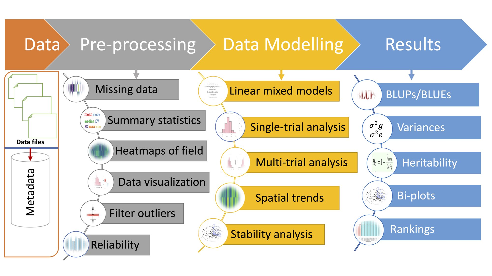{fig-align="center" height="400px"}

::: small-note
Figure from Hussain et al. (2022), Plant Methods 18, 1. doi: 10.1186/s13007-022-00845-7. Open access, CC BY 4.0. The authors share the code with a demo data set (see the last slides).
:::

## The path of the data

```{r}
#| fig-width: 10
#| fig-height: 3.6
#| fig-align: center
plot_flow()
```

::: small-note
Cassava breeding flow. Data are collected with a field book app, stored in a database in the cloud (Cassava Base), and downloaded as one table. Then the analysis starts.
:::

## Our example, nine cassava trials

::::: columns
::: {.column width="55%"}
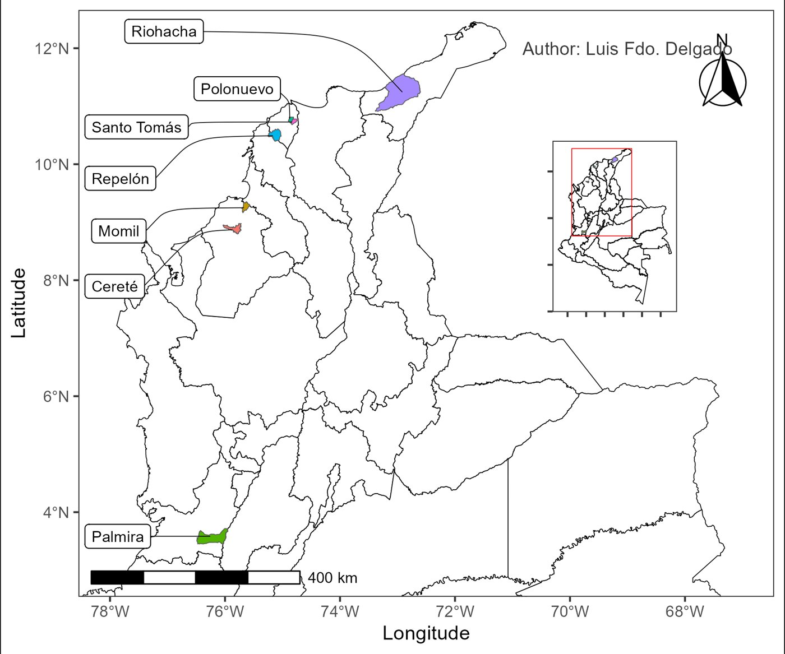{fig-align="center" height="420px"}
:::

::: {.column width="45%"}
-   **9 trials**, 2021 and 2022, Caribbean coast of Colombia
-   **51 clones**, 28 of them in all nine trials
-   Row-column design with **checks** (released varieties) spread at random
-   Traits: yield, dry matter, plant type, germination, height of first branch, branch number

::: small-note
Data are public in Cassava Base (anyone can register and download). The R code is in the repository Cassava2050/2022DVGXE9env.
:::
:::
:::::

# Where the data comes from {.divider}

```{r}
#| fig-width: 10
#| fig-height: 3
#| fig-align: center
plot_flow(1:3)
```

## Data collection

::::: columns
::: {.column width="33%"}
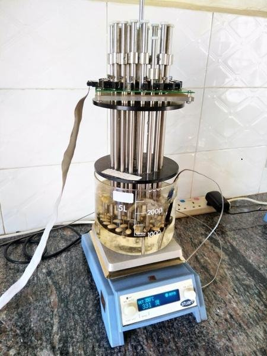{fig-align="center" height="210px"}

Bean Mattson cooker, cooking time
:::

::: {.column width="33%"}
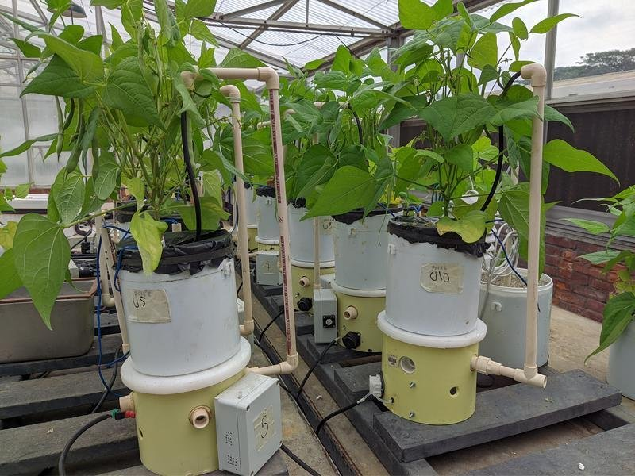{fig-align="center" height="210px"}

Field rover that moves along the rows and records plants
:::

::: {.column width="33%"}
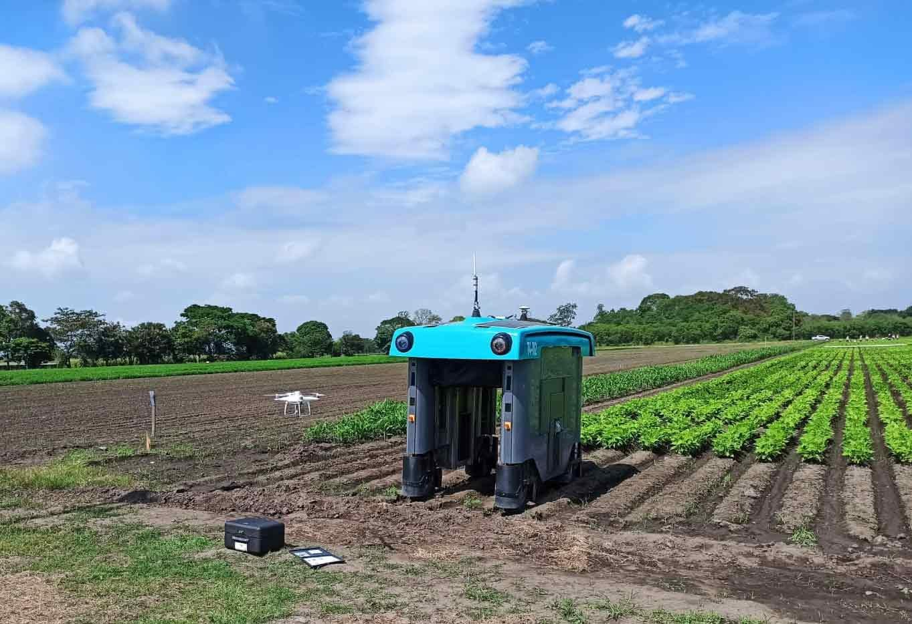{fig-align="center" height="210px"}

Lysimeter, plant transpiration rate
:::
:::::

::: keybox
This is the same idea as the NIR spectra we saw before. Machines and sensors give more data every year. A pipeline is what lets us use it.
:::

## Seedlings to multi-location trials

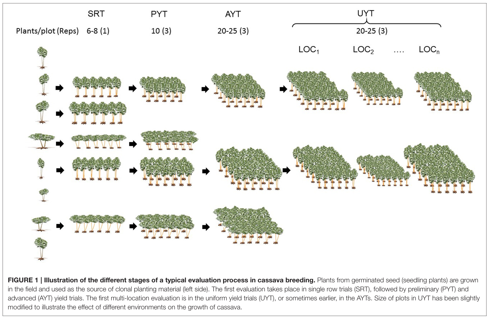{fig-align="center" height="390px"}

::: small-note
Stages of clonal evaluation in cassava breeding. Early stages have few plants and little replication. Later stages have more plots and more locations. Figure: Morales et al. (2022).
:::

## Data lives in a breeding database

-   Field books are loaded into a database (**BreedBase**, **Cassava Base** for cassava).
-   Data are downloaded as one table, one row per plot.
-   Our table has **762 rows** and these key columns: trial, clone, rep, row, column, check or test, and the traits.

```{r}
knitr::kable(head(d[, c("trial", "accession_name", "rep_number", "row_number", "col_number", "check_test", "yield_ha", "DM_gravity", "plant_type")], 6),
             col.names = c("trial", "clone", "rep", "row", "col", "check/test", "yield", "dry matter", "plant type"),
             row.names = FALSE, digits = 1)
```

# Pre-processing {.divider}

```{r}
#| fig-width: 10
#| fig-height: 3
#| fig-align: center
plot_flow(4)
```

## Look at the field design first

```{r}
#| fig-width: 11
#| fig-height: 4.6
#| fig-align: center
plot_layout_grid(d, c("ciat21", "momi21", "polo21", "repe21", "ciat22", "saha22"))
```

::: small-note
Six of the nine trials. Orange tiles are checks, blue tiles are test clones. The checks are spread at random, so we can measure soil variation.
:::

## Missing data

```{r}
#| fig-width: 9
#| fig-height: 4.4
#| fig-align: center
plot_missing(d)
```

::: small-note
Percentage of plots with no value, by trial and trait. A common rule is to drop a trait or trial with more than 20% missing. Here almost everything is complete.
:::

## Shared clones between trials

```{r}
#| fig-width: 8
#| fig-height: 4.4
#| fig-align: center
plot_connect(d)
```

::: small-note
Number of clones in common between two trials. Trials need shared clones (or checks) to be compared. Here the 2021 trials have 28 clones and the 2022 trials have 39 to 50.
:::

## Variation between trials

```{r}
#| fig-width: 9
#| fig-height: 4.2
#| fig-align: center
plot_trait_trial(d, "yield_ha")
```

::: small-note
Yield of all plots, by trial. Trials differ a lot in the mean. This is the **environment effect**. We want the clone effect, not the place effect.
:::

# Modelling {.divider}

```{r}
#| fig-width: 10
#| fig-height: 3
#| fig-align: center
plot_flow(5:6)
```

## Single trial analysis with a spatial model

```{r}
#| label: spats-fit
m1 <- fit_spats(d, "ciat22", "yield_ha")
```

```{r}
#| fig-width: 10
#| fig-height: 3.7
#| fig-align: center
plot(m1, cex = 0.7)
```

::: small-note
Trial ciat22, yield. Raw data, fitted surface and residuals in the field. The smooth surface (SpATS) removes the soil trend, so clone means are fairer.
:::

## What a spatial model does

-   Neighbour plots are often more alike than distant plots (soil, water, light).
-   If we ignore this, the trend goes into the error and the clone ranking gets noisy.
-   **SpATS** fits clone as random plus a smooth two-dimensional surface over rows and columns.
-   The output is a **BLUP** per clone and a **heritability** per trial.

::: keybox
Same idea as the spatial analysis of Tuesday. The new part is that we repeat it for every trial and every trait in a loop.
:::

## Heritability of each trial

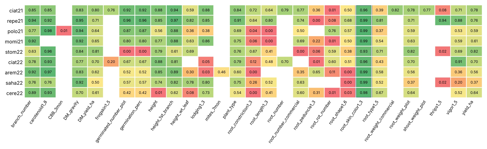{.lightbox fig-align="center" width="100%"}

::: small-note
Heritability of the clone means, all traits and all nine trials (green is high, red is low, blank means the trait was not measured). Original table of the 2022 report.
:::

::: keybox
**root_skin_color** has a very high heritability in every trial (0.93 to 0.99). It is a **genetic control** to take into account when the heritability of the other traits is low.
:::

## Common misunderstandings of heritability

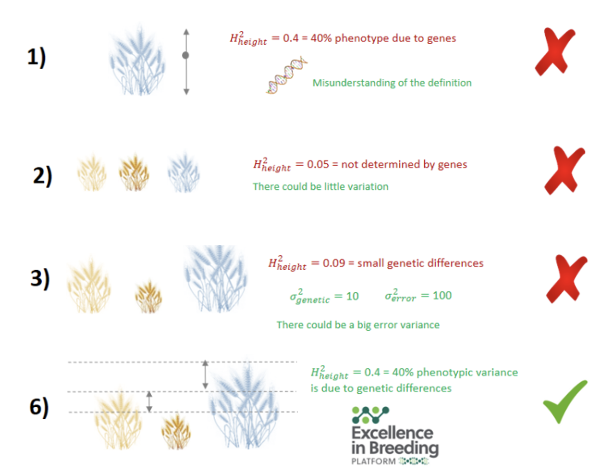{fig-align="center" height="520px"}

::: small-note
Heritability is **not** the percent of a trait that is "due to genes" in one plant. It is the share of the variance **between clones** that is genetic, in this population and these trials. Figure by the Excellence in Breeding Platform.
:::

## Multi-environment model and G×E

**Yield of a plot = trial mean + clone effect + clone × trial effect + error**

```{r}
#| label: met
met <- lapply(c("yield_ha", "DM_gravity", "plant_type"), function(tr) {
  m <- met_model(d, tr); v <- met_h2(m, d, tr)
  data.frame(trait = TRAIT_LABELS[[tr]], clone = v[["Vg"]], clone_x_trial = v[["VgxE"]], residual = v[["Ve"]], H2 = v[["h2"]])
})
met <- do.call(rbind, met)
knitr::kable(met, digits = 2, row.names = FALSE,
             col.names = c("Trait", "Clone variance", "Clone by trial variance", "Residual variance", "Heritability, all trials"))
```

::: small-note
Model in lme4: `yield ~ trial + (1 | clone) + (1 | clone:trial)`. When clone by trial variance is large, the best clone changes from place to place.
:::

## Genotypic correlation between trials

```{r}
#| fig-width: 8.5
#| fig-height: 3.9
#| fig-align: center
mY <- met_model(d, "yield_ha")
plot_corr(trial_gcor(mY))
```

::: small-note
Correlation of clone BLUPs, yield, between pairs of trials. Values near 1 mean the ranking is similar. Low values (momi21 with ciat22) mean a clone x trial interaction.
:::

# Results {.divider}

```{r}
#| fig-width: 10
#| fig-height: 3
#| fig-align: center
plot_flow(7)
```

## Correlation between traits

```{r}
#| fig-width: 7.5
#| fig-height: 3.9
#| fig-align: center
B <- all_blups(d)
Rt <- cor(B[, TRAITS])
colnames(Rt) <- rownames(Rt) <- c("yield", "dry matter", "plant type", "germination", "height 1st br.", "branch no.")
plot_corr(Rt)
```

::: small-note
Genotypic correlation between traits (clone BLUPs). Yield goes with germination and dry matter. A tall first branch goes with a better plant type (low score).
:::

## Selection index

```{r}
#| label: index
S <- selection_table(B)
```

-   Traits used: **yield**, **dry matter**, **plant type**.
-   Each BLUP is standardised and multiplied by a score. **Yield +10, dry matter +10, plant type -5** (a low plant type score is better).
-   The clones are ranked by the index. **We keep the top 20%.**

::: keybox
The scores are a **breeder's decision**, not a statistical result. The statistics only gives fair numbers to combine.
:::

## What the index recommends

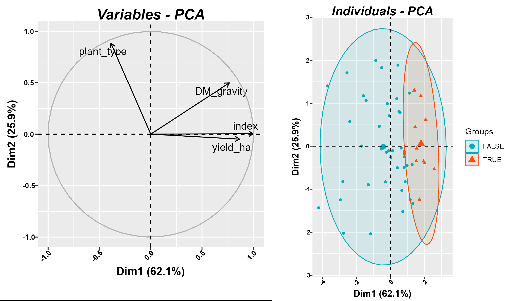{fig-align="center" height="430px"}

::: small-note
Left, the traits. The arrow **index** points the same way as yield and dry matter, and plant type goes in another direction. Right, the clones. The orange triangles are the clones the index selects. Original figure of the 2022 report, 51 clones.
:::

## Advancement table

::: {style="font-size: 0.78em"}
```{r}
top <- head(S, 11)
tab <- data.frame(Rank = top$rank, Clone = top$g,
                  Yield = round(top$yield_ha, 1), `Dry matter` = round(top$DM_gravity, 1),
                  `Plant type` = round(top$plant_type, 2), Index = round(top$index, 1),
                  Advance = ifelse(top$selected, "yes", "no"), check.names = FALSE)
knitr::kable(tab, row.names = FALSE)
```
:::

::: small-note
BLUPs are differences from the mean of all clones. 51 clones, the top 20% (11 clones) advance. Clones with "is" in the name are released varieties used as checks.
:::

## The table the breeder received

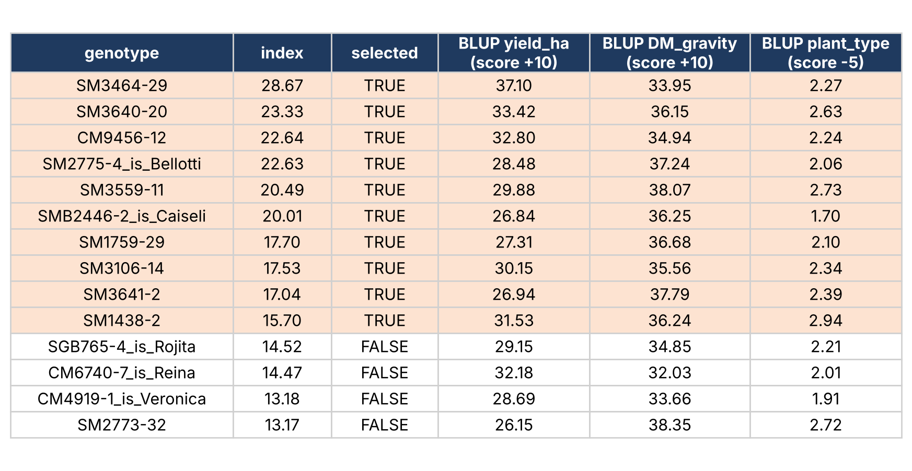{fig-align="center" height="440px"}

::: small-note
Original table of the 2022 report (top 14 of 51 clones). The index uses the BLUP of each trait with its score. The 10 shaded clones (top 20%) are the ones selected.
:::

## BLUPs of all clones, part 1 of 3

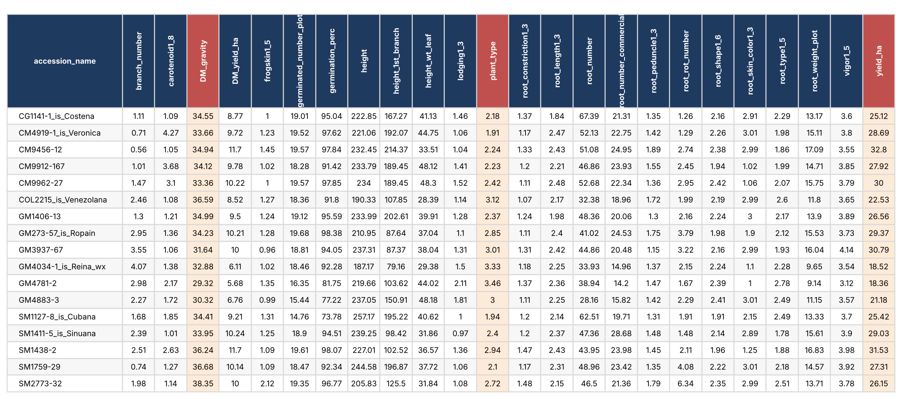{.lightbox fig-align="center" width="100%"}

::: small-note
BLUP of every trait for each clone (sheet BLUPs_gxe of the report). The three red columns are the traits used in the index. This is the base for the breeder's decision. Click to enlarge.
:::

## BLUPs of all clones, part 2 of 3

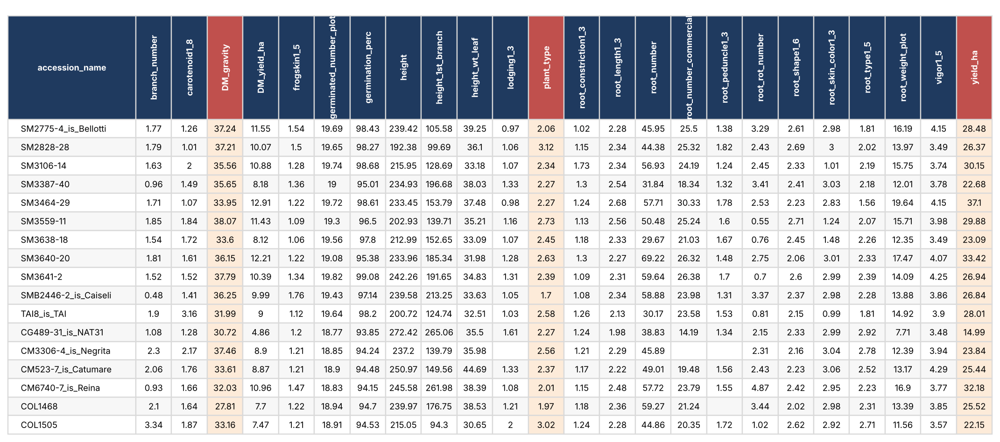{.lightbox fig-align="center" width="100%"}

::: small-note
BLUP of every trait for each clone (sheet BLUPs_gxe of the report). The three red columns are the traits used in the index. This is the base for the breeder's decision. Click to enlarge.
:::

## BLUPs of all clones, part 3 of 3

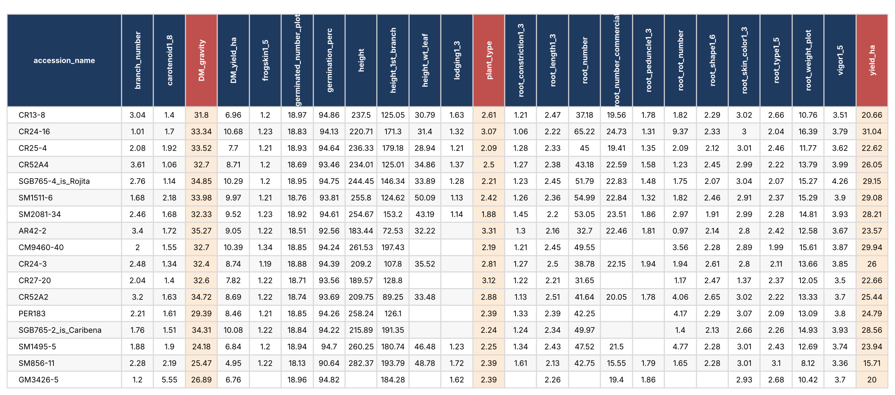{.lightbox fig-align="center" width="100%"}

::: small-note
BLUP of every trait for each clone (sheet BLUPs_gxe of the report). The three red columns are the traits used in the index. This is the base for the breeder's decision. Click to enlarge.
:::

## What a breeder decides from this

-   **Keep** the clones with a high index **and** stable ranking across trials.
-   **Look again** at clones that are good in one place only (G×E).
-   **Check** the traits that were not in the index (disease, root quality) before the final list.
-   **Do not trust** a trait with low heritability.
-   **Write down** the weights and the cut-off, so the next cycle can repeat them.

# Resources for you {.divider}

## Hussain et al. 2022, an open pipeline

::::: columns
::: {.column width="55%"}
-   Article: *Open-source analytical pipeline for robust data analysis, visualizations and sharing in crop breeding*. Plant Methods 18, 1. [doi:10.1186/s13007-022-00845-7](https://doi.org/10.1186/s13007-022-00845-7)
-   Code and demo data: [github.com/whussain2/Analysis-pipeline](https://github.com/whussain2/Analysis-pipeline)
-   R Markdown files with the full code: **quality check** and **lme4**.
-   Demo data: field trials with row and column, outliers and heritability.
:::

::: {.column width="45%"}
::: keybox
**Download**: [Pipeline_cassava_support.zip](../downloads/Pipeline_cassava_support.zip). It has our cassava R Markdown, the data, the original code of Cassava2050, and the demo folders of Hussain et al. (code and data, with their README). Unzip it and open the `.Rproj`.
:::
:::
:::::

## Today's pipeline in one file

-   `Pipeline_cassava_support.Rmd` runs **every step** of this session with free packages.
-   `helpers.R` has the short functions (missing data, layout, SpATS, lme4, correlation, selection).
-   `reference/` keeps the **original code** of the nine trials and the **Hussain folders**, so you can compare.

::: small-note
Run `00_install_packages.R` first. Every package must print TRUE.
:::

## Qualitative traits and mutant populations

-   Disease scores and plant type are **ordinal** or **binary**. A model for counts or categories (binomial, ordinal logistic) can be better than a normal model.
-   In a mutant population the **checks** are the parent, and the plots are **M2 or M3 plants or families**. The same steps apply. Check the design, fix soil trend, estimate the effect of each line against the parent.
-   Few replicates and many lines mean low heritability. **Do not skip the QC** step.

## Key takeaways

-   A pipeline turns many trials into **one repeatable decision**.
-   Always **look at the data first**: design, missing values, shared clones.
-   Fix the **field trend** in each trial before comparing clones.
-   Use a **multi-environment model** to separate clone, place and interaction.
-   The **selection index** uses the breeder's weights. The code makes them visible.

## Plan the analysis before the trial

{fig-align="center" height="280px"}

> "To consult the statistician after an experiment is finished is often merely to ask him to conduct a postmortem examination. He can perhaps say what the experiment died of."

::: small-note
Ronald Fisher, 1938. A good design and a clear question come first. The pipeline only works if the trial was planned well.
:::

## Download the whole report

The Excel file of the 2022 report has all the results of this example. Each sheet is one table, for example the BLUEs and BLUPs of each trial, the heritabilities, the BLUPs of the multi-environment model and the selection index.

::: keybox
**Download**: [2022_DVGXE_master_results.xlsx](../downloads/2022_DVGXE_master_results.xlsx)
:::
