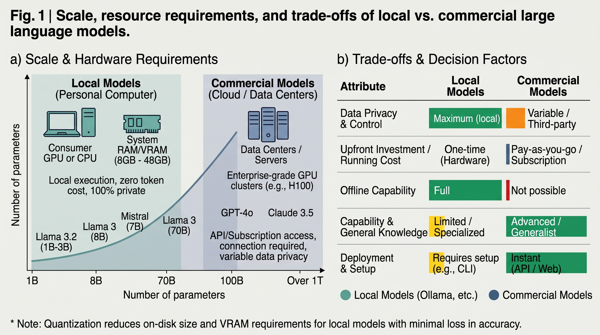

```{r}
#| label: setup
#| include: false
library(ggplot2)
```

## Start the download now {.smaller}

While we talk, install a **free model on your own computer**. It takes a few minutes.

:::::: columns
::: {.column width="50%"}
**1. Install Ollama (Windows)**

Go to [[**ollama.com/download**]{.underline}](https://ollama.com/download/windows)[,]{.underline} download the installer and run it.

**2. Open PowerShell**

Start menu, write `PowerShell`, press Enter.

**3. Download ONE model** (see the table)

```         
ollama pull gemma3:4b
```

**4. Test it**

```         
ollama run gemma3:4b
```

Write `Hello`, press Enter. To leave write `/bye`.
:::

:::: {.column width="50%"}
| Your RAM | Model to download | Size   |
|----------|-------------------|--------|
| 8 GB     | `gemma3:4b`       | 3.3 GB |
| 6 GB     | `llama3.2:3b`     | 2.0 GB |
| 4 GB     | `gemma3:1b`       | 0.8 GB |

::: keybox
Close the browser tabs you do not need. The model uses your memory. The first download is slow if everybody uses the same network. Be patient.
:::
::::
::::::

## Talk to your computer {.smaller}

You can **speak** your questions instead of typing. It is faster for long prompts.

:::::: columns
::: {.column width="55%"}
- **Windows voice typing**. Click in any text box, press the **Windows key + H**, and speak. It is free and already installed.
- [[**Handy**]{.underline}](https://handy.computer/). A free and open source program. It works **offline** and does not send your voice anywhere.
- **Aqua Voice**. A paid program in the cloud. The free plan has 2,000 words. It is fast and fixes your sentences.
:::

:::: {.column width="45%"}
::: keybox
Speak in full sentences. Say the design, the variables and the objective. Read the text before you send it.
:::
::::
::::::

::: small-note
Test your language and your accent before you rely on a tool. Prices and free plans change.
:::

## Plan for this session

1.  What are LLMs, and which free ones can we use
2.  What they do well and what they get wrong
3.  How to write a good prompt
4.  **Live demo** with the alpha-lattice data of Day 2
5.  How to move an answer from one model to another
6.  Data privacy, and models that run on your computer
7.  **Live demo** with a local model and R

# Free assistants {.divider}

## What is an LLM

- A **large language model** has read a huge amount of text. It learns which word comes next.
- It writes text and code that **look** right. It does not run your analysis and it does not know your field.
- Because it predicts text, it can write a **wrong answer with great confidence**.

::: keybox
An LLM is like a very fast assistant who has read every statistics book but has never seen your trial. Good for drafts. Not for decisions.
:::

## Free assistants in the browser {.smaller}

| Assistant | Address | Good to know |
|-----------------------|--------------------|-----------------------------|
| ChatGPT | chatgpt.com | Very popular. The free plan has a daily limit. |
| Claude | claude.ai | Good with long texts and code. Free plan has a limit. |
| Gemini | gemini.google.com | Needs a Google account. Works well with Google Sheets. |
| DeepSeek | chat.deepseek.com | Strong in code. Data are processed on servers in China. |
| Qwen | chat.qwen.ai | Strong in code. Also by a Chinese company. |

::: small-note
Plans, limits and countries change often. Use two different assistants.
:::

## What they do well

- **Write R code** from a clear description (a plot, a model, a loop over trials)
- **Debug**. Paste the error and the line. They explain it and fix it.
- **Explain** an output or a function in simple words
- **Draft** a report, a table caption or a methods paragraph
- **Translate** your text and your comments
- **Convert** code from one style to another (base R to tidyverse)

## What they get wrong

- **Invented results**. If you do not give the data, they invent a number.
- **Wrong model structure**. They forget that block names repeat in each replicate.
- **Functions that do not exist**, or arguments from an old version
- **Sure and wrong**. The text sounds right even when the statistics is wrong.
- **They do not know your design**, unless you tell them.

::: keybox
The risk is not that the code fails. The risk is that it **runs** and gives a **wrong** answer.
:::

## A typical mistake

In the data of Day 2 the blocks are called B1 to B6 **in every replicate**. So block B1 of replicate 1 is not block B1 of replicate 2.

```{r}
#| echo: true
#| eval: false
# Correct. The block is nested in the replicate.
lmer(yield ~ rep + gen + (1 | rep:block), data = d)

# Typical wrong answer. Blocks with the same name are treated as one block.
lmer(yield ~ gen + (1 | rep) + (1 | block), data = d)
```

::: small-note
Both codes run without an error. The second one gives a different block variance and a different residual. Only a person who knows the design sees the problem.
:::

# Good prompting {.divider}

## A bad prompt and a good prompt {.smaller}

::::: columns
::: {.column width="40%"}
**Bad**

> Analyse my trial and tell me which genotype is the best.

The assistant does not know the design, the columns or the goal. It will guess, and it can invent.
:::

::: {.column width="60%"}
**Good**

> You are a statistician who helps a plant breeder. Answer in simple English.\
> **Design**: alpha-lattice, 3 replicates, 6 incomplete blocks per replicate, 24 genotypes.\
> **Data**: data frame `d` with `rep`, `block` (B1 to B6, repeated in each replicate), `gen`, `yield` (t/ha).\
> **Objective**: adjusted mean of each genotype.\
> **Task**: write R code with lme4 and emmeans. Give only code. **Do not invent numbers.**
:::
:::::

## The recipe of a good prompt

1.  **Role**. Who should the assistant be?
2.  **Design**. Replicates, blocks, locations, number of genotypes.
3.  **Data**. Names, types and units of each column. Anything special.
4.  **Objective**. What do you want to know?
5.  **Task and format**. Which package, how long, only code?
6.  **A rule**. "Do not invent numbers. Ask me if something is not clear."

::: keybox
Ask for **code**, not for **results**. The numbers must come from your own R session.
:::

## Always run and verify

1.  **Run** the code on your data.
2.  **Check the model** against your design. What is fixed, what is random?
3.  **Check the numbers** in the text against your output.
4.  **Check the functions**. Does it exist? Try `?function`.
5.  **Ask a second assistant** to review the first one.
6.  **Keep your record**. Save the final code and the prompt that worked.

::: small-note
The checklist and a prompt template are in the folder you can download at the end.
:::

# Live demo {.divider}

## Demos 1 and 2. Two assistants {.smaller}

Data: `john_alpha.csv` (72 plots, 24 genotypes, 3 replicates, 6 blocks per replicate).

1.  **Bad prompt** in assistant A. What does it answer?
2.  **Good prompt** in assistants A and B. Compare the two codes.
3.  **Run both** in RStudio. Compare `VarCorr()`. Are they the same model?
4.  **Invented result**. Ask for the heritability **without** data. Watch the number.
5.  **Debug**. Open `buggy_code.R`. Copy each error to the assistant.
6.  **Explain and report**. Paste the output and ask for a paragraph. Check every number.

::: small-note
Everything is in the folder `prompts/`. Copy and paste. Try it on your computer too.
:::

# Moving between models {.divider}

## How to transfer an answer from one model to another

The assistants do not share memory. A new chat starts from zero.

```{r}
#| fig-width: 10
#| fig-height: 2.6
#| fig-align: center
box <- data.frame(x = c(1, 3.3, 5.6, 7.9), label = c("Assistant A\nworks with you", "Ask A for a\nhand-over summary", "Paste the summary\nin assistant B", "B continues\nor reviews"))
ggplot(box) +
  geom_tile(aes(x, 1, fill = x == 5.6 | x == 7.9), width = 2, height = 1.1, colour = "white") +
  geom_text(aes(x, 1, label = label), size = 4.6, colour = "white", fontface = "bold") +
  geom_segment(aes(x = x + 1.05, xend = x + 1.25, y = 1, yend = 1), data = box[1:3, ],
               arrow = arrow(length = unit(0.18, "cm")), linewidth = 1, colour = "grey40") +
  scale_fill_manual(values = c("#1F3A5F", "#C0504D"), guide = "none") +
  xlim(-0.2, 9.1) + theme_void()
```

::: keybox
Ask the first assistant: **"Write a summary so I can continue in another assistant."** Include the design, the columns, the objective, the final code, the errors and what is missing.
:::

## Use one assistant to check the other

- Paste the code of assistant A in assistant B.
- Ask: *"Review this code as a statistician. Is the model correct for this design? List every error."*
- If they **agree**, you have more confidence. If they **disagree**, you found the place to look.
- **You** decide. Two assistants can make the same mistake.

# Data privacy {.divider}

## Unpublished data and institutional policy {.smaller}

What you write in a free online assistant is sent to a company's servers. It can be stored. Some plans use it to train new models.

| Do not paste | You can paste |
|-----------------------------------|-------------------------------------|
| The full data of an unpublished trial | The design and the column names |
| Names of lines under protection or of partners | Codes (G01, G02) instead of real names |
| GPS coordinates of fields or farmers | A few rows of **simulated** data |
| Anything your institution says is confidential | The error message and the code |

::: keybox
Ask your institution for its AI policy. If there is none, **do not paste unpublished data**. Share the structure, not the data. Check the privacy settings of the assistant and turn off the use of your chats for training.
:::

## A model on your own computer

- The model runs **on your computer**. Without internet. Nothing leaves your machine.
- It is **free**, with no daily limit.
- It is **smaller and slower** than ChatGPT or Claude. Use it for drafts, code and your private data.

Programs to run one:

- **Ollama**. Simple. It is what R connects to. We use it today.
- **LM Studio** or **Jan**. Programs with windows and buttons. They also show if a model fits in your memory.
- **Hugging Face**. The website where most of the models live.

## Local models in simple words {.smaller}

::::: columns
::: {.column width="50%"}
**Parameters (4B, 12B)**\
The size of the model. B means billions of numbers. More parameters means a better model, and more memory.

**Quantization**\
A way to **compress** a model, like a photo saved as JPEG. It becomes 3 or 4 times smaller and loses little quality. The default of Ollama is 4 bits.
:::

::: {.column width="50%"}
**Context window**\
How much text the model can keep in mind in one chat. A long data table can fill it.

**Temperature**\
How creative it is. Low (0 to 0.3) for code and statistics. High for ideas and names.
:::
:::::

::: keybox
Rule: At 4 bits, a model needs about **0.6 GB for every billion parameters**, plus extra memory for the chat. A model of 4B needs about 3 GB.
:::

## Local models vs cloud models



## Which model fits in my computer

```{r}
#| fig-width: 10
#| fig-height: 4
#| fig-align: center
m <- data.frame(
  model = c("gemma3:1b", "llama3.2:3b", "gemma3:4b", "qwen3:8b", "qwen2.5-coder:14b"),
  gb = c(0.8, 2.0, 3.3, 5.2, 9.0))
m$model <- factor(m$model, levels = m$model)
m$fit <- factor(c("Fits 8 GB", "Fits 8 GB", "Fits 8 GB", "Tight in 8 GB", "Needs 16 GB"),
                levels = c("Fits 8 GB", "Tight in 8 GB", "Needs 16 GB"))
ggplot(m, aes(model, gb, fill = fit)) +
  geom_col(width = 0.6) +
  geom_text(aes(label = paste(gb, "GB")), vjust = -0.5, size = 4.5) +
  scale_fill_manual(values = c("#4F9D5D", "#E0A030", "#C0504D"), name = NULL) +
  labs(x = NULL, y = "Download size (GB)") + ylim(0, 10.5) +
  theme_minimal(base_size = 14) + theme(legend.position = "top")
```

::: small-note
Download sizes from the Ollama library. The model needs more memory than its size while it runs. With 8 GB of RAM choose a model of 4 GB or less. A model as large as your RAM will not run.
:::

# Demo with a local model {.divider}

## Demo 3. The model in PowerShell

```         
ollama list
ollama run gemma3:4b
```

Ask in the window:

> Write R code for a boxplot of yield by genotype. The data frame is `d`, columns `gen` and `yield`.

- Turn off the internet. Ask again. It still works.
- Compare with the cloud assistant: **speed**, **quality**, **Spanish or English**.

## Demo 4. The same model from R

```{r}
#| echo: true
#| eval: false
library(ellmer)

chat <- chat_ollama(
  model = "gemma3:4b",
  system_prompt = "You are a statistics assistant for plant breeders. Give R code, not results."
)

chat$chat("Alpha-lattice, 3 replicates, 6 blocks per replicate, 24 genotypes.
           Data frame d: rep, block, gen, yield. Write lme4 code for the adjusted mean of each genotype.")
```

- The **data stay in R**. Only the text of your question goes to the model.
- Run the code that it writes. **Check it** with the 7 checks.

# Ollama window and API {.divider}

## Ollama has a window too {.smaller}

- Open the **Ollama app** from the Start menu. A small llama icon stays near the clock while it runs.
- It has a **chat window**. Choose a model from the list, write, press Enter. No terminal.
- Your chats are saved **on your computer**.
- It is the **same Ollama**. A model that you downloaded in PowerShell appears in the window, and the other way around.
- Look in **Settings** for the folder where the models are saved and, in recent versions, the **context length**.

::: small-note
Use the window if you do not like the terminal. Use PowerShell if you want more control. Both use the same models.
:::

## The API. There is nothing to get {.smaller}

When Ollama is open, it runs a small server on your computer.

::: keybox
Address: `http://localhost:11434`. **No key. No account. No cost.**
:::

- Test it: open that address in the browser. You read **Ollama is running**.
- When a program asks for an API, write this:

| The program asks for       | You write                                  |
|----------------------------|--------------------------------------------|
| Base URL, host or endpoint | `http://localhost:11434`                   |
| OpenAI compatible URL      | `http://localhost:11434/v1`                |
| API key                    | nothing, or any text, for example `ollama` |
| Model                      | the exact name in `ollama list`            |

::: small-note
`localhost` means your own computer. Nobody else can use your model.
:::

## Connect Ollama to your tools {.smaller}

| Tool | How to connect |
|-------------------|-----------------------------------------------------|
| **ellmer** | `chat_ollama(model = "gemma3:4b")` |
| **btw** | `options(btw.client = ellmer::chat_ollama(model = "qwen2.5-coder:3b"))` then `btw::btw_app()` |
| **chattr** | `chattr::chattr_use(ellmer::chat_ollama(model = "gemma3:4b"))` then `chattr::chattr_app()` |
| **Positron Assistant** | Accounts menu, *Configure Language Model Providers*, choose **Ollama**, Connect |
| **Other programs** | Look for *OpenAI compatible* and use `http://localhost:11434/v1` |

::: small-note
btw and Positron agents need a model with **tools** (see `ollama show`). Set the context length in Ollama, not in R.
:::

## Tools to use an assistant inside R {.smaller}

| Tool | What it does |
|-----------------------|-------------------------------------------------|
| **ellmer** | The R package of Posit to talk to a model, local or in the cloud. The base of the others. |
| **btw** | Gives the model the context of your R session (objects, help pages). |
| **gander** | An assistant inside the editor. You select code and ask. |
| **Positron Assistant** | A chat inside Positron, the new editor of Posit. It can use local models from Ollama. |

::: small-note
These tools change quickly. Start with `ellmer`. The others add comfort, not new ideas.
:::

## Cloud or local

|              | Cloud (ChatGPT, Claude...)  | Local (Ollama)            |
|--------------|-----------------------------|---------------------------|
| **Quality**  | Better                      | Good for small tasks      |
| **Speed**    | Fast                        | Slow in a modest computer |
| **Privacy**  | Your text goes to a company | Stays on your computer    |
| **Cost**     | Free plan with limits       | Free, no limit            |
| **Internet** | Needed                      | Not needed                |

::: keybox
Use the **cloud** for hard questions with **public or simulated** data. Use the **local** model when your data are **private**.
:::

## Tonight's task {.smaller}

Practise with **one cloud assistant**, **one local model** and **your data** (or a practice data set). About 60 minutes.

1.  **Check Ollama (10 min).** The window answers. `localhost:11434` says "Ollama is running". `01_ellmer_local_model.R` runs.
2.  **One problem, two assistants (25 min).** Write one prompt with the six parts. Send it to the cloud assistant and to the local model. Run both codes. Apply the 7 checks.
3.  **Make it fail (10 min).** Ask each assistant to review the code of the other.
4.  **Your notes (10 min).** Model, speed, what was wrong, one question for the class.

::: keybox
No data of your own? Download [Practice_datasets.zip](../downloads/Practice_datasets.zip) (chrysanthemum, wheat or bean). The prompt template is `prompt_template.md` inside [LLM_assistants_demo.zip](../downloads/LLM_assistants_demo.zip). **Do not paste unpublished data into a cloud assistant.**
:::

## Cheat sheets

::: keybox
- [Ollama commands](../cheatsheets/ollama_commands_cheatsheet.pdf). For the terminal lovers.
- [Local models in simple words](../cheatsheets/local_models_cheatsheet.pdf). Parameters, quantization, context, memory. For everyone.
- [Tonight's task](../cheatsheets/tonight_task.pdf). One page with the steps and a table for your notes.
:::

They are also inside the demo folder.

## Key takeaways

1.  Assistants are **fast and useful** for code, errors, explanations and drafts.
2.  They can **invent** and they can **choose a wrong model**. Describe your design and **run and verify**.
3.  A good prompt has role, design, data, objective, task and a rule.
4.  To change assistant, ask for a **hand-over summary**. Use one assistant to **review** the other.
5.  Do not paste **unpublished data**. Share the structure. Follow your institution.
6.  A **local model** keeps the data on your computer. It is slower, but it works without internet.
7.  Ollama has a **window** and an **API** at `http://localhost:11434`. No key. Any tool can use it.

## Download the demo folder

::: keybox
**Download**: [LLM_assistants_demo.zip](../downloads/LLM_assistants_demo.zip). It has the data, the prompts, a script with errors, the R script for a local model, the checklist and the prompt template.
:::

Full notes: course manual, chapter "Using Large Language Models as Data Analysis Assistants".

::: small-note
Models and prices mentioned here were checked in November 2026 and change often.
:::
