<style>
.reveal .slides section img:not(.logo){max-height:300px;width:auto;max-width:100%;}
.reveal .slides section h2{font-size:1.5em;}
.reveal .slides section table{font-size:0.8em;}
.reveal .slides section div.sourceCode{font-size:0.8em;}
</style>

## Plan for this session

1.  **Mutant populations are different.** M2 to M5, high variability, unreplicated and replicated stages, seed and clonal crops.
2.  **One example, one pipeline.** 120 chrysanthemum mutants, 4 environments, 6 steps, only free packages.
3.  **Explore and clean.** Missing data, boxplots, correlations, outliers.
4.  **Single trial.** `SpATS` and `lme4`. Heritability, BLUEs and BLUPs.
5.  **Multi-environment.** Shared genotypes, G × E, genotypic correlations.
6.  **Stability and selection.** GGE biplot, selection index, advancement list.

::: small-note
The data are simulated, so we know the true answer and we can check our decisions. The same code works with your own data.
:::

# Mutant populations are different {.divider}

## What changes with irradiation {.smaller}

- In a normal breeding population the variation comes from crosses between known parents. Here it comes from **random changes** in the DNA.
- Most mutations are **harmful or neutral**. A few are useful. The useful ones are rare.
- The population is **large** and the material per line is **small**. Seeds, cuttings and space are limited.
- Many lines are tested **without replication**, at least in the first generations.
- The **parent** is the reference. A good mutant is a parent with **one or a few useful changes**.

::: keybox
Same statistics as in conventional breeding. The difference is the **amount of material** and the **stage**.
:::

## Generations M2 to M5 {.smaller}

| Stage | Material | Replication | What we do with the data |
|---------------|------------------------|---------------|-------------------------|
| **M2** | Single plants, very variable | None | Compare with the **controls**. Select plants. |
| **M3** | Progeny of the selected plants, small rows | None or 1 to 2 | Confirm the change. Compare each family with its control. |
| **M4** | Lines in preliminary trials | 2 or more, or partial | Mixed models, **heritability**, BLUPs. First ranking. |
| **M5 and later** | Advanced lines, several locations | 2 to 3, several environments | **Multi-environment** analysis, stability, advancement. |

::: small-note
A typical scheme. Each programme and each crop adjusts it. The biology of each generation is in the lecture of Mirjana.
:::

## Selection under high variability {.smaller}

::::: columns
::: {.column width="50%"}
**Unreplicated (early generations)**

- Repeat the **controls** (the parents) all over the field.
- Judge each plant against its **neighbour controls**, not against the whole field.
- Remove the field trend with a **spatial model** (`SpATS`).
- Select with a **low intensity of trust**: one plot is a weak signal.
:::

::: {.column width="50%"}
**Replicated (later generations)**

- Two or more plots per line. Blocks or rows and columns in the model.
- Genotype as **random**: BLUPs and heritability.
- Genotype as **fixed**: BLUEs.
- Several environments: **G × E** and stability.
:::
:::::

::: keybox
The more replication, the more we can trust the ranking. With one plot, **keep more lines** than you think you need.
:::

## Seed crops and clonal crops {.smaller}

| | Autogamous (wheat, rice, bean, barley) | Allogamous (maize, sunflower) | Clonal (chrysanthemum, banana, potato, cassava) |
|----------------|----------------------|----------------------|----------------------|
| **How the mutation is kept** | Becomes homozygous by selfing. Lines are fixed in M4 or M5. | Heterozygous. Need selfing or controlled crosses. | Cuttings or tubers. Every plant of a clone is the same. |
| **Unit of analysis** | Line | Family or selfed progeny | Clone |
| **Replication** | Plots of a line | Plots of a family | Cuttings of the same clone |
| **Typical problem** | Few seeds in M2 and M3 | Many generations of selfing | **Chimeras**: part of the plant is mutated |

::: small-note
Our example is clonal. A clone can be repeated as many times as cuttings you have, so heritabilities are high. A **chimera** is a plant made of tissues with different genotypes: only one sector carries the mutation. Cuttings of the same line can then look different, so purify it (propagate several times, keep the shoots that show the full change) before you select. The pipeline is the same for the other crops. Only the unit and the replication change.
:::

# One example, one pipeline {.divider}

## The data. Chrysanthemum mutants {.smaller}

- **120 lines**: 4 parent cultivars and 116 mutants from cuttings irradiated with 20, 40 or 60 Gy. **Gy** (gray) is the unit of radiation dose: 1 Gy is 1 joule of energy absorbed by each kilogram of tissue.
- **4 environments**: greenhouse in autumn and spring, open field in autumn and spring.
- **Randomized complete blocks**: 2 or 3 blocks of 12 rows by 10 columns. Row and column are known.
- **5 traits**: days to flowering, plant height, flower diameter, flower number, stem weight. Also flower colour.
- **1,080 plots**.

::: keybox
**Simulated data.** Real problems on purpose: missing values, a flooded block and wrong values. Download it: `Practice_datasets.zip`.
:::

## The pipeline in six steps

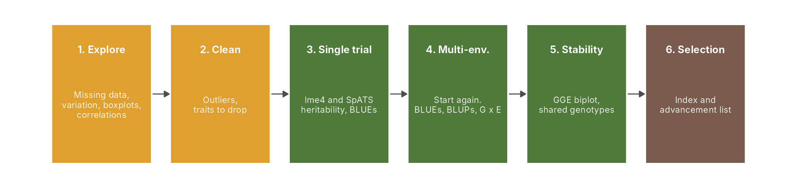{fig-align="center"}

- Same ideas as the cassava pipeline of Day 6. Now with **free packages**: `ggplot2`, `lme4` and `SpATS`.
- One function for each step, in the file `helpers_mutant.R`.

## How the data were simulated {.smaller}

- Made in **R** with the package **`FieldSimR`**, which is built to simulate field trials: genotype effects, **spatial error** (trend by row and column), blocks and several environments.
- Correlated effects between traits and between environments come from a multivariate normal (`MASS::mvrnorm`). This creates the genotype and **G × E** that we try to recover.
- Then we add **real problems on purpose**: missing plots, a flooded block, wrong values (outliers) and chimeras in the colour of the flowers.
- The **true genetic values are kept by the instructor**. This is why we can ask at the end: *how good was our choice?*

::: small-note
Chrysanthemum, wheat and bean were made in the same way. Real data are never this clean, but the pipeline is the same.
:::

# 1. Explore {.divider}

## Missing data

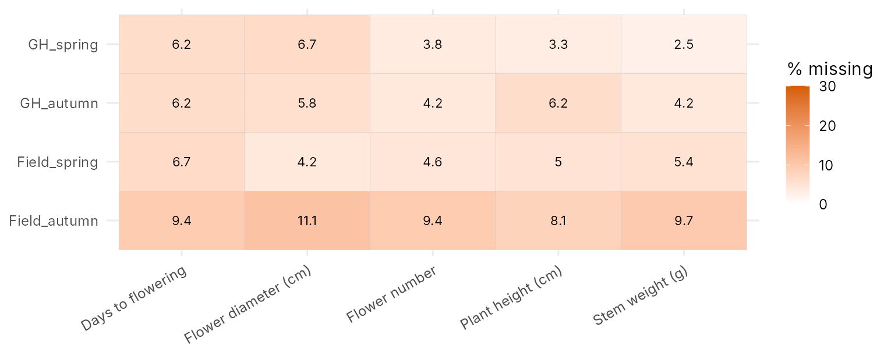{fig-align="center"}

::: keybox
A trait with **more than 20 to 25% of missing values** is not worth analysing. Here the highest is 8%, so all stay.
:::

## Is there variation?

```{r}
#| echo: true
#| eval: false
source("helpers_mutant.R")
d <- load_mutant("data/chrysanthemum_mutant_trials.csv")
traits <- c("days_to_flowering", "plant_height_cm", "flower_diameter_cm",
            "flower_number", "stem_weight_g")
check_traits(d, traits)       # % missing, mean, sd, coefficient of variation, keep
```

| Trait | Missing (%) | Mean | CV (%) | Keep |
|-------------------|-----------|----------|-----------|----------|
| Days to flowering | 7.4 | 83.3 | 21.4 | yes |
| Plant height (cm) | 5.9 | 81.7 | 19.2 | yes |
| Flower diameter (cm) | 7.4 | 7.6 | 76.7 | yes |
| Flower number | 5.9 | 13.2 | 107.7 | yes |
| Stem weight (g) | 5.9 | 58.8 | 67.8 | yes |

::: small-note
A trait with almost no variation (CV below 1%) cannot be used to select. It is removed here. The very high CV of flower diameter, flower number and stem weight in the **raw** data is a warning. Look at the boxplots.
:::

## Boxplots of all the traits

```{r}
#| echo: true
#| eval: false
library(ggplot2)
long <- reshape(d[, c("trial", traits)], direction = "long", varying = traits, v.names = "value",
                timevar = "trait", times = traits, idvar = NULL)
ggplot(long, aes(trial, value)) + geom_boxplot(outlier.colour = "#D55E00") +
  facet_wrap(~trait, scales = "free_y")
```

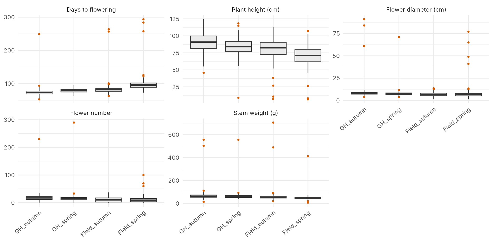{fig-align="center"}

## What the boxplots tell us

- **Orange points far from the box** are values that are not possible. A flowering time of 290 days. A flower of 90 cm. A stem of 700 g.
- They are **typing errors**: a decimal point in the wrong place, a number multiplied by 10.
- They hide the real variation. The box is flat because one point stretches the axis.
- Also see the **difference between environments**: the greenhouse is taller and flowers earlier.

::: keybox
Never delete a value because it is high. Delete it because it is **impossible**, or because the model says it does not belong.
:::

## The field

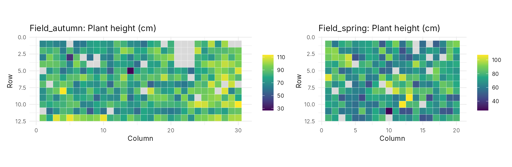{fig-align="center"}

- Grey squares are missing plots. In `Field_autumn` there is a **block of grey plots**: a flood. The plots were lost, and they are not random.
- A trend in the colours (taller on one side) would tell us that a **spatial model** can help.

## Raw correlation between traits

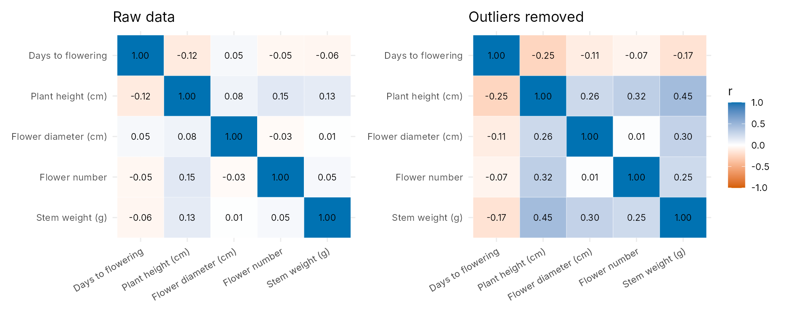{fig-align="center"}

::: keybox
With the **raw** data almost all correlations are close to zero. A few wrong values hide the real relation. After **cleaning**, plant height and stem weight show r = 0.46.
:::

# 2. Clean {.divider}

## Find the outliers

We flag a value in two steps, in each trial and trait:

1.  **Gross errors.** A value very far from the median of the trial (robust z above 6).
2.  **With a model.** Genotype and block as random terms. A plot whose residual is above 4 robust standard deviations. Only when lines have 1.5 plots or more.

```{r}
#| echo: true
#| eval: false
flags <- flag_outliers(d, traits)       # a table with the flagged values
head(flags)
d_clean <- remove_outliers(d, flags)    # the flagged values become NA
```

::: small-note
In our simulated data 32 outliers were inserted. The function flags 32 values and finds 31 of them. A flag is only a **question**. The next slide shows how to review the flagged values before removing them.
:::

## Remove or keep? Review first {.smaller}

**Not every outlier is an error.** In a mutant population the most interesting line can be the one that looks strange. A line that is extreme in **all its plots** may be a **potential mutant** or a new accession for a second stage. Removing it blindly would throw away what we are looking for.

```{r}
#| echo: true
#| eval: false
flags <- flag_outliers(d, TRAITS, cutoff = 3)   # a lower cut-off to be more sensitive
rev <- review_outliers(d, flags, limits = list(plant_height_cm = c(10, 200)))
table(rev$suggestion)
d2 <- remove_outliers(d, rev[!grepl("Possible mutant", rev$suggestion), ])   # optional
```

| Flagged value is | What we see | Suggestion |
|-----------------------|-----------------------|---------------------------|
| **Impossible** | Outside the limits you give (28 values) | Remove |
| **Isolated** | The other plots of the line are normal (25 values) | Check the field book, then remove |
| **Repeated** | The line is extreme in its other plots too (2 values) | **Keep it. Possible mutant** |

::: keybox
The breeder decides. Removing outliers is **optional**. Keep a list of the lines to check, and look at them again in the next stage.
:::

## An outlier that was a real mutant

- Line **M066** (60 Gy, from Parent_C) was flagged for plant height in `Field_autumn`, and it is low in its other plots too.
- Because the data are simulated we know the truth: M066 is the **shortest line of the whole population** (59 cm, while its parent has 87 cm). A dwarf mutant, and a promising one.
- The other flagged line that is repeated, M106, is a false alarm: its flowers are only a little larger than average.

::: small-note
The review does not decide for you. It tells you **where to look**. In the practical you do this with the flags of your own run.
:::

## Before and after

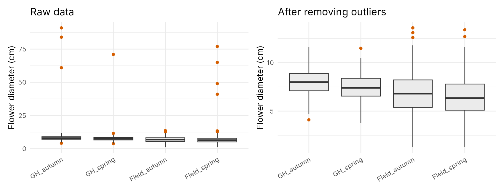{fig-align="center"}

- After removing the outliers the boxplots show the **real variation**.
- Missing values go from 7.4% to 8.1% for this trait. We **lose a little data and gain a lot of reliability**.

# 3. Single trial {.divider}

## Two ways to model the field {.smaller}

::::: columns
::: {.column width="50%"}
**lme4. Design and random terms**

```{r}
#| echo: true
#| eval: false
# BLUPs and heritability
lmer(y ~ (1 | g) + (1 | block) +
         (1 | row) + (1 | col))
# BLUEs
lmer(y ~ g + (1 | block) +
         (1 | row) + (1 | col))
```

Row and column are **random terms**. We can try several versions.
:::

::: {.column width="50%"}
**SpATS. Design and space**

```{r}
#| echo: true
#| eval: false
SpATS(response = "y", genotype = "g",
  genotype.as.random = TRUE,
  spatial = ~ PSANOVA(col, row),
  random = ~ block, data = x)
```

A smooth surface of the field is taken out of the error. It needs row and column.
:::
:::::

::: keybox
Both give a heritability and BLUEs. We compare them. If they agree, we trust the result more.
:::

## Four lme4 models {.smaller}

- **block**: `(1 | block)`. Design only. The starting point.
- **rowcol**: `(1 | block) + (1 | row) + (1 | col)`. Row and column as **crossed** random effects.
- **nested**: `(1 | block) + (1 | block:row) + (1 | block:col)`. Row and column **inside each block**. Use it when the row or column numbers are repeated in every block.
- **rowcol_nb**: `(1 | row) + (1 | col)`. No block term, when blocks are too small to estimate.

Genotype is always random: `(1 | g)`.

```{r}
#| echo: true
#| eval: false
cm <- compare_lme4_models(x, "plant_height_cm")   # AIC, heritability and variances of the four models
```

::: small-note
In our trial the blocks are strips of columns, so the column is already inside the block. The row crosses the blocks. Other field layouts need other choices. Try them and compare.
:::

## Do the rows and columns explain variance?

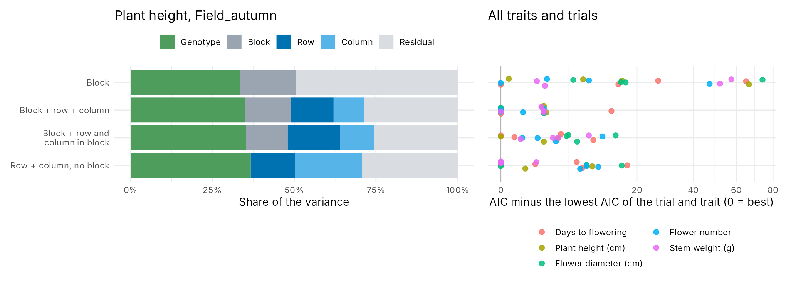{fig-align="center" style="max-height:230px"}

- **Left.** In plant height of `Field_autumn`, row and column take **a large part** of the variance that was in the residual. The genotype share stays about the same.
- **Right.** The AIC of the model with block only is much higher than the others in most traits and trials. Adding row and column **improves the fit**.

## Choose the model {.smaller}

- The model with the **lowest AIC** is the best fit (a difference below 2 is a tie). We also look at the heritability.
- Which model wins depends on the trial and the trait: *rowcol* (8 of 20), *rowcol_nb* (8), *block* (2), *nested* (2).

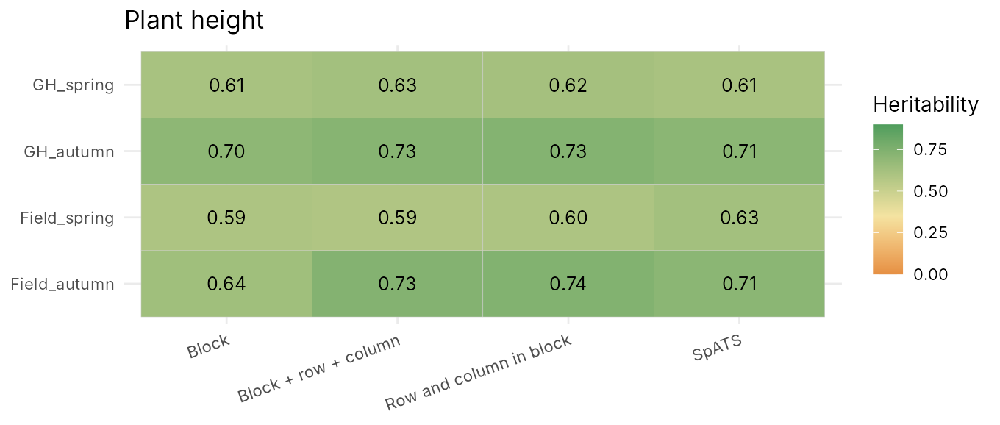{fig-align="center" style="max-height:230px"}

::: keybox
For plant height, the heritability of the block model was 0.64 in `Field_autumn`. With **row and column** it goes to 0.73. The residual went down, so the **line means are more precise**. SpATS gives 0.71.
:::

## Heritability by trial and trait

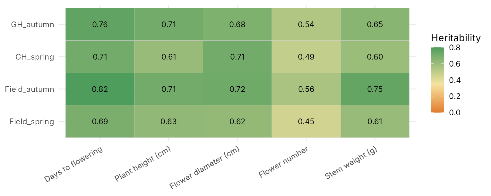{fig-align="center"}

- Heritability here is the **generalized heritability** of a trial, as given by `SpATS`. We also calculate it from the `lme4` models, using the prediction error variance of the BLUPs. It says how well the line means reflect the genotype.
- **Flower number** is the lowest. It is a count and it has a lot of noise.
- **Days to flowering** is the highest.

## Can we continue with the trait?

| Heritability | Decision |
|---------------------------------|-------------------------------------------|
| **Above 0.5** | Good. Use it for selection. |
| **0.2 to 0.5** | Use with care. Give it less weight in the index. |
| **Below 0.2** | Do not trust the ranking in this trial. Drop the trial or the trait. |

::: small-note
These limits are a guide, not a law. They depend on the crop, the stage and the cost of a mistake. In our data all traits are above 0.4 in all trials, so we keep everything.
:::

## lme4 against SpATS {.smaller}

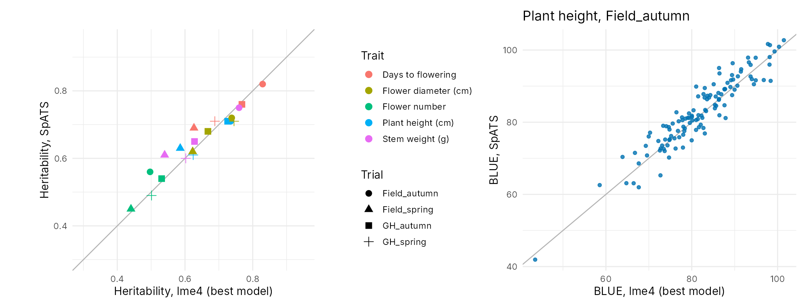{fig-align="center" style="max-height:230px"}

- **Left.** Each point is **one trait in one trial**: 5 traits in 4 trials, 20 points. The colour is the trait and the shape is the trial. On the line, both methods give the same heritability.
- **Right.** BLUEs of plant height in one trial. The two methods rank the lines in a very similar way.
- On average the heritability is 0.64 with the best `lme4` model and 0.65 with `SpATS`. When they agree, the choice of method matters little.

## BLUE or BLUP

| | BLUE | BLUP |
|----------------|----------------------------|-----------------------------|
| **Genotype is** | Fixed | Random |
| **Estimate** | Adjusted mean of the line | Mean pulled towards the general mean |
| **Use it for** | Comparing lines, **stage 2** of a multi-environment model | **Ranking** and selection |
| **Weakness** | Noisy for lines with few plots | Depends on the heritability |

::: keybox
**BLUPs of a single trial are not an input for the multi-environment model.** They are already shrunk. Start again from the plot data, or use the BLUEs.
:::

## Early generations. Lines with one plot {.smaller}

- In M2 and M3 many lines have **one plot**. For these lines the plot error and the genotype cannot be separated.
- The BLUP pulls a line with one plot **towards the mean**. One plot is a weak signal, so a high value can be luck.
- Lines with one and with several plots can be compared on **one scale** with BLUPs, as long as the controls are repeated in the field.

::: keybox
Keep **more lines** than you think you need in the first generations. Repeat the best ones in the next stage.
:::

# 4. Multi-environment {.divider}

## Start again from the plot data

::::: columns
::: {.column width="55%"}
**Single stage with `lme4`**

```{r}
#| echo: true
#| eval: false
lmer(y ~ trial + (1 | block_id) +
       (1 | g) + (1 | g:trial))
```

All environments in **one model**, from the plot data.
:::

::: {.column width="45%"}
**What we get**

- BLUPs and BLUEs over the environments.
- **Variance** of genotype, of G × E and of error.
- Heritability **across** environments.
:::
:::::

::: small-note
With many lines that are not in all trials, a **two-stage** analysis is easier: first the BLUEs of each trial with their standard errors, then one model over the trials with weights (`nlme`, function `stage2_met` in the practical).
:::

## Shared genotypes {.smaller}

::::: columns
::: {.column width="55%"}
- A model over environments needs **lines in common**. They are the **bridges**: they tell us how the same line behaves in different places.
- With few shared lines the G × E estimate is weak.
- In our example all **120 lines are in all 4 environments**, so every pair of trials shares 120 lines.
:::

::: {.column width="45%"}
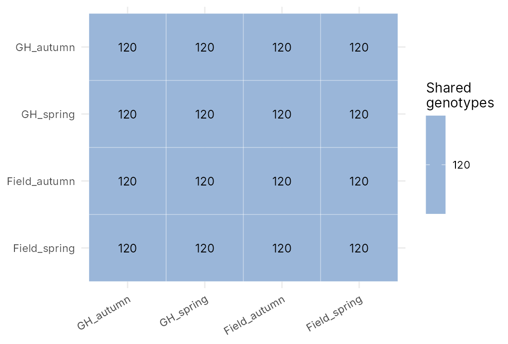{fig-align="center"}
:::
:::::

::: small-note
In real programmes the lines in advanced trials are different from year to year. Plan some **common lines** (the parents and a few good lines) in every trial.
:::

## Variance in the multi-environment model

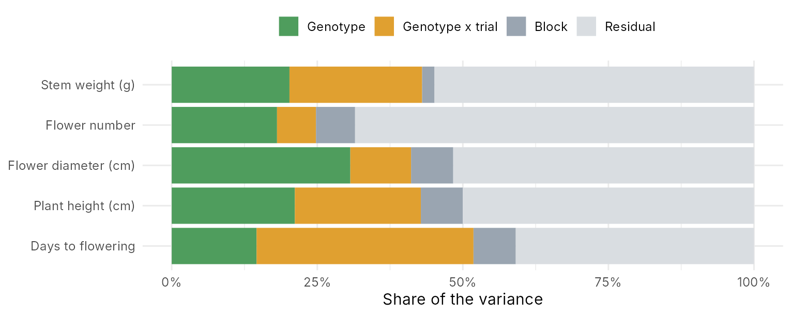{fig-align="center" style="max-height:230px"}

| Trait | Genotype | G × trial | Block | Residual | Heritability |
|--------------------|---------|---------|---------|---------|----------|
| Days to flowering | 8.0 | 20.5 | 4.0 | 22.5 | 0.50 |
| Plant height | 37.6 | 38.4 | 12.8 | 88.8 | 0.64 |
| Flower diameter | 1.0 | 0.3 | 0.2 | 1.7 | 0.77 |
| Flower number | 11.6 | 4.3 | 4.3 | 44.0 | 0.64 |
| Stem weight | 30.0 | 33.8 | 3.2 | 81.4 | 0.62 |

## Reading the table

- **Flower diameter**: G × E is small. The best lines in one place are the best everywhere. Select once.
- **Days to flowering**: G × E is **larger than the genotype variance**. The lines flower in a different order in each environment.
- **Plant height and stem weight**: G × E about as large as genotype. Look at stability.
- The heritability is on a line-mean basis, over all environments.

::: keybox
Large G × E means that a good line **somewhere** is not always good **everywhere**. Decide where the variety will be grown.
:::

## Genotypic correlation between trials

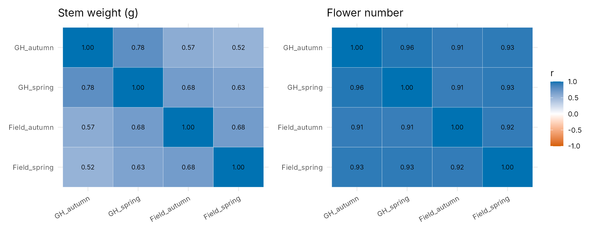{fig-align="center" style="max-height:230px"}

- **Traits shown: stem weight (left) and flower number (right).**
- **Stem weight**: the correlation between environments goes from 0.54 to 0.80. The greenhouse and the field rank the lines differently.
- **Flower number**: above 0.9. Very stable.
- These come from BLUPs, which are shrunk, so they tend to be a little **high**.

## Genotypic correlation between traits

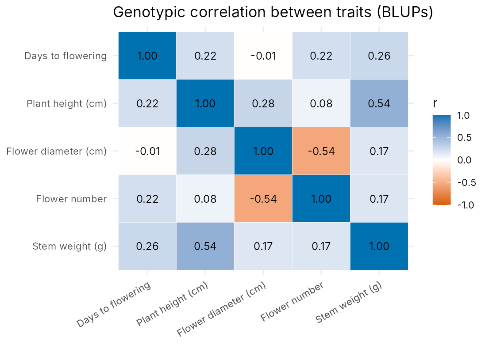{fig-align="center" width="62%"}

- **Flower number against flower diameter: r = -0.54.** More flowers, smaller flowers. A **trade-off** that the index must handle.
- Plant height and stem weight go together (0.53).

# 5. Stability {.divider}

## GGE biplot of stem weight

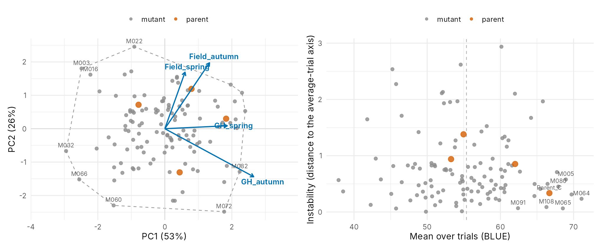{fig-align="center"}

## How to read it {.smaller}

- **Left.** Each blue arrow is an environment. Each dot is a line. The two axes explain 80% of the variation of genotype plus G × E.
- Arrows that point to **different directions** mean that the environments rank the lines differently. Here the greenhouse and the field are apart.
- **Right.** The best lines are at the **right** (high mean) and at the **bottom** (stable).
- Orange dots are the **parents**. The best mutants are above all the parents on the right.

::: keybox
Choose a line for the environment where you will grow it. If you must grow it everywhere, choose the one that is **high and stable**.
:::

# 6. Selection {.divider}

## Selection index

- We need **one number** per line. A weighted sum of the standardised BLUPs.
- The weights are the **product profile**, in other words, what the market and the growers want.

| Trait | Weight | Why |
|-----------------------|----------|-------------------------------|
| Flower number | +10 | More flowers per plant |
| Flower diameter | +10 | Bigger flowers |
| Stem weight | +5 | Stronger stem |
| Days to flowering | -5 | Earlier crop |
| Plant height | 0 | Not part of the profile |

::: small-note
These weights are an **example**. Define yours with the breeder, the grower and the market.
:::

## Ranking and the 25% that we advance

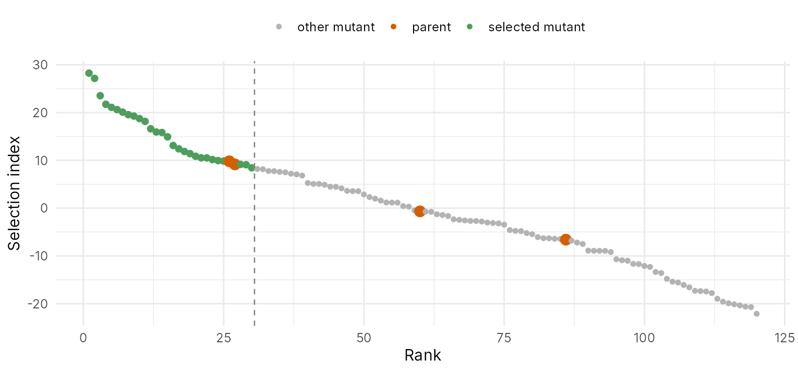{fig-align="center"}

- We advance the top 25%: **30 lines**.
- Two of the four parents are inside the group. The mutants have to be better than the parents, **25 mutants** are above the best parent (C) and 26 above parent A.

## Who is selected {.smaller}

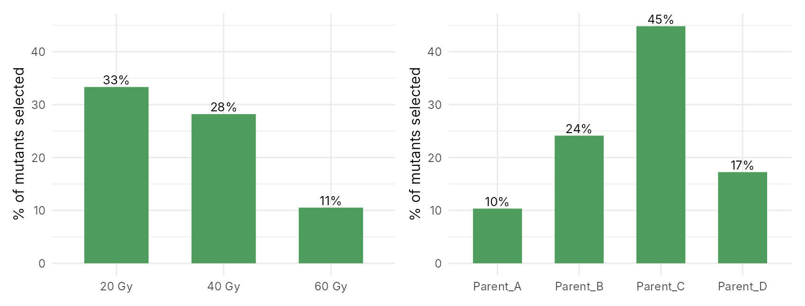{fig-align="center" style="max-height:230px"}

- The **40 Gy** group gives 28% and the **20 Gy** group 33%. The 60 Gy group is lower (10%). More damage is not more gain.
- **Gy (gray)** is the unit of radiation dose: **1 Gy = 1 joule absorbed per kg of tissue**. Here 20 Gy is **low**, 40 Gy **medium** and 60 Gy **high**. More dose gives more mutations, but also more damage. The right dose comes from the radiosensitivity test.
- Parent C gives the most selected mutants.
- **No chimera was selected**.

## The best 10 mutants

| Rank | Line | Parent | Dose (Gy) | Colour | Index | Flowers | Diameter (cm) | Stem (g) | Days |
|---|---|---|---|---|---|---|---|---|---|
| 1 | M009 | Parent_A | 60 | pink | 28.3 | 16.1 | 7.0 | 59 | 77 |
| 2 | M005 | Parent_A | 40 | light pink | 27.2 | 14.7 | 7.6 | 65 | 81 |
| 3 | M073 | Parent_C | 20 | yellow | 23.5 | 14.3 | 8.6 | 61 | 84 |
| 4 | M077 | Parent_C | 40 | yellow | 21.7 | 11.9 | 8.5 | 58 | 80 |
| 5 | M062 | Parent_C | 40 | yellow | 21.1 | 11.0 | 8.4 | 64 | 81 |
| 6 | M080 | Parent_C | 40 | yellow | 20.6 | 12.7 | 8.2 | 62 | 82 |
| 7 | M029 | Parent_A | 40 | pink | 20.1 | 22.2 | 6.2 | 53 | 83 |
| 8 | M061 | Parent_C | 20 | yellow | 19.6 | 12.7 | 8.2 | 59 | 81 |
| 9 | M108 | Parent_D | 60 | bronze | 19.3 | 16.2 | 7.1 | 63 | 83 |
| 10 | M047 | Parent_B | 40 | white | 18.8 | 12.9 | 8.5 | 62 | 84 |

## How good was our selection?

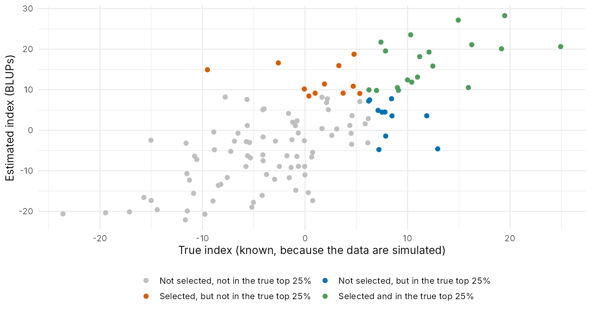{fig-align="center"}

::: keybox
Of the 30 lines selected, **19 are truly in the best 25%**. The others were lucky. Some of the truly best lines were not selected (blue). This is the **uncertainty** that we always have.
:::

# Practical session {.divider}

## What you do now

1.  Open `Mutant_pipeline_practical/Mutant_pipeline.Rproj` and the file `Mutant_pipeline.Rmd`.
2.  Run the pipeline **for chrysanthemum**. Answer the questions in each step.
3.  Change **one line** to use **wheat** (partially replicated) or **bean**.
4.  Then use your own data. The functions read any table with genotype, block, trial, row and column.

::: keybox
**Download**: [Mutant_pipeline_practical.zip](../downloads/Mutant_pipeline_practical.zip). It has the data of the three crops, the functions, the report and the instructions.
:::

## Key takeaways

1.  A mutant population needs the **same statistics**, with **more care**: more variation, less material, less replication.
2.  Always start with **exploration**: missing data, boxplots, correlation. **Clean** before modelling.
3.  Use **SpATS and lme4** in each trial. Check the **heritability** before you continue.
4.  The multi-environment model **starts again** from plot data or BLUEs. Never from single-trial BLUPs.
5.  Look at **G × E and stability** (GGE biplot) before you choose.
6.  Select with an **index** that follows the product profile, and accept the **uncertainty**.

::: small-note
Simulated data. Packages: `ggplot2`, `lme4`, `SpATS`, `nlme`, `patchwork`. Full notes in the course manual, chapter "Experimental Design and Statistical Pipelines for Mutation Breeding Applications".
:::
