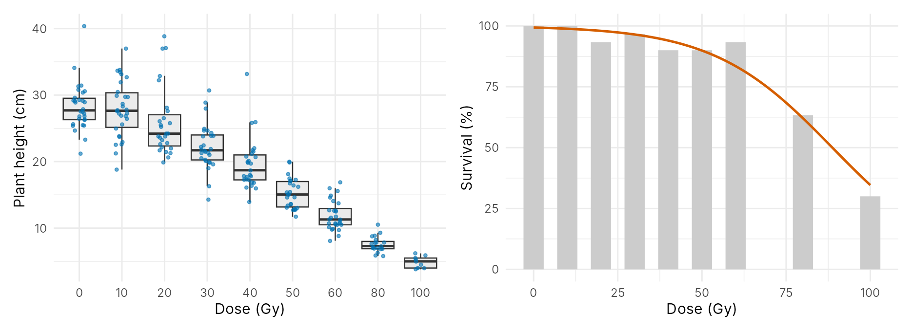
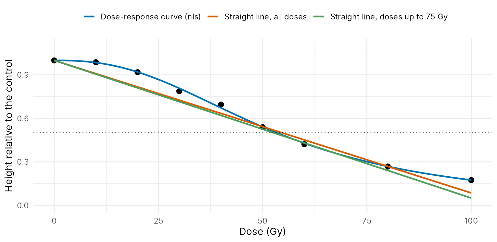
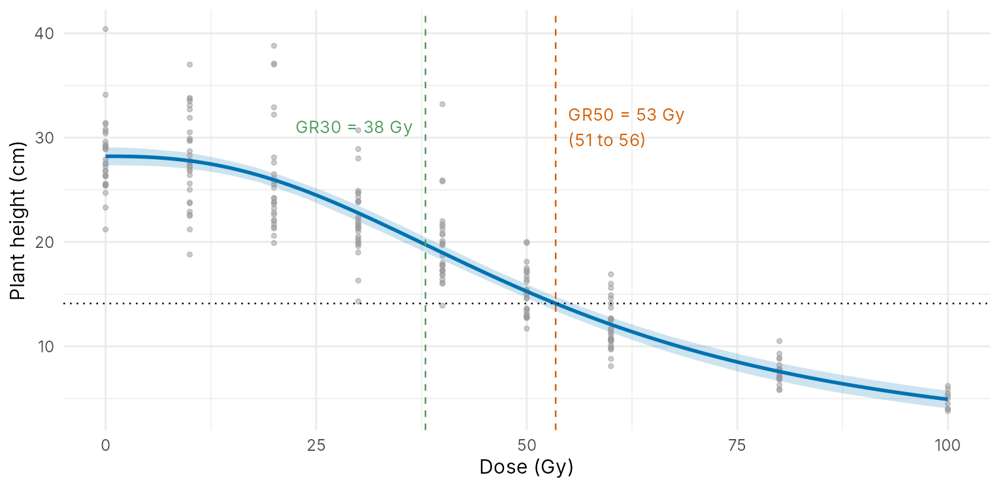
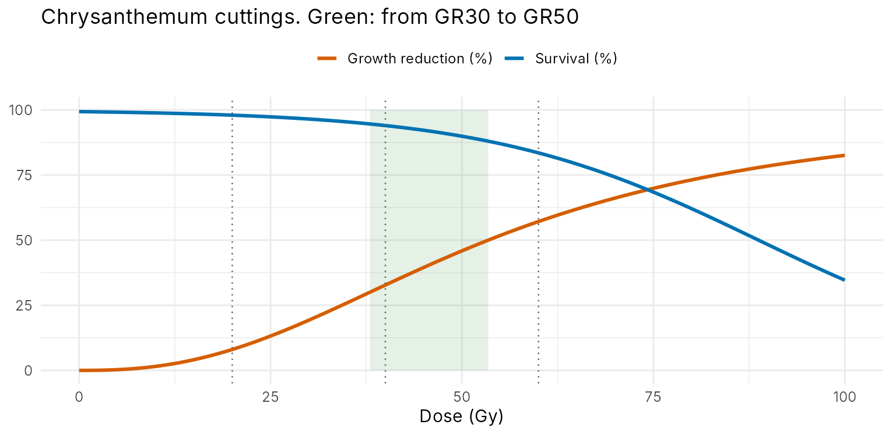
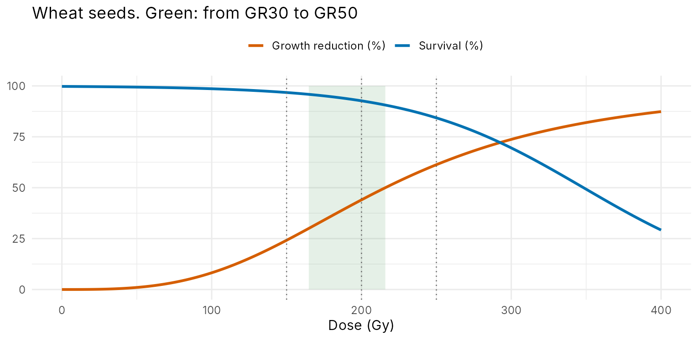

<style>
.reveal .slides section img:not(.logo){max-height:300px;width:auto;max-width:100%;}
.reveal .slides section h2{font-size:1.5em;}
.reveal .slides section table{font-size:0.8em;}
.reveal .slides section div.sourceCode{font-size:0.8em;}
</style>

## Plan for this practical

1.  **Why the dose matters.** Too low: no variation. Too high: no plants.
2.  **Two numbers.** GR50 (growth) and LD50 (survival).
3.  **From plant data to a curve.** Simple line first, then the dose-response curve.
4.  **Choose the dose** for the mutation breeding programme.
5.  **Your turn** with chrysanthemum cuttings and wheat seeds.

::: small-note
Simulated data. The same code works with your own test of doses.
:::

# Why the dose matters {.divider}

## The ideal dose {.smaller}

- **Too low.** Few mutations. The population looks like the parent.
- **Too high.** Many plants die, the survivors are weak and sterile. The mutations are there, but we lose the material.
- **In the middle.** Enough mutations and enough plants to select from.

::: keybox
Mutation breeding **follows conventional breeding**: the parent must already be a good variety. The mutant only has to add one or two useful changes. The dose is chosen **before** the big irradiation, with a small test.
:::

## LD50 and GR50

| | What it is | Measured on |
|---------------|----------------------------|-------------------------|
| **LD50** | Dose that kills **50% of the plants** | Survival (alive or dead) |
| **GR50** | Dose that **reduces growth by 50%** compared with 0 Gy | Height, weight, root length of the survivors |
| **GR30** | Dose that reduces growth by 30% | Same as GR50 |

- Both depend on the **crop**, the **tissue** (seed, cutting, in vitro) and the **trait**.
- Many programmes work with a dose around **GR30 to GR50** and with good survival. This is a **guide**, not a rule. Check the literature for your crop.

# The data {.divider}

## One row per plant

```{r}
#| echo: true
#| eval: false
source("radio_helpers.R")
d <- read.csv("data/chrysanthemum_radiosensitivity.csv")
head(d)
```

| crop | dose_Gy | plant | survived | height_cm | fresh_weight_g |
|--------------|---------|-------|----------|-----------|----------------|
| chrysanthemum | 0 | 1 | 1 | 30.8 | 22.6 |
| chrysanthemum | 0 | 2 | 1 | 29.1 | 17.8 |
| chrysanthemum | 20 | 31 | 0 | NA | NA |

- 9 doses (0 to 100 Gy) with **30 cuttings** each. Wheat: 8 doses (0 to 400 Gy), **40 seeds**.
- A dead plant has `survived = 0` and no measurement.

## How the data were simulated {.smaller}

- Simulated in base **R**. Each plant has a growth value that follows a **dose-response curve** plus plant-to-plant noise, which is larger at the middle doses.
- Survival is simulated with a **logistic curve** of the dose. Dead plants have no measurement.
- Chrysanthemum cuttings (0 to 100 Gy) and wheat seeds (0 to 400 Gy) use the same code with different parameters.
- The **true GR50 and LD50 are kept by the instructor**, so we can compare them with our estimates at the end.

## Look at the raw data first

{fig-align="center"}

- Each point is a plant. The line joins the **means**.
- The plants get smaller as the dose goes up, and the spread **changes** with the dose.

## Relative growth

```{r}
#| echo: true
#| eval: false
s <- dose_summary(d)     # mean, sd, n, relative growth and reduction (%) by dose
s
```

| Dose (Gy) | Mean height (cm) | Plants alive | Reduction (%) |
|-----------|----------------|--------------|----------------|
| 0 | 28.2 | 30 | 0 |
| 30 | 22.2 | 28 | 21 |
| 50 | 15.2 | 26 | 46 |
| 60 | 11.9 | 28 | 58 |
| 100 | 4.9 | 9 | 83 |

::: small-note
Reduction = 1 - (mean at the dose / mean at 0 Gy). The 50% reduction is between 50 and 60 Gy.
:::

# Estimate GR50 {.divider}

## Step 1. The simple way, a straight line

{fig-align="center"}

- A regression `height ~ dose` and the dose where the line reaches half of the intercept.
- With only the lower doses: **GR50 = 53 Gy**. Using all doses: **55 Gy**.
- The true curve is **not a straight line**. The line works only near the middle.

## Step 2. The dose-response curve

`growth = D / (1 + (dose / e)^b)`

- **D** growth without radiation. **e** = GR50. **b** how fast the growth falls.

```{r}
#| echo: true
#| eval: false
fit <- fit_dose_response(d, "height_cm")    # nls on the plant data
dose_for_reduction(fit, 0.5)                # GR50 with a 95% interval
```

{fig-align="center"}

## Results of the curve

| | Estimate (Gy) | 95% interval |
|-----------|---------------|---------------|
| **GR20** | 31 | 27 to 33 |
| **GR30** | 38 | 35 to 41 |
| **GR50** | **53** | 51 to 56 |

::: keybox
The curve uses **all plants** and gives an **interval**. The line gave 53 to 55 and no interval. The curve is the better way to report the result.
:::

# Estimate LD50 {.divider}

## Survival

```{r}
#| echo: true
#| eval: false
sv <- fit_survival(d)          # glm(survived ~ dose, family = binomial)
ld50(sv)                       # dose with 50% survival, with interval
```

- LD50 = **89 Gy** (95% interval 81 to 99).
- It is **higher** than GR50. The plants are smaller well before they die.

::: small-note
The model is a logistic regression: the probability of survival goes down with the dose.
:::

# Choose the dose {.divider}

## Put it all together

{fig-align="center"}

## The table to decide

| Dose (Gy) | Growth reduction (%) | Survival (%) |
|-----------|--------------------|---------------|
| 20 | 8 | 98 |
| 30 | 19 | 96 |
| **40** | **33** | **94** |
| **50** | **46** | **90** |
| 60 | 57 | 83 |
| 80 | 73 | 62 |
| 100 | 83 | 35 |

::: keybox
Between **GR30 and GR50** (about 40 to 55 Gy) we have a strong effect on growth and still **90% of the plants alive**. At 80 Gy we lose 4 plants of 10. The final choice also depends on the **mutation frequency** that you see in the next generation.
:::

## The trait changes the answer

| | GR50 height | GR50 fresh weight |
|------------|-------------|-------------------|
| Chrysanthemum | 53 Gy | **39 Gy** |

- Weight is more sensitive than height. Use the trait that is **important for your breeding goal** and say which one.
- Better still: **report both** and choose a dose that works for the two.

## Same analysis with wheat seeds

{fig-align="center"}

- **GR50 = 216 Gy** (209 to 223). **LD50 = 348 Gy** (328 to 372).
- The doses are different (seeds, Gy), the **method is the same**. Same functions, only another file.

# Practical session {.divider}

## Your turn

1.  Open `Radiosensitivity_practical/Radiosensitivity.Rproj`.
2.  Run the script for **chrysanthemum**. Answer the questions.
3.  Run it for **wheat** by changing one line.
4.  Question: *If you could only irradiate 2 doses in your big experiment, which ones and why?*

::: keybox
**Download**: [Radiosensitivity_practical.zip](../downloads/Radiosensitivity_practical.zip)
:::

## Key takeaways

1.  The test of doses is **small and cheap**. The mistake of a wrong dose is **big and expensive**.
2.  **GR50** comes from growth and **LD50** from survival. They are different numbers.
3.  Use a **curve** (and report an interval), not only a straight line.
4.  Pick a dose with **good growth effect and good survival**, and report the trait you used.
5.  Mutation breeding **follows** conventional breeding: the parent must be good first.
