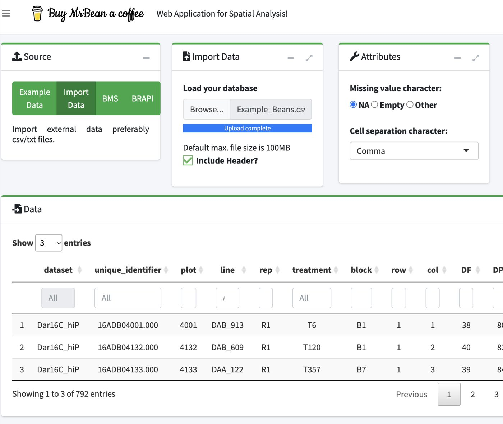
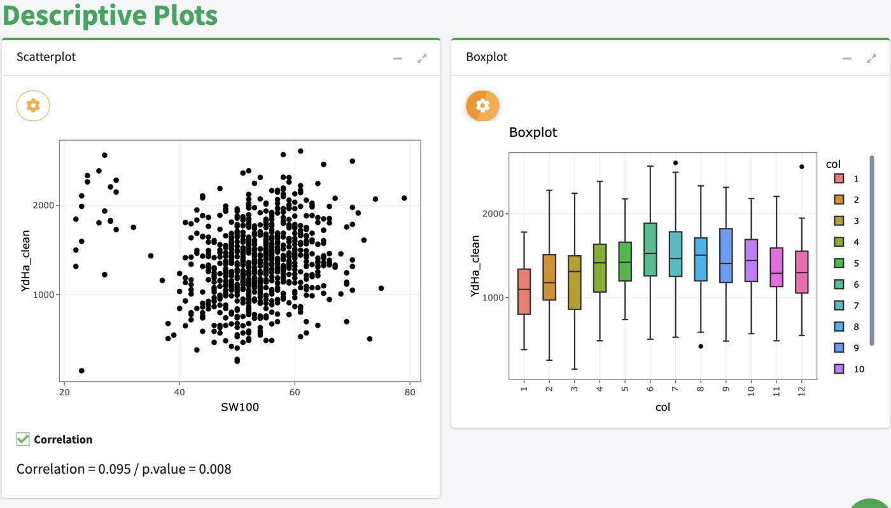
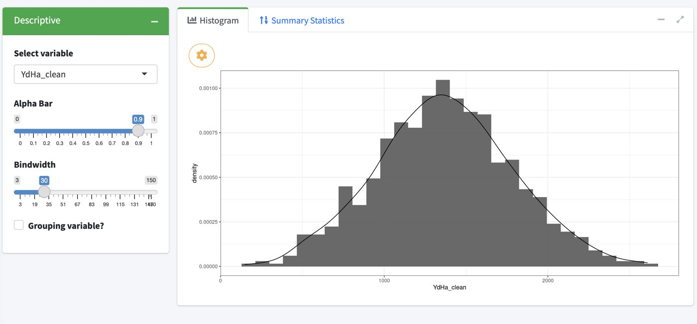
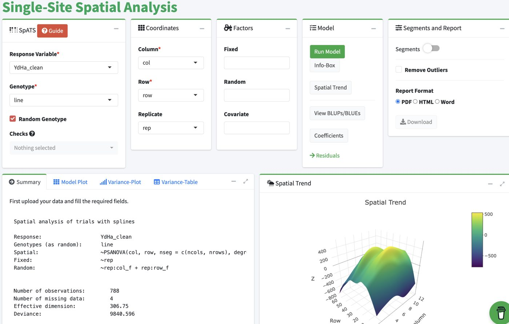

## What you will do

In about **35 minutes** you will analyse a real bean trial in **Mr.Bean**, a free web application for spatial analysis of breeding trials. You only need a web browser: nothing to install.

By the end you will be able to:

- load a trial into the app and look at it with simple plots,
- fit a **SpATS** model (the same one we use in R in the second practical),
- read the main results: heritability, variance components, spatial trend, BLUPs and residuals,
- download the results and a report.

::: {.callout-note}
**App:** <https://beanteam.shinyapps.io/MrBean_BETA/> (version 2.0.7).
**Data:** [Example_Beans.csv](../data/Example_Beans.csv) (also inside the practical folder `Day4_morning_spatial_analysis`).

The app runs on a free server shared by the whole room. **Work in pairs.** If the page turns grey or is slow, reload it and upload the data again.
:::

## 1. The example data

One bean (*Phaseolus vulgaris*) trial, dataset `Dar16C_hiP`.

| Feature | Value |
|:--|:--|
| Plots (rows in the file) | 792 |
| Lines (column `line`) | 380 |
| Replicates (column `rep`) | 2 (R1 and R2, 396 plots each) |
| Field size | 66 rows x 12 columns |
| Layout | R1 is in columns 1 to 6, R2 is in columns 7 to 12 |
| Incomplete blocks (column `block`) | 18 in each replicate |
| Lines with 4 plots (checks) | 16, for example CAL_143, DAB_614, SEQ_1003, TIO_CANELA_75 |

| Column | Meaning |
|:--|:--|
| `dataset`, `unique_identifier`, `plot` | Trial name and plot codes |
| `line` | Genotype (the line we want to compare) |
| `rep`, `block`, `treatment` | Design factors |
| `row`, `col` | Position of the plot in the field (needed for spatial analysis) |
| `DF` | Days to flowering |
| `DPM` | Days to physiological maturity |
| `PLHA` | Plants harvested per plot |
| `POM_c2` | Grain moisture (%) |
| `SW100` | Weight of 100 seeds (g) |
| `TSW` | Total seed weight per plot |
| `YDHA` | Yield per hectare, raw data |
| `YDHPL` | Yield per plant |
| `YdHa_clean` | Yield per hectare after cleaning, in kg/ha (**the trait we analyse**) |

A few values are missing (4 in `YdHa_clean`). This is normal and the app handles them.

## 2. Key words

- **Line (genotype):** the variety or breeding line we want to compare.
- **Replicate (rep):** a complete copy of all lines in the field.
- **Row and column:** the address of each plot in the field.
- **Spatial trend:** a smooth pattern in the field (for example better soil on one side) that changes the yield but has nothing to do with genetics.
- **SpATS:** *Spatial Analysis of Trials using Splines*. It fits a smooth surface over the field to remove the spatial trend.
- **Fixed line, BLUEs:** the best estimate of each line mean. Use them when you will combine several trials later.
- **Random line, BLUPs:** predictions of the genetic value, pulled ("shrunk") towards the mean. Use them to rank and select lines. Only this option gives the heritability.
- **Heritability (H2):** the share of the differences between lines that is genetic, from 0 (none) to 1 (all).
- **Residual:** what the model cannot explain (the error) in each plot.
- **Variance component:** how much of the total variation comes from each source (lines, rows, columns, error).

## 3. Step 1: load the data

In the left menu click **Data > Upload**.

1. In the **Source** box choose **Import Data**. (You can also use *Example Data*, or *BrAPI* to connect to a database.)
2. In the **Import Data** box click **Browse...** and select `Example_Beans.csv`. Wait for **Upload complete**.
3. Keep **Include Header?** ticked.
4. In **Attributes** check: missing value character **NA**, cell separation **Comma**.
5. The **Data** table at the bottom shows your file.

::: {.callout-tip}
**Check:** the table must say *Showing 1 to 3 of 792 entries*. If the columns look wrong, check the header box and the separator.
:::

## 4. Step 2: descriptive plots

In the left menu click **Data > Descriptives**. You see a **Scatterplot** and a **Boxplot**.

**Scatterplot** (relation between two traits)

1. Click the orange **gear icon** above the plot.
2. Choose the variable for the Y axis (`YdHa_clean`) and for the X axis (`SW100`).
3. Click the green **Plot** button. Keep **Correlation** ticked.

**Boxplot** (a trait by group)

1. Click the gear icon above the boxplot.
2. Choose the trait (`YdHa_clean`) and the group (`col`).
3. Click **Plot**.

**What we see**

- Yield and seed weight have a weak but significant correlation (0.095, p = 0.008).
- The boxplot shows a **pattern across columns**: the median yield is lowest in columns 1 to 3 (about 1100 to 1300 kg/ha), highest around columns 5 to 9 and lower again at the right edge. This is a first sign of a **spatial trend**, and the reason why we need a spatial model.

::: {.callout-tip}
Do not use `line` as the grouping variable: with 380 lines the legend is too long. If the input list closes after you choose from a dropdown, click the gear again and press **Plot**.
:::

## 5. Step 3: distribution and summary statistics

In the left menu click **Data > Distribution**. Select the variable `YdHa_clean`.

- **Histogram** tab: the shape of the data with a density curve. *Alpha Bar* changes the transparency and *Bindwidth* the width of the bars.
- **Summary Statistics** tab: the table of main numbers.

Numbers you should find for `YdHa_clean` (they may differ in the last decimals):

| Statistic | Value |
|:--|--:|
| Valid plots | 788 (4 missing) |
| Mean | 1370 |
| Standard deviation | 416 |
| Minimum / maximum | 147 / 2608 |
| Q1 / median / Q3 | 1092 / 1357 / 1644 |
| CV | 0.30 |
| Skewness / kurtosis | about 0.07 / about -0.11 |

**How to read it:** skewness and kurtosis close to 0 mean a shape close to a bell (normal) curve. This is good for a mixed model.

## 6. Step 4: set up the SpATS model

In the left menu click **SpATS > Single-Site > Model Specs**. The red **Guide** button gives a short tour of the page.

| Box | Field | What to choose |
|:--|:--|:--|
| SpATS | Response Variable | `YdHa_clean` |
| SpATS | Genotype | `line` |
| SpATS | Random Genotype | **Tick it** (gives BLUPs and heritability) |
| SpATS | Checks | Leave empty |
| Coordinates | Column | `col` |
| Coordinates | Row | `row` |
| Coordinates | Replicate | `rep` |
| Factors | Fixed / Random / Covariate | Leave empty |
| Segments and Report | Segments | Leave OFF (only for very large fields) |

Then click the green **Run Model** button and wait a few seconds.

**Which model did the app fit?** You can read it in the *Summary* tab:

- **Fixed:** intercept and replicate (`~rep`).
- **Random:** the lines, plus a row effect and a column effect inside each replicate (`rep:row_f`, `rep:col_f`).
- **Spatial:** a smooth surface over rows and columns (`PSANOVA`, P-splines, one segment per column and per row).

In simple words: the model compares the lines **after** removing the effect of the replicate, of each row and column, and of the smooth trend of the field.

## 7. Step 5: read the results

Use the buttons of the **Model** box: **Info-Box**, **Spatial Trend**, **View BLUPs/BLUEs**, **Coefficients** and **Residuals**.

### Info-Box

| Indicator | Result | Meaning |
|:--|--:|:--|
| Heritability | **0.64** | 64 % of the differences between lines are genetic. Good for a yield trial. |
| Residual SD | 232.05 | Size of the error, in kg/ha. Lower is better. |
| R-Square | 0.81 | The model explains 81 % of the variation. |
| Coefficient of variation | 13.23 % | Error relative to the mean. Below about 20 % is acceptable for yield. |

### Summary tab

- Number of observations: 788; missing: 4. Effective dimension of the model: 306.75.
- The **Dimensions** table: the line `line` has an effective dimension of **243.1** out of a maximum of 379 (380 lines minus 1). The ratio, 243.1 / 379 = **0.64**, is the heritability shown in the Info-Box.

### Model Plot tab (six field maps)

1. **Raw data:** the yield of each plot.
2. **Fitted data:** the yield predicted by the model.
3. **Residuals:** what is left. It should look like random noise.
4. **Fitted spatial trend:** the smooth field effect. Here the yield is lower at the bottom left and higher in the middle columns.
5. **Genotypic BLUPs:** the genetic value of each line placed on its plot.
6. **Histogram** of the BLUPs.

Turn on **Percentage** to see the trend as a percentage of the mean.

### Variance-Plot and Variance-Table tabs

| Component | Variance | SD | In plain words |
|:--|--:|--:|:--|
| `line` | 53370 | 231.0 | Genetic differences between lines |
| `rep:col_f` | 619.9 | 24.9 | Column effects inside each replicate |
| `rep:row_f` | 3752 | 61.3 | Row effects inside each replicate |
| `f(col)` | 86620 | 294.3 | Smooth trend along columns |
| `f(row)` | 1966 | 44.4 | Smooth trend along rows |
| `f(col):row` | 102500 | 320.2 | Column trend that changes with row |
| `col:f(row)` | 56.84 | 7.5 | Row trend that changes with column |
| `f(col):f(row)` | 43160 | 207.7 | Smooth two-dimensional surface |
| Residual | 53850 | 232.0 | Plot error |

**How to read it:** the genetic variance (`line`) is about as large as the error. The biggest spatial parts belong to the **columns**, which agrees with the boxplot of Step 2. Without a spatial model this field trend would be mixed with the genetic differences.

### Spatial Trend panel

An interactive 3D surface. Rotate it with the mouse and move over it to read the column, the row and the effect in kg/ha. Yellow is a better area, purple a worse one.

## 8. Step 6: the BLUPs (line predictions)

Click **SpATS > Single-Site > BLUPs/BLUEs** (or the **View BLUPs/BLUEs** button).

- **Predictions Plot:** the 380 lines ranked from best to worst, with error bars. The dashed line is the mean.
- **Predictions Table:** `line`, `predicted.values`, `standard.errors`. Click a column title to sort, use **Search** to find a line and **Download** to save the table.

**Top 6 lines in the app**

| Rank | Line | Predicted yield | Standard error |
|:--|:--|--:|--:|
| 1 | SEF_060 | 1955.9 | 139.0 |
| 2 | DOR_364 | 1848.5 | 139.8 |
| 3 | DAB_366 | 1840.4 | 139.4 |
| 4 | TIO_CANELA_75 | 1811.5 | 109.2 |
| 5 | DOR_390 | 1787.6 | 139.2 |
| 6 | SEN_056 | 1778.6 | 141.3 |

::: {.callout-note}
`TIO_CANELA_75` has a smaller standard error because it has 4 plots, not 2: more plots give a more precise estimate.
:::

## 9. Step 7: check the residuals

Click **SpATS > Single-Site > Residuals**.

- **Field Residuals:** a map of the field. Outliers are shown in red.
- **QQplot:** the points should follow the line. Here they do, except for a few at the ends.
- **Potential Outliers:** a table of suspicious plots.

**Result:** with a random line no outliers were found. If there are some you can (1) check the plot in your field book (typing error? damage?), (2) click **Download Data Cleaned**, or (3) tick **Remove Outliers** in *Model Specs* and run the model again.

## 10. Step 8: download a report

In *Model Specs*, in the box **Segments and Report**, choose the format (PDF, HTML or Word) and click **Download**. The report keeps the model, the results and the plots as a record for your trial file.

## 11. Exercises

1. Make a scatterplot of `YdHa_clean` against `DF` grouped by `rep`. Is there a correlation?
2. Make a boxplot of `YdHa_clean` by `block`. Do some blocks yield more?
3. Run SpATS for `DF` (days to flowering) with a random line. Compare its heritability with the yield. Which trait is more heritable? Why?
4. Run the yield model **without** ticking *Random Genotype*. Download the BLUEs and compare the top 10 lines with the BLUP ranking.
5. Look at the fitted spatial trend. Where in this field would you place the next trial?

## 12. Compare with R

The R practical of this morning (`Spatial_models_comparison.Rmd`) fits the same model with the function `spats_app()`. Fill in this table with your numbers from the app:

| | Mr.Bean | R |
|:--|:--|:--|
| Heritability | | 0.641 |
| Residual SD | | 232.05 |
| Effective dimension of the lines | | 243.1 |
| Best line | | SEF_060 |

The app and R give the **same** model, because the app is SpATS running in R behind the web page. The predicted values of the lines can differ slightly (by about 10 to 20 kg/ha, because the app and your R session may use different package versions), but the ranking of the top lines is the same.

## 13. Troubleshooting

| Problem | Solution |
|:--|:--|
| The page is grey or frozen | The server disconnected. Reload the page and upload the data again. |
| The plot does not change | Click the gear again and press **Plot** after choosing the variables. |
| "First upload your data and fill the required fields" | Fill Response Variable, Genotype, Column and Row (the fields marked with *). |
| No heritability in the Info-Box | Tick **Random Genotype** and run the model again. |
| The model is slow | The server is shared. Wait, or work with your neighbour on one computer. |
| Wrong columns after upload | Check **Include Header?** and the separator (comma, semicolon or tab). |

## 14. More information

- In the app, see **About > info** for authors and references.
- Other modules to explore later: **Site-by-Site** and **Trait-by-Trait** (SpATS for many trials or traits), **MET Analysis** (multi-environment, two stages) and **Analysis with lme4** (traditional designs).

*Numbers in this tutorial come from a run of Mr.Bean v2.0.7 on 12 November 2026 with `Example_Beans.csv`. Small differences can appear in other versions.*
